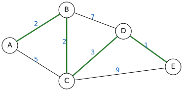
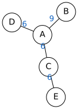
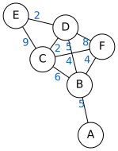
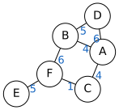
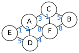

# Задание 4. Кратчайший путь

| Часть | Ответ | Балл | Время на экзамене | Сложность |
|---|---|---|---|---|
| 1 (без компьютера) | число | 1 | 3–5 мин | базовая |

**Что проверяют:** умение анализировать формальное описание реального объекта: таблицу или схему дорог между пунктами.

**Теория:** [Графы, таблицы, схемы](../theory/05-graphs.md).

## Карта подтипов

| № | Подтип | Как узнать по условию | Частота |
|---|---|---|---|
| [4.1](#подтип-41-кратчайший-путь-по-таблице) | Кратчайший путь по таблице | «…протяжённость которых приведена в таблице. Определите длину кратчайшего пути…» | **часто** — основной тип |
| [4.2](#подтип-42-через-пункт-или-в-обход-пункта) | Через пункт или в обход пункта | «…проходящего через пункт C», «…не проходящего через пункт D» | иногда |
| [4.3](#подтип-43-схема-вместо-таблицы) | Схема вместо таблицы | дороги нарисованы, а не заданы таблицей | редко |

## Главная идея: почему работает метод пометок

**Таблица — это граф.** Строки и столбцы — пункты, число на пересечении — длина дороги, пустая клетка — дороги нет. Таблица симметрична: дорога A–B записана и в строке A, и в строке B.

Самый надёжный способ найти кратчайший путь — **метод пометок** (упрощённый алгоритм Дейкстры):

1. У старта пометка 0, у остальных пунктов — «∞».
2. Берём **непосещённый** пункт с **наименьшей** пометкой и считаем его окончательным.
3. От него обновляем соседей: если «пометка + длина дороги» меньше их пометки, записываем новое число.
4. Повторяем, пока не станет окончательным финиш.

**Почему окончательная пометка уже не уменьшится.** Все остальные непосещённые пункты имеют пометку **не меньше**. Любой другой путь к нашему пункту прошёл бы через один из них, а дальше длины дорог только добавляются (они положительные). Значит, обходной путь не может оказаться короче.

**Почему «каждый пункт можно посетить только один раз» ничего не меняет.** Такая оговорка встречается в банке. Кратчайший путь никогда не заходит в пункт дважды: петля только добавила бы длины. Это условие можно не учитывать.

> [!TIP]
> Самый быстрый способ ошибиться — взять **первую попавшуюся** или **прямую** дорогу. Короткая прямая дорога часто проигрывает обходу из нескольких коротких.

---

## Подтип 4.1. Кратчайший путь по таблице

*Частота: часто.*

### Как выглядит на экзамене

> Между населёнными пунктами A, B, C, D, E построены дороги, протяжённость которых (в километрах) приведена в таблице:
>
> |   | A | B | C | D | E |
> |---|---|---|---|---|---|
> | **A** |  | 5 | 3 |  |  |
> | **B** | 5 |  | 1 | 4 |  |
> | **C** | 3 | 1 |  |  6 |  |
> | **D** |  | 4 | 6 |  | 1 |
> | **E** |  |  |  | 1 |  |
>
> Определите длину кратчайшего пути между пунктами A и E. Передвигаться можно только по дорогам, протяжённость которых указана в таблице.
>
> *Открытый банк заданий, № 23 в каталоге «Решу ОГЭ».*

Сначала выпишите дороги (только над диагональю, чтобы не повторяться): A–B 5, A–C 3, B–C 1, B–D 4, C–D 6, D–E 1.

### Способ 1. Метод пометок

| Шаг | A | B | C | D | E | Окончательный |
|---|---|---|---|---|---|---|
| 0 | **0** | ∞ | ∞ | ∞ | ∞ | A |
| 1 | ✓ | 5 | **3** | ∞ | ∞ | C |
| 2 | ✓ | **4** (3 + 1) | ✓ | 9 | ∞ | B |
| 3 | ✓ | ✓ | ✓ | **8** (4 + 4) | ∞ | D |
| 4 | ✓ | ✓ | ✓ | ✓ | **9** | E |

Путь A → C → B → D → E: 3 + 1 + 4 + 1 = **9**.

Обратите внимание: в B «напрямую» (5) дольше, чем через C (3 + 1 = 4).

### Способ 2. Перебор путей деревом

При 5–6 пунктах можно выписать все пути без повторов. Идём от A, на каждом шаге — во всех соседей, которых ещё не было:

| Путь | Длина |
|---|---|
| A → B → D → E | 5 + 4 + 1 = 10 |
| A → B → C → D → E | 5 + 1 + 6 + 1 = 13 |
| A → C → D → E | 3 + 6 + 1 = 10 |
| **A → C → B → D → E** | 3 + 1 + 4 + 1 = **9** |

Перебор нагляднее, но на 6 пунктах путей бывает 15–20. Пропустить один легко, поэтому для проверки лучше метод пометок.

### Ещё два примера из банка

- **№ 35576** («каждый пункт можно посетить только один раз»): A–B 4, B–C 4, B–E 1, C–D 1, C–E 2, D–E 3. Путь A → D: A → B → E → D = 4 + 1 + 3 = **8** (столько же A → B → E → C → D = 4 + 1 + 2 + 1 = 8). Ответ — длина, поэтому неважно, что кратчайших путей два.
- **№ 404**: A–B 5, A–C 5, A–D 4, B–C 2, C–F 2, D–E 2, D–F 3, E–F 1. Путь A → F: **7** (тремя способами: A–C–F, A–D–F, A–D–E–F).

### Проверка за 30 секунд

1. Пройдите по найденному пути и убедитесь, что **каждая** дорога есть в таблице.
2. Пересчитайте сумму.
3. Для каждого пункта на пути спросите: «Нет ли из предыдущего пункта короткой дороги в следующий через кого-то ещё?» (пример: A → B за 5 против A → C → B за 4).

### Тренировка

<!-- BEGIN:sub:4.1 -->

#### Тренировка 4.1.1

Между населёнными пунктами A, B, C, D, E построены дороги, протяжённость которых (в километрах) приведена в таблице.

|   | A | B | C | D | E |
|---|---|---|---|---|---|
| **A** |  |  |  | 1 |  |
| **B** |  |  | 6 |  | 4 |
| **C** |  | 6 |  | 2 | 5 |
| **D** | 1 |  | 2 |  | 7 |
| **E** |  | 4 | 5 | 7 |  |

Определите длину кратчайшего пути между пунктами A и E. Передвигаться можно только по дорогам, протяжённость которых указана в таблице.

Ответ

**8**

#### Тренировка 4.1.2

Между населёнными пунктами A, B, C, D, E построены дороги, протяжённость которых (в километрах) приведена в таблице.

|   | A | B | C | D | E |
|---|---|---|---|---|---|
| **A** |  | 7 |  |  |  |
| **B** | 7 |  | 2 | 8 | 7 |
| **C** |  | 2 |  |  |  |
| **D** |  | 8 |  |  |  |
| **E** |  | 7 |  |  |  |

Определите длину кратчайшего пути между пунктами A и E. Передвигаться можно только по дорогам, протяжённость которых указана в таблице.

Ответ

**14**

#### Тренировка 4.1.3

Между населёнными пунктами A, B, C, D, E, F построены дороги, протяжённость которых (в километрах) приведена в таблице.

|   | A | B | C | D | E | F |
|---|---|---|---|---|---|---|
| **A** |  | 5 | 7 | 9 | 6 | 9 |
| **B** | 5 |  | 8 | 9 |  | 5 |
| **C** | 7 | 8 |  | 9 | 5 | 4 |
| **D** | 9 | 9 | 9 |  | 2 | 7 |
| **E** | 6 |  | 5 | 2 |  | 1 |
| **F** | 9 | 5 | 4 | 7 | 1 |  |

Определите длину кратчайшего пути между пунктами A и F. Передвигаться можно только по дорогам, протяжённость которых указана в таблице.

Ответ

**7**

#### Тренировка 4.1.4

Между населёнными пунктами A, B, C, D, E, F построены дороги, протяжённость которых (в километрах) приведена в таблице.

|   | A | B | C | D | E | F |
|---|---|---|---|---|---|---|
| **A** |  |  | 7 | 8 | 5 |  |
| **B** |  |  |  |  |  | 7 |
| **C** | 7 |  |  |  | 3 |  |
| **D** | 8 |  |  |  | 6 |  |
| **E** | 5 |  | 3 | 6 |  | 3 |
| **F** |  | 7 |  |  | 3 |  |

Определите длину кратчайшего пути между пунктами A и F. Передвигаться можно только по дорогам, протяжённость которых указана в таблице.

Ответ

**8**

<!-- END:sub:4.1 -->

---

## Подтип 4.2. Через пункт или в обход пункта

*Частота: иногда.*

### Почему решается разбиением

**«Проходящего через пункт C».** Любой такой путь состоит из двух частей: A → C и C → E. Каждая часть должна быть кратчайшей (иначе её можно заменить на более короткую). Поэтому:

$$\text{ответ} = d(A, C) + d(C, E)$$

**«Не проходящего через пункт D».** Мысленно **вычеркните строку и столбец D** из таблицы и решайте обычную задачу.

### Примеры на таблицах из банка

**«Через пункт».** Таблица № 404 (A–B 5, A–C 5, A–D 4, B–C 2, C–F 2, D–E 2, D–F 3, E–F 1). Кратчайший путь из A в F, **проходящий через B**:

- d(A, B) = 5 (напрямую; через C было бы 5 + 2 = 7);
- d(B, F) = B → C → F = 2 + 2 = 4;
- ответ: 5 + 4 = **9**. Без ограничения было бы 7: условие «через B» удлиняет путь.

**«Не через пункт».** Таблица № 35576 (A–B 4, B–C 4, B–E 1, C–D 1, C–E 2, D–E 3). Кратчайший путь из A в D, **не проходящий через E**:

- вычёркиваем E и все его дороги: остаются A–B 4, B–C 4, C–D 1;
- ответ: A → B → C → D = 4 + 4 + 1 = **9** (без ограничения было 8).

### Способ 2. Перебор только нужных путей

В переборе деревом оставьте только ветки, где C есть (или где D нет). Для маленьких таблиц это быстрее, чем считать два метода пометок.

### Проверка за 30 секунд

Найденный путь «через C» действительно содержит C; путь «не через D» действительно не содержит D. И ответ не может быть **меньше**, чем обычный кратчайший путь без ограничений.

### Тренировка

<!-- BEGIN:sub:4.2 -->

#### Тренировка 4.2.1

Между населёнными пунктами A, B, C, D, E, F построены дороги, протяжённость которых (в километрах) приведена в таблице.

|   | A | B | C | D | E | F |
|---|---|---|---|---|---|---|
| **A** |  | 8 |  | 2 | 8 | 7 |
| **B** | 8 |  | 8 | 5 |  | 9 |
| **C** |  | 8 |  | 2 | 3 |  |
| **D** | 2 | 5 | 2 |  |  | 9 |
| **E** | 8 |  | 3 |  |  | 3 |
| **F** | 7 | 9 |  | 9 | 3 |  |

Определите длину кратчайшего пути между пунктами A и F, проходящего через пункт C. Передвигаться можно только по дорогам, протяжённость которых указана в таблице.

Ответ

**10**

#### Тренировка 4.2.2

Между населёнными пунктами A, B, C, D, E построены дороги, протяжённость которых (в километрах) приведена в таблице.

|   | A | B | C | D | E |
|---|---|---|---|---|---|
| **A** |  | 5 |  | 9 | 8 |
| **B** | 5 |  | 4 | 6 | 4 |
| **C** |  | 4 |  |  | 7 |
| **D** | 9 | 6 |  |  | 1 |
| **E** | 8 | 4 | 7 | 1 |  |

Определите длину кратчайшего пути между пунктами A и E, проходящего через пункт B. Передвигаться можно только по дорогам, протяжённость которых указана в таблице.

Ответ

**9**

#### Тренировка 4.2.3

Между населёнными пунктами A, B, C, D, E построены дороги, протяжённость которых (в километрах) приведена в таблице.

|   | A | B | C | D | E |
|---|---|---|---|---|---|
| **A** |  | 7 | 5 |  |  |
| **B** | 7 |  | 9 | 2 | 8 |
| **C** | 5 | 9 |  | 2 |  |
| **D** |  | 2 | 2 |  | 2 |
| **E** |  | 8 |  | 2 |  |

Определите длину кратчайшего пути между пунктами A и E, не проходящего через пункт D. Передвигаться можно только по дорогам, протяжённость которых указана в таблице.

Ответ

**15**

#### Тренировка 4.2.4

Между населёнными пунктами A, B, C, D, E, F построены дороги, протяжённость которых (в километрах) приведена в таблице.

|   | A | B | C | D | E | F |
|---|---|---|---|---|---|---|
| **A** |  | 2 | 9 |  |  | 9 |
| **B** | 2 |  |  |  |  | 7 |
| **C** | 9 |  |  | 9 |  | 3 |
| **D** |  |  | 9 |  | 2 |  |
| **E** |  |  |  | 2 |  |  |
| **F** | 9 | 7 | 3 |  |  |  |

Определите длину кратчайшего пути между пунктами A и F, проходящего через пункт E. Передвигаться можно только по дорогам, протяжённость которых указана в таблице.

Ответ

**34**

<!-- END:sub:4.2 -->

---

## Подтип 4.3. Схема вместо таблицы

*Частота: редко.*

Вместо таблицы дан рисунок: кружки — пункты, линии с числами — дороги. Решается так же, только переносить в граф ничего не нужно.

### Способ 1. Пометки прямо на рисунке

Пишите пометки карандашом рядом с кружками и зачёркивайте старые, когда находите меньше. Для схемы выше от A до E: B = 2, C = min(5, 2 + 2) = 4, D = min(2 + 7, 4 + 3) = 7, E = min(4 + 9, 7 + 1) = **8**. Зелёным выделен ответ: A → B → C → D → E.

### Способ 2. Обратная проверка с конца

Найдите, откуда можно прийти в финиш: E соединён с C (9) и D (1). Тогда d(E) = min(d(C) + 9, d(D) + 1). Повторите для C и D. Этот «обратный» способ хорош для проверки.

### Проверка за 30 секунд

Посчитайте длину найденного пути по рисунку ещё раз и убедитесь, что каждая линия на пути действительно нарисована (схемы иногда содержат пересекающиеся линии без перекрёстка).

### Тренировка

<!-- BEGIN:sub:4.3 -->

#### Тренировка 4.3.1

На схеме изображены дороги между населёнными пунктами A, B, C, D, E; числа — протяжённость дорог в километрах.

Определите длину кратчайшего пути между пунктами A и E. Передвигаться можно только по дорогам, указанным на схеме.

Ответ

**12**

#### Тренировка 4.3.2

На схеме изображены дороги между населёнными пунктами A, B, C, D, E, F; числа — протяжённость дорог в километрах.

Определите длину кратчайшего пути между пунктами A и F. Передвигаться можно только по дорогам, указанным на схеме.

Ответ

**9**

#### Тренировка 4.3.3

На схеме изображены дороги между населёнными пунктами A, B, C, D, E, F; числа — протяжённость дорог в километрах.

Определите длину кратчайшего пути между пунктами A и F. Передвигаться можно только по дорогам, указанным на схеме.

Ответ

**5**

#### Тренировка 4.3.4

На схеме изображены дороги между населёнными пунктами A, B, C, D, E, F; числа — протяжённость дорог в километрах.

Определите длину кратчайшего пути между пунктами A и F. Передвигаться можно только по дорогам, указанным на схеме.

Ответ

**4**

<!-- END:sub:4.3 -->

---

## Ловушки

> [!WARNING]
> - Взяли прямую дорогу и не проверили обходы.
> - Пропустили дорогу при переносе таблицы в рисунок. Сверьте: дорог столько, сколько заполненных клеток **над** диагональю.
> - Перепутали строку и столбец при чтении таблицы — лучше сразу выписать список дорог.
> - В подтипе 4.2 «через C» сложили не кратчайшие участки, а первые попавшиеся.

## Смешанная тренировка (как на экзамене)

<!-- BEGIN:generated -->

### Задача 1

Между населёнными пунктами A, B, C, D, E, F построены дороги, протяжённость которых (в километрах) приведена в таблице.

|   | A | B | C | D | E | F |
|---|---|---|---|---|---|---|
| **A** |  | 9 |  | 4 |  |  |
| **B** | 9 |  |  | 1 |  |  |
| **C** |  |  |  |  |  | 9 |
| **D** | 4 | 1 |  |  | 1 | 1 |
| **E** |  |  |  | 1 |  | 2 |
| **F** |  |  | 9 | 1 | 2 |  |

Определите длину кратчайшего пути между пунктами A и F, проходящего через пункт E. Передвигаться можно только по дорогам, протяжённость которых указана в таблице.

Ответ

**7**

### Задача 2

Между населёнными пунктами A, B, C, D, E, F построены дороги, протяжённость которых (в километрах) приведена в таблице.

|   | A | B | C | D | E | F |
|---|---|---|---|---|---|---|
| **A** |  |  | 9 | 6 |  |  |
| **B** |  |  |  | 1 | 4 |  |
| **C** | 9 |  |  |  |  |  |
| **D** | 6 | 1 |  |  | 1 |  |
| **E** |  | 4 |  | 1 |  | 4 |
| **F** |  |  |  |  | 4 |  |

Определите длину кратчайшего пути между пунктами A и F. Передвигаться можно только по дорогам, протяжённость которых указана в таблице.

Ответ

**11**

### Задача 3

Между населёнными пунктами A, B, C, D, E построены дороги, протяжённость которых (в километрах) приведена в таблице.

|   | A | B | C | D | E |
|---|---|---|---|---|---|
| **A** |  | 6 |  |  |  |
| **B** | 6 |  | 7 |  | 6 |
| **C** |  | 7 |  | 3 |  |
| **D** |  |  | 3 |  | 1 |
| **E** |  | 6 |  | 1 |  |

Определите длину кратчайшего пути между пунктами A и E. Передвигаться можно только по дорогам, протяжённость которых указана в таблице.

Ответ

**12**

### Задача 4

Между населёнными пунктами A, B, C, D, E, F построены дороги, протяжённость которых (в километрах) приведена в таблице.

|   | A | B | C | D | E | F |
|---|---|---|---|---|---|---|
| **A** |  |  | 4 |  |  |  |
| **B** |  |  | 3 | 4 | 1 | 4 |
| **C** | 4 | 3 |  |  | 9 |  |
| **D** |  | 4 |  |  |  |  |
| **E** |  | 1 | 9 |  |  | 1 |
| **F** |  | 4 |  |  | 1 |  |

Определите длину кратчайшего пути между пунктами A и F. Передвигаться можно только по дорогам, протяжённость которых указана в таблице.

Ответ

**9**

### Задача 5

Между населёнными пунктами A, B, C, D, E построены дороги, протяжённость которых (в километрах) приведена в таблице.

|   | A | B | C | D | E |
|---|---|---|---|---|---|
| **A** |  | 4 | 7 | 2 | 4 |
| **B** | 4 |  | 7 | 4 |  |
| **C** | 7 | 7 |  | 8 | 3 |
| **D** | 2 | 4 | 8 |  | 1 |
| **E** | 4 |  | 3 | 1 |  |

Определите длину кратчайшего пути между пунктами A и E, проходящего через пункт C. Передвигаться можно только по дорогам, протяжённость которых указана в таблице.

Ответ

**9**

<!-- END:generated -->

---

[← Задание 3](03-logic.md) · [К оглавлению](../README.md) · [Задание 5 →](05-executor.md)
