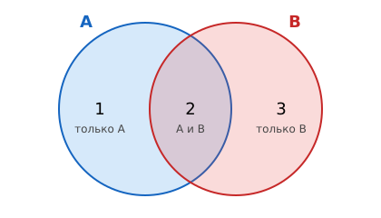
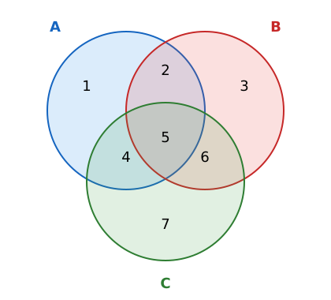

# Задание 8. Запросы для поисковых систем

| Часть | Ответ | Балл | Время на экзамене | Сложность |
|---|---|---|---|---|
| 1 (без компьютера) | число | 1 | 2–5 мин | повышенная |

**Что проверяют:** понимание принципов поиска информации в Интернете: логические операции в запросах, круги Эйлера.

**Теория:** [Интернет: адреса и поисковые запросы](../theory/09-internet.md#поисковые-запросы-и-круги-эйлера).

## Карта подтипов

| № | Подтип | Как узнать по условию | Частота |
|---|---|---|---|
| [8.1](#подтип-81-два-слова) | Два слова | в таблице запросы из двух слов | **часто** — основной тип |
| [8.2](#подтип-82-три-слова) | Три слова | в таблице три слова, часто «… & … = 0» | иногда |

## Главная идея: страницы — это множества

Каждое слово задаёт **множество страниц**, на которых оно встречается.

- `A & B` — страницы, где есть **оба** слова: **пересечение** множеств.
- `A | B` — страницы, где есть **хотя бы одно** слово: **объединение**.

### Откуда берётся формула

Посчитаем страницы запроса `A | B`, сложив страницы A и страницы B. Страницы, где есть **оба** слова, при этом посчитаны **дважды**: и в A, и в B. Значит, одну лишнюю копию нужно вычесть:

$$|A \mid B| = |A| + |B| - |A \mathbin{\&} B|$$

Это **формула включений-исключений**. Из неё любая из четырёх величин выражается через три остальные:

| Найти | Формула |
|---|---|
| $A \mid B$ | $A + B - (A \mathbin{\&} B)$ |
| $A \mathbin{\&} B$ | $A + B - (A \mid B)$ |
| $B$ | $(A \mid B) - A + (A \mathbin{\&} B)$ |

### Второй способ: «области»

Обозначьте числами три области: только A (1), A и B вместе (2), только B (3). Каждый запрос — сумма областей:

| Запрос | Области |
|---|---|
| A | 1 + 2 |
| B | 2 + 3 |
| A & B | 2 |
| A \| B | 1 + 2 + 3 |

Заполните сначала то, что известно сразу (обычно пересечение), потом остальное. Этот способ медленнее формулы, но он **работает всегда**, в том числе для трёх слов.

---

## Подтип 8.1. Два слова

*Частота: часто.*

### Как выглядит на экзамене

> В языке запросов поискового сервера для обозначения логической операции «ИЛИ» используется символ «|», а для обозначения логической операции «И» — символ «&». В таблице приведены запросы и количество найденных по ним страниц некоторого сегмента сети Интернет.
>
> | Запрос | Найдено страниц (в тысячах) |
> |---|---|
> | Рыбак \| Рыбка | 780 |
> | Рыбак | 260 |
> | Рыбак & Рыбка | 50 |
>
> Какое количество страниц (в тысячах) будет найдено по запросу **Рыбка**?
>
> *Открытый банк заданий, № 10473 в каталоге «Решу ОГЭ».*

### Способ 1. Формула

$$\text{Рыбка} = (\text{Рыбак} \mid \text{Рыбка}) - \text{Рыбак} + (\text{Рыбак} \mathbin{\&} \text{Рыбка}) = 780 - 260 + 50 = 570$$

### Способ 2. Области

| Область | Как считаем | Значение |
|---|---|---|
| оба слова | дано | 50 |
| только «Рыбак» | 260 − 50 | 210 |
| только «Рыбка» | 780 − 210 − 50 | 520 |
| **Рыбка** | 520 + 50 | **570** |

### Ещё два примера из банка

- **№ 18123**: Скорпион 3300, Козерог 1900, Скорпион | Козерог 4300. Скорпион & Козерог = 3300 + 1900 − 4300 = **900**.
- **№ 10476**: Угол | Прямая 180, Угол 60, Угол & Прямая 20. Прямая = 180 − 60 + 20 = **140**.

### Проверка за 30 секунд

Подставьте ответ в формулу «вперёд»: 260 + 570 − 50 = 780 ✓. И проверьте неравенства: $A \mathbin{\&} B \le A \le A \mid B$ (здесь 50 ≤ 570 ≤ 780 ✓). Если ответ больше значения для `|` или меньше значения для `&`, где-то ошибка в знаке.

### Тренировка

<!-- BEGIN:sub:8.1 -->

#### Тренировка 8.1.1

В языке запросов поискового сервера для обозначения логической операции «ИЛИ» используется символ «|», а для обозначения логической операции «И» — символ «&».

В таблице приведены запросы и количество найденных по ним страниц некоторого сегмента сети Интернет.

| Запрос | Найдено страниц (в тысячах) |
|---|---|
| Щегол | 1960 |
| Канарейка | 2170 |
| Канарейка \| Щегол | 3860 |

Какое количество страниц (в тысячах) будет найдено по запросу **Канарейка & Щегол**?

Считается, что все запросы выполнялись практически одновременно, так что набор страниц, содержащих все искомые слова, не изменялся за время выполнения запросов.

Ответ

**270**

#### Тренировка 8.1.2

В языке запросов поискового сервера для обозначения логической операции «ИЛИ» используется символ «|», а для обозначения логической операции «И» — символ «&».

В таблице приведены запросы и количество найденных по ним страниц некоторого сегмента сети Интернет.

| Запрос | Найдено страниц (в тысячах) |
|---|---|
| Лермонтов | 930 |
| Пушкин \| Лермонтов | 2290 |
| Пушкин | 1510 |

Какое количество страниц (в тысячах) будет найдено по запросу **Пушкин & Лермонтов**?

Считается, что все запросы выполнялись практически одновременно, так что набор страниц, содержащих все искомые слова, не изменялся за время выполнения запросов.

Ответ

**150**

#### Тренировка 8.1.3

В языке запросов поискового сервера для обозначения логической операции «ИЛИ» используется символ «|», а для обозначения логической операции «И» — символ «&».

В таблице приведены запросы и количество найденных по ним страниц некоторого сегмента сети Интернет.

| Запрос | Найдено страниц (в тысячах) |
|---|---|
| Шахматы | 2350 |
| Шахматы & Шашки | 30 |
| Шашки | 2800 |

Какое количество страниц (в тысячах) будет найдено по запросу **Шахматы | Шашки**?

Считается, что все запросы выполнялись практически одновременно, так что набор страниц, содержащих все искомые слова, не изменялся за время выполнения запросов.

Ответ

**5120**

#### Тренировка 8.1.4

В языке запросов поискового сервера для обозначения логической операции «ИЛИ» используется символ «|», а для обозначения логической операции «И» — символ «&».

В таблице приведены запросы и количество найденных по ним страниц некоторого сегмента сети Интернет.

| Запрос | Найдено страниц (в тысячах) |
|---|---|
| Рыбка \| Рыбак | 3550 |
| Рыбка & Рыбак | 360 |
| Рыбка | 1590 |

Какое количество страниц (в тысячах) будет найдено по запросу **Рыбак**?

Считается, что все запросы выполнялись практически одновременно, так что набор страниц, содержащих все искомые слова, не изменялся за время выполнения запросов.

Ответ

**2320**

<!-- END:sub:8.1 -->

---

## Подтип 8.2. Три слова

*Частота: иногда.*

### Как выглядит на экзамене

> | Запрос | Найдено страниц (в тысячах) |
> |---|---|
> | Поле | 40 |
> | Агроном | 20 |
> | Индукция | 44 |
> | Индукция \| Поле \| Агроном | 74 |
> | Индукция & Поле | 14 |
> | Индукция & Агроном | 0 |
>
> Какое количество страниц (в тысячах) будет найдено по запросу **Поле & Агроном**?
>
> *Открытый банк заданий, № 43568 в каталоге «Решу ОГЭ».*

### Способ 1. Формула для трёх множеств

Та же идея «вычесть лишнее», только аккуратнее:

$$|A \mid B \mid C| = A + B + C - (A\&B) - (A\&C) - (B\&C) + (A\&B\&C)$$

Почему в конце **плюс**: страницы со всеми тремя словами сначала посчитаны три раза (в A, B, C), потом трижды вычтены (в трёх попарных пересечениях). Их стало 0, поэтому одну копию добавляем обратно.

«Индукция & Агроном = 0» означает, что и тройное пересечение пустое. Подставляем:

$$74 = 44 + 40 + 20 - 14 - 0 - x + 0 \Rightarrow 74 = 90 - x \Rightarrow x = 16$$

### Способ 2. Заполнение областей (надёжнее)

1. Индукция & Агроном = 0 → области «И и А» и «все три» пустые.
2. Только Индукция = 44 − 14 = **30** (14 — это «И и П», третьего пересечения у И нет).
3. Поле = 40 = 14 (И и П) + только П + П и А → только П + П и А = **26**.
4. Всё вместе = 74 = 30 + 14 + 26 + только А → только А = **4**.
5. Агроном = 20 = П и А + только А → П и А = 20 − 4 = **16**.

**Ответ:** 16.

### Способ 3. Объединить два слова в одно

Если в запросах всё время встречается одна и та же пара (например, «Луна | Венера»), обозначьте её одной буквой X и решайте как задачу с двумя словами: X | Марс, X, Марс & X.

### Проверка за 30 секунд

Сложите все области — должно получиться число для запроса со всеми тремя словами через `|`: 30 + 14 + 10 + 16 + 4 = 74 ✓ (только П = 26 − 16 = 10). Ни одна область не может быть отрицательной.

### Тренировка

<!-- BEGIN:sub:8.2 -->

#### Тренировка 8.2.1

В языке запросов поискового сервера для обозначения логической операции «ИЛИ» используется символ «|», а для обозначения логической операции «И» — символ «&».

В таблице приведены запросы и количество найденных по ним страниц некоторого сегмента сети Интернет.

| Запрос | Найдено страниц (в тысячах) |
|---|---|
| Барокко \| Классицизм \| Ампир | 1270 |
| Классицизм & Ампир | 0 |
| Ампир | 580 |
| Барокко & Ампир | 330 |

Какое количество страниц (в тысячах) будет найдено по запросу **Барокко | Классицизм**?

Считается, что все запросы выполнялись практически одновременно, так что набор страниц, содержащих все искомые слова, не изменялся за время выполнения запросов.

Ответ

**1020**

#### Тренировка 8.2.2

В языке запросов поискового сервера для обозначения логической операции «ИЛИ» используется символ «|», а для обозначения логической операции «И» — символ «&».

В таблице приведены запросы и количество найденных по ним страниц некоторого сегмента сети Интернет.

| Запрос | Найдено страниц (в тысячах) |
|---|---|
| Солнце | 730 |
| Солнце & Дождь | 400 |
| Ветер | 400 |
| Солнце \| Дождь | 830 |
| Солнце \| Ветер | 890 |
| Ветер & Дождь | 0 |

Какое количество страниц (в тысячах) будет найдено по запросу **Солнце | Ветер | Дождь**?

Считается, что все запросы выполнялись практически одновременно, так что набор страниц, содержащих все искомые слова, не изменялся за время выполнения запросов.

Ответ

**990**

#### Тренировка 8.2.3

В языке запросов поискового сервера для обозначения логической операции «ИЛИ» используется символ «|», а для обозначения логической операции «И» — символ «&».

В таблице приведены запросы и количество найденных по ним страниц некоторого сегмента сети Интернет.

| Запрос | Найдено страниц (в тысячах) |
|---|---|
| Луна \| Венера | 1460 |
| Венера | 660 |
| Луна & Марс | 400 |
| Луна | 1140 |

Какое количество страниц (в тысячах) будет найдено по запросу **Луна & Венера**?

Считается, что все запросы выполнялись практически одновременно, так что набор страниц, содержащих все искомые слова, не изменялся за время выполнения запросов.

Ответ

**340**

#### Тренировка 8.2.4

В языке запросов поискового сервера для обозначения логической операции «ИЛИ» используется символ «|», а для обозначения логической операции «И» — символ «&».

В таблице приведены запросы и количество найденных по ним страниц некоторого сегмента сети Интернет.

| Запрос | Найдено страниц (в тысячах) |
|---|---|
| Барокко \| Классицизм | 830 |
| Барокко & Ампир | 120 |
| Классицизм | 400 |
| Классицизм & Ампир | 210 |
| Барокко | 430 |
| Ампир | 680 |
| Барокко & Классицизм | 0 |

Какое количество страниц (в тысячах) будет найдено по запросу **Классицизм | Ампир**?

Считается, что все запросы выполнялись практически одновременно, так что набор страниц, содержащих все искомые слова, не изменялся за время выполнения запросов.

Ответ

**870**

<!-- END:sub:8.2 -->

---

## Ловушки

> [!WARNING]
> - В формуле перепутан знак у пересечения: при поиске одного слова пересечение **прибавляется**.
> - Ответ больше, чем для запроса с `|`, — значит, ошибка.
> - Для трёх слов забыли, что «& = 0» обнуляет и тройное пересечение.
> - Ответ дают в тех же единицах, что в таблице (тысячи): пишите просто число.

## Смешанная тренировка (как на экзамене)

<!-- BEGIN:generated -->

### Задача 1

В языке запросов поискового сервера для обозначения логической операции «ИЛИ» используется символ «|», а для обозначения логической операции «И» — символ «&».

В таблице приведены запросы и количество найденных по ним страниц некоторого сегмента сети Интернет.

| Запрос | Найдено страниц (в тысячах) |
|---|---|
| Москва | 730 |
| Москва & Петербург | 220 |
| Петербург | 840 |

Какое количество страниц (в тысячах) будет найдено по запросу **Москва | Петербург**?

Считается, что все запросы выполнялись практически одновременно, так что набор страниц, содержащих все искомые слова, не изменялся за время выполнения запросов.

Ответ

**1350**

### Задача 2

В языке запросов поискового сервера для обозначения логической операции «ИЛИ» используется символ «|», а для обозначения логической операции «И» — символ «&».

В таблице приведены запросы и количество найденных по ним страниц некоторого сегмента сети Интернет.

| Запрос | Найдено страниц (в тысячах) |
|---|---|
| Лермонтов | 530 |
| Пушкин \| Лермонтов | 2390 |
| Пушкин & Лермонтов | 380 |

Какое количество страниц (в тысячах) будет найдено по запросу **Пушкин**?

Считается, что все запросы выполнялись практически одновременно, так что набор страниц, содержащих все искомые слова, не изменялся за время выполнения запросов.

Ответ

**2240**

### Задача 3

В языке запросов поискового сервера для обозначения логической операции «ИЛИ» используется символ «|», а для обозначения логической операции «И» — символ «&».

В таблице приведены запросы и количество найденных по ним страниц некоторого сегмента сети Интернет.

| Запрос | Найдено страниц (в тысячах) |
|---|---|
| Москва | 2940 |
| Петербург | 400 |
| Москва \| Петербург | 3240 |

Какое количество страниц (в тысячах) будет найдено по запросу **Москва & Петербург**?

Считается, что все запросы выполнялись практически одновременно, так что набор страниц, содержащих все искомые слова, не изменялся за время выполнения запросов.

Ответ

**100**

### Задача 4

В языке запросов поискового сервера для обозначения логической операции «ИЛИ» используется символ «|», а для обозначения логической операции «И» — символ «&».

В таблице приведены запросы и количество найденных по ним страниц некоторого сегмента сети Интернет.

| Запрос | Найдено страниц (в тысячах) |
|---|---|
| Фрегат | 2140 |
| Эсминец | 900 |
| Фрегат & Эсминец | 250 |

Какое количество страниц (в тысячах) будет найдено по запросу **Фрегат | Эсминец**?

Считается, что все запросы выполнялись практически одновременно, так что набор страниц, содержащих все искомые слова, не изменялся за время выполнения запросов.

Ответ

**2790**

### Задача 5

В языке запросов поискового сервера для обозначения логической операции «ИЛИ» используется символ «|», а для обозначения логической операции «И» — символ «&».

В таблице приведены запросы и количество найденных по ним страниц некоторого сегмента сети Интернет.

| Запрос | Найдено страниц (в тысячах) |
|---|---|
| Рыбка \| Рыбак | 2050 |
| Рыбка & Рыбак | 160 |
| Рыбка | 1430 |

Какое количество страниц (в тысячах) будет найдено по запросу **Рыбак**?

Считается, что все запросы выполнялись практически одновременно, так что набор страниц, содержащих все искомые слова, не изменялся за время выполнения запросов.

Ответ

**780**

<!-- END:generated -->

---

[← Задание 7](07-url.md) · [К оглавлению](../README.md) · [Задание 9 →](09-graph-paths.md)
