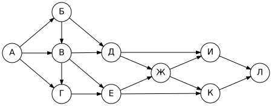
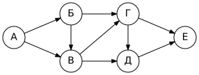
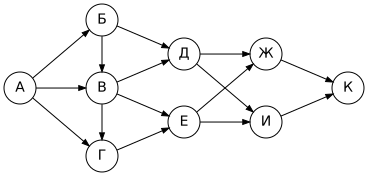
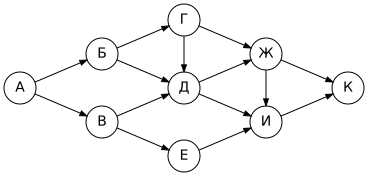
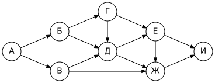
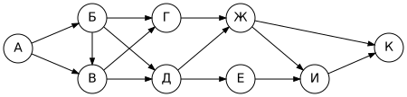
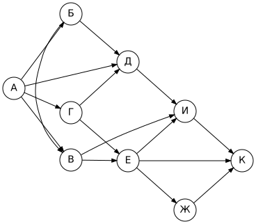
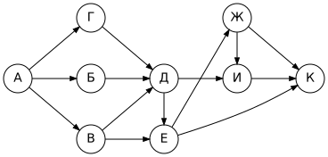
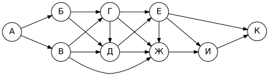
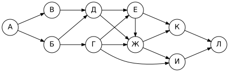

# Задание 9. Количество путей в графе

| Часть | Ответ | Балл | Время на экзамене | Сложность |
|---|---|---|---|---|
| 1 (без компьютера) | число | 1 | 3–5 мин | базовая |

**Что проверяют:** умение анализировать информацию, представленную в виде схем (ориентированный граф).

**Теория:** [Графы, таблицы, схемы](../theory/05-graphs.md#количество-путей-в-ориентированном-графе-задание-9).

## Что нужно знать

**Число путей в вершину = сумма чисел путей во все вершины, из которых в неё ведут стрелки.**

Считаем от старта (у него 1) к финишу, причём вершину считаем только тогда, когда посчитаны все вершины, из которых в неё входят стрелки.

## Разбор

> На рисунке — схема дорог, связывающих города А, Б, В, Г, Д, Е, Ж, И, К, Л. По каждой дороге можно двигаться только в одном направлении, указанном стрелкой. Сколько существует различных путей из города А в город Л?
>
> 

| Вершина | Входят стрелки из | Число путей |
|---|---|---|
| А | — | **1** |
| Б | А | 1 |
| В | А, Б | 1 + 1 = **2** |
| Г | А, В | 1 + 2 = **3** |
| Д | Б, В | 1 + 2 = **3** |
| Е | В, Г | 2 + 3 = **5** |
| Ж | Д, Е | 3 + 5 = **8** |
| И | Д, Ж | 3 + 8 = **11** |
| К | Ж, Е | 8 + 5 = **13** |
| Л | И, К | 11 + 13 = **24** |

**Ответ:** 24.

> [!TIP]
> Пишите числа прямо на рисунке рядом с вершинами (на черновике). Для каждой вершины сначала **найдите все входящие стрелки**, проведя пальцем по каждой.

## Варианты вопроса

- **«…проходящих через город Е»**: (пути А → Е) × (пути Е → Л). Для схемы выше: 5 × 3 = **15** (из Е в Л: Е→Ж→И→Л, Е→Ж→К→Л, Е→К→Л).
- **«…не проходящих через город Е»**: считаем заново, поставив Е = 0. Для схемы выше: Ж = 3, И = 6, К = 3, Л = **9**. Проверка: 24 − 15 = 9 ✓.

## Ловушки

> [!WARNING]
> - Пропустили стрелку, идущую «через ряд» (например, Д → И) или «вертикально» (Б → В, В → Г).
> - Сложили не те вершины: в сумму идут вершины, **из которых** стрелка выходит, а не куда она входит.
> - Посчитали вершину раньше, чем все её «предшественники». Если у вершины Г есть стрелка из В, сначала считаем В.

## Тренировка

### Часть А. Разминка (авторские задачи)

### Задача 1

Сколько существует различных путей из города А в город Е?

Ответ

**8**

А = 1, Б = 1, В = 1 + 1 = 2, Г = Б + В = 3, Д = В + Г = 5, Е = Г + Д = 8.

### Задача 2

Сколько существует различных путей из города А в город К?

Ответ

**16**

Б = 1, В = 2, Г = 3, Д = Б + В = 3, Е = В + Г = 5, Ж = Д + Е = 8, И = Д + Е = 8, К = Ж + И = 16.

### Задача 3

Схема из задачи 2. Сколько существует путей из А в К, **проходящих через город В**?

Ответ

**12**

Путей А → В: 2. Путей В → К: считаем от В = 1: Г = 1, Д = 1, Е = 1 + 1 = 2, Ж = 1 + 2 = 3, И = 3, К = 6. Итого 2 × 6 = 12.

### Задача 4

Сколько существует путей из А в К, **не проходящих через город Д**?

Ответ

**3**

Ставим Д = 0: Б = 1, В = 1, Г = 1, Е = 1, Ж = Г + Д = 1, И = Д + Е + Ж = 0 + 1 + 1 = 2, К = Ж + И = 3. (Всего путей 12, через Д — 9.)

### Задача 5

Сколько существует путей из А в И, **не проходящих через город Ж**?

Ответ

**4**

Ставим Ж = 0: Б = 1, В = 1, Г = 1, Д = Б + В + Г = 3, Е = Г + Д = 4, И = Е + Ж = 4.

### Часть Б. Как на экзамене (по образцу ФИПИ)

<!-- BEGIN:generated -->

### Задача 6

На рисунке — схема дорог, связывающих города А, Б, В, Г, Д, Е, Ж, И, К. По каждой дороге можно двигаться только в одном направлении, указанном стрелкой.

Сколько существует различных путей из города А в город К, не проходящих через город Г?

Ответ

**9**

### Задача 7

На рисунке — схема дорог, связывающих города А, Б, В, Г, Д, Е, Ж, И, К. По каждой дороге можно двигаться только в одном направлении, указанном стрелкой.

Сколько существует различных путей из города А в город К?

Ответ

**14**

### Задача 8

На рисунке — схема дорог, связывающих города А, Б, В, Г, Д, Е, Ж, И, К. По каждой дороге можно двигаться только в одном направлении, указанном стрелкой.

Сколько существует различных путей из города А в город К?

Ответ

**15**

### Задача 9

На рисунке — схема дорог, связывающих города А, Б, В, Г, Д, Е, Ж, И, К. По каждой дороге можно двигаться только в одном направлении, указанном стрелкой.

Сколько существует различных путей из города А в город К, не проходящих через город Е?

Ответ

**7**

### Задача 10

На рисунке — схема дорог, связывающих города А, Б, В, Г, Д, Е, Ж, И, К, Л. По каждой дороге можно двигаться только в одном направлении, указанном стрелкой.

Сколько существует различных путей из города А в город Л, не проходящих через город Д?

Ответ

**6**

<!-- END:generated -->

---

[← Задание 8](08-search-queries.md) · [К оглавлению](../README.md) · [Задание 10 →](10-number-systems.md)
