# Задание 9. Количество путей в графе

| Часть | Ответ | Балл | Время на экзамене | Сложность |
|---|---|---|---|---|
| 1 (без компьютера) | число | 1 | 3–5 мин | базовая |

**Что проверяют:** умение анализировать информацию, представленную в виде схемы (ориентированного графа).

**Теория:** [Графы, таблицы, схемы](../theory/05-graphs.md#количество-путей-в-ориентированном-графе-задание-9).

## Карта подтипов

| № | Подтип | Как узнать по условию | Частота |
|---|---|---|---|
| [9.1](#подтип-91-все-пути) | Все пути | «Сколько существует различных путей из города А в город …?» | **часто** — основной тип |
| [9.2](#подтип-92-через-вершину) | Через вершину | «…проходящих через город Ж?» | иногда |
| [9.3](#подтип-93-не-через-вершину) | Не через вершину | «…не проходящих через город Д?» | иногда |
| [9.4](#подтип-94-через-одну-вершину-но-не-через-другую) | Через одну, но не через другую | «…проходящих через город Ж, но не проходящих через город К?» | редко |

## Главная идея: правило суммы

**Число путей в вершину = сумма чисел путей во все вершины, из которых в неё ведут стрелки.**

Почему это верно. Любой путь в вершину Е **последней** дорогой приходит в Е из какого-то соседа: из В или из Г. Пути «через В последним шагом» и «через Г последним шагом» разные, и других нет. Поэтому пути в Е делятся на две непересекающиеся группы:

$$N(Е) = N(В) + N(Г)$$

Отсюда порядок работы: считать вершины так, чтобы к моменту подсчёта вершины **все** вершины, из которых в неё входят стрелки, были уже посчитаны.

Для «через вершину X» работает **правило произведения**. Путь через X — это пара «путь до X» + «путь от X». Любой первый кусок можно соединить с любым вторым, поэтому вариантов $N(\text{старт} \to X) \cdot N(X \to \text{финиш})$.

---

## Подтип 9.1. Все пути

*Частота: часто.*

### Как выглядит на экзамене

> На рисунке — схема дорог, связывающих города А, Б, В, Г, Д, Е, Ж, И, К, Л. По каждой дороге можно двигаться только в одном направлении, указанном стрелкой. Сколько существует различных путей из города А в город Л?
>
> 

### Способ 1. Вперёд от старта

| Вершина | Стрелки входят из | Число путей |
|---|---|---|
| А | — | **1** |
| Б | А | 1 |
| В | А, Б | 1 + 1 = **2** |
| Г | А, В | 1 + 2 = **3** |
| Д | Б, В | 1 + 2 = **3** |
| Е | В, Г | 2 + 3 = **5** |
| Ж | Д, Е | 3 + 5 = **8** |
| И | Д, Ж | 3 + 8 = **11** |
| К | Е, Ж | 5 + 8 = **13** |
| Л | И, К | 11 + 13 = **24** |

**Ответ:** 24.

### Способ 2. Назад от финиша (идеально для проверки)

Теперь считаем, сколько путей ведёт **из** каждой вершины в Л. Правило то же, только по **выходящим** стрелкам:

| Вершина | Стрелки выходят в | Путей до Л |
|---|---|---|
| Л | — | 1 |
| И | Л | 1 |
| К | Л | 1 |
| Ж | И, К | 2 |
| Е | Ж, К | 2 + 1 = 3 |
| Д | Ж, И | 2 + 1 = 3 |
| Г | Е | 3 |
| В | Г, Д, Е | 3 + 3 + 3 = 9 |
| Б | В, Д | 9 + 3 = 12 |
| А | Б, В, Г | 12 + 9 + 3 = **24** |

Ответ совпал — значит, ни одна стрелка не потеряна.

### Проверка за 30 секунд

Посчитайте **число стрелок**, которые вы учли в суммах, и сравните с числом стрелок на рисунке (здесь 17). Если не совпадает — какую-то стрелку пропустили или посчитали дважды.

### Тренировка

<!-- BEGIN:sub:9.1 -->

#### Тренировка 9.1.1

На рисунке — схема дорог, связывающих города А, Б, В, Г, Д, Е, Ж, И, К, Л, М. По каждой дороге можно двигаться только в одном направлении, указанном стрелкой.

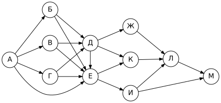

Сколько существует различных путей из города А в город М?

Ответ

**27**

#### Тренировка 9.1.2

На рисунке — схема дорог, связывающих города А, Б, В, Г, Д, Е, Ж, И, К, Л, М. По каждой дороге можно двигаться только в одном направлении, указанном стрелкой.

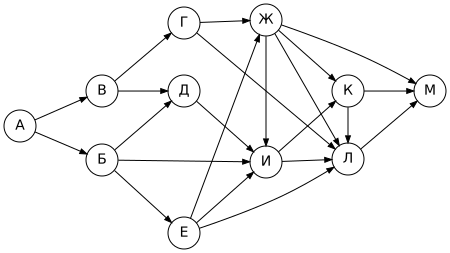

Сколько существует различных путей из города А в город М?

Ответ

**28**

#### Тренировка 9.1.3

На рисунке — схема дорог, связывающих города А, Б, В, Г, Д, Е, Ж, И, К, Л. По каждой дороге можно двигаться только в одном направлении, указанном стрелкой.

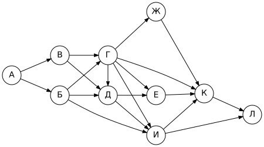

Сколько существует различных путей из города А в город Л?

Ответ

**24**

#### Тренировка 9.1.4

На рисунке — схема дорог, связывающих города А, Б, В, Г, Д, Е, Ж, И, К, Л, М. По каждой дороге можно двигаться только в одном направлении, указанном стрелкой.

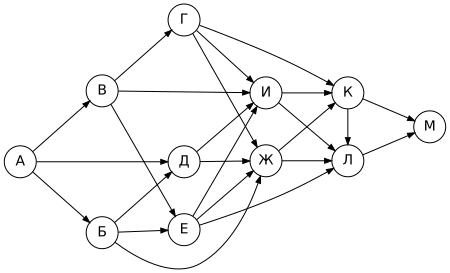

Сколько существует различных путей из города А в город М?

Ответ

**40**

<!-- END:sub:9.1 -->

---

## Подтип 9.2. Через вершину

*Частота: иногда.*

### Способ 1. Правило произведения

Сколько путей из А в Л **проходят через Ж** (схема выше)?

- путей А → Ж: **8** (из таблицы способа 1);
- путей Ж → Л: **2** (из таблицы способа 2: Ж → И → Л и Ж → К → Л);
- ответ: 8 · 2 = **16**.

### Способ 2. «Вырезать обходы»

Считайте как обычно, но после вершины Ж учитывайте **только пути, пришедшие через Ж**. Все вершины, которые стоят «параллельно» Ж (из них можно дойти до финиша, минуя Ж), обнулите. Этот способ легко запутать, поэтому для проверки лучше использовать способ 1.

### Проверка за 30 секунд

Путей через Ж не может быть больше, чем всех путей (16 ≤ 24 ✓). А «через Ж» + «не через Ж» = все пути (см. подтип 9.3).

### Тренировка

<!-- BEGIN:sub:9.2 -->

#### Тренировка 9.2.1

На рисунке — схема дорог, связывающих города А, Б, В, Г, Д, Е, Ж, И, К, Л, М. По каждой дороге можно двигаться только в одном направлении, указанном стрелкой.

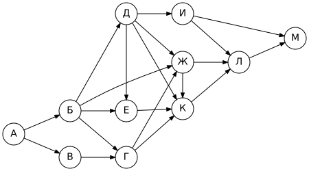

Сколько существует различных путей из города А в город М, проходящих через город Ж?

Ответ

**8**

#### Тренировка 9.2.2

На рисунке — схема дорог, связывающих города А, Б, В, Г, Д, Е, Ж, И, К, Л. По каждой дороге можно двигаться только в одном направлении, указанном стрелкой.

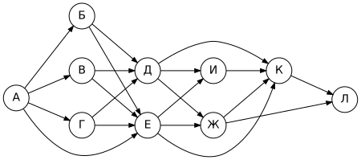

Сколько существует различных путей из города А в город Л, проходящих через город Ж?

Ответ

**14**

#### Тренировка 9.2.3

На рисунке — схема дорог, связывающих города А, Б, В, Г, Д, Е, Ж, И, К, Л. По каждой дороге можно двигаться только в одном направлении, указанном стрелкой.

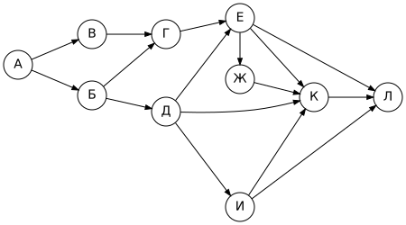

Сколько существует различных путей из города А в город Л, проходящих через город Д?

Ответ

**6**

#### Тренировка 9.2.4

На рисунке — схема дорог, связывающих города А, Б, В, Г, Д, Е, Ж, И, К, Л, М. По каждой дороге можно двигаться только в одном направлении, указанном стрелкой.

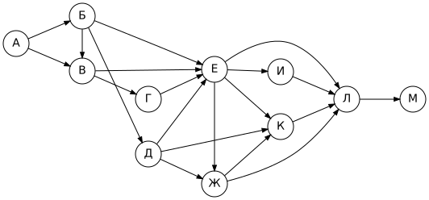

Сколько существует различных путей из города А в город М, проходящих через город В?

Ответ

**20**

<!-- END:sub:9.2 -->

---

## Подтип 9.3. Не через вершину

*Частота: иногда.*

### Способ 1. Обнулить вершину

Сколько путей из А в Л **не проходят через Ж**? Считаем как в подтипе 9.1, но ставим **Ж = 0**: тогда пути через Ж «обрываются».

Вершины до Ж не меняются: А = 1, Б = 1, В = 2, Г = 3, Д = 3, Е = 5. Дальше: **Ж = 0**, И = Д + Ж = 3, К = Е + Ж = 5, Л = И + К = **8**.

### Способ 2. Вычитание

«Не через Ж» = «все» − «через Ж» = 24 − 16 = **8**. Два способа дали одно число — хорошая проверка.

### Тренировка

<!-- BEGIN:sub:9.3 -->

#### Тренировка 9.3.1

На рисунке — схема дорог, связывающих города А, Б, В, Г, Д, Е, Ж, И, К, Л, М. По каждой дороге можно двигаться только в одном направлении, указанном стрелкой.

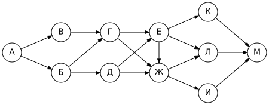

Сколько существует различных путей из города А в город М, не проходящих через город Г?

Ответ

**6**

#### Тренировка 9.3.2

На рисунке — схема дорог, связывающих города А, Б, В, Г, Д, Е, Ж, И, К, Л, М. По каждой дороге можно двигаться только в одном направлении, указанном стрелкой.

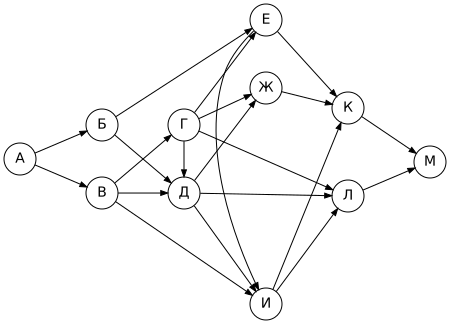

Сколько существует различных путей из города А в город М, не проходящих через город Г?

Ответ

**13**

#### Тренировка 9.3.3

На рисунке — схема дорог, связывающих города А, Б, В, Г, Д, Е, Ж, И, К, Л. По каждой дороге можно двигаться только в одном направлении, указанном стрелкой.

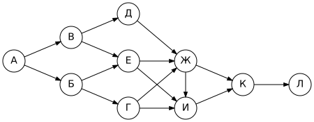

Сколько существует различных путей из города А в город Л, не проходящих через город И?

Ответ

**4**

#### Тренировка 9.3.4

На рисунке — схема дорог, связывающих города А, Б, В, Г, Д, Е, Ж, И, К. По каждой дороге можно двигаться только в одном направлении, указанном стрелкой.

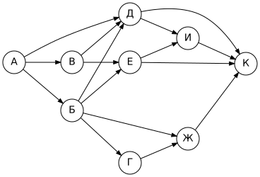

Сколько существует различных путей из города А в город К, не проходящих через город Г?

Ответ

**11**

<!-- END:sub:9.3 -->

---

## Подтип 9.4. Через одну вершину, но не через другую

*Частота: редко (пример — задача № 11025 в каталоге «Решу ОГЭ»).*

### Способ 1. Произведение с обнулением

Путь должен пройти через Ж, но не через К. Разбиваем путь на две части в точке Ж и в **каждой** части запрещаем К:

- А → Ж без К: К стоит после Ж, на эту часть он не влияет → **8**;
- Ж → Л без К: из Ж в Л ведут Ж → И → Л и Ж → К → Л, второй запрещён → **1**;
- ответ: 8 · 1 = **8**.

### Способ 2. Обнулить К и считать только пути через Ж

Поставьте К = 0 и посчитайте пути через Ж по правилу произведения на «урезанной» схеме. Получится то же самое.

### Проверка за 30 секунд

Ответ не больше, чем «через Ж» (8 ≤ 16 ✓), и не больше, чем «не через К» (на этой схеме таких путей 11 ✓).

### Тренировка

<!-- BEGIN:sub:9.4 -->

#### Тренировка 9.4.1

На рисунке — схема дорог, связывающих города А, Б, В, Г, Д, Е, Ж, И, К, Л, М. По каждой дороге можно двигаться только в одном направлении, указанном стрелкой.

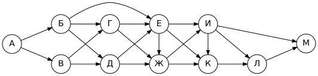

Сколько существует различных путей из города А в город М, проходящих через город В, но не проходящих через город Г?

Ответ

**12**

#### Тренировка 9.4.2

На рисунке — схема дорог, связывающих города А, Б, В, Г, Д, Е, Ж, И, К, Л, М. По каждой дороге можно двигаться только в одном направлении, указанном стрелкой.

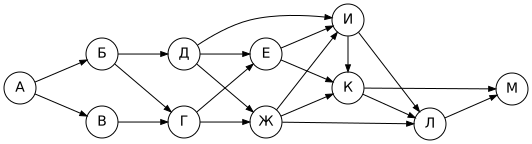

Сколько существует различных путей из города А в город М, проходящих через город К, но не проходящих через город Г?

Ответ

**10**

#### Тренировка 9.4.3

На рисунке — схема дорог, связывающих города А, Б, В, Г, Д, Е, Ж, И, К. По каждой дороге можно двигаться только в одном направлении, указанном стрелкой.

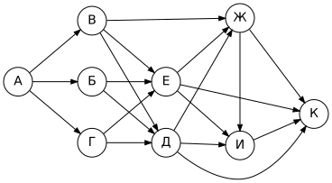

Сколько существует различных путей из города А в город К, проходящих через город В, но не проходящих через город И?

Ответ

**5**

#### Тренировка 9.4.4

На рисунке — схема дорог, связывающих города А, Б, В, Г, Д, Е, Ж, И, К, Л, М. По каждой дороге можно двигаться только в одном направлении, указанном стрелкой.

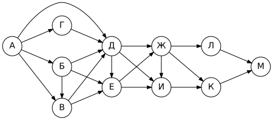

Сколько существует различных путей из города А в город М, проходящих через город Е, но не проходящих через город И?

Ответ

**16**

<!-- END:sub:9.4 -->

---

## Ловушки

> [!WARNING]
> - Пропустили стрелку, идущую «через ряд» (Д → И) или вертикально (Б → В, В → Г).
> - Сложили не те вершины: в сумму идут вершины, **из которых** стрелка выходит.
> - Посчитали вершину раньше, чем все её предшественники.
> - В подтипе 9.2 сложили вместо того, чтобы перемножить.

## Смешанная тренировка (как на экзамене)

<!-- BEGIN:generated -->

### Задача 1

На рисунке — схема дорог, связывающих города А, Б, В, Г, Д, Е, Ж, И, К. По каждой дороге можно двигаться только в одном направлении, указанном стрелкой.

Сколько существует различных путей из города А в город К, не проходящих через город Г?

Ответ

**9**

### Задача 2

На рисунке — схема дорог, связывающих города А, Б, В, Г, Д, Е, Ж, И, К. По каждой дороге можно двигаться только в одном направлении, указанном стрелкой.

Сколько существует различных путей из города А в город К?

Ответ

**14**

### Задача 3

На рисунке — схема дорог, связывающих города А, Б, В, Г, Д, Е, Ж, И, К. По каждой дороге можно двигаться только в одном направлении, указанном стрелкой.

Сколько существует различных путей из города А в город К?

Ответ

**15**

### Задача 4

На рисунке — схема дорог, связывающих города А, Б, В, Г, Д, Е, Ж, И, К. По каждой дороге можно двигаться только в одном направлении, указанном стрелкой.

Сколько существует различных путей из города А в город К, не проходящих через город Е?

Ответ

**7**

### Задача 5

На рисунке — схема дорог, связывающих города А, Б, В, Г, Д, Е, Ж, И, К, Л. По каждой дороге можно двигаться только в одном направлении, указанном стрелкой.

Сколько существует различных путей из города А в город Л, не проходящих через город Д?

Ответ

**6**

<!-- END:generated -->

---

[← Задание 8](08-search-queries.md) · [К оглавлению](../README.md) · [Задание 10 →](10-number-systems.md)
