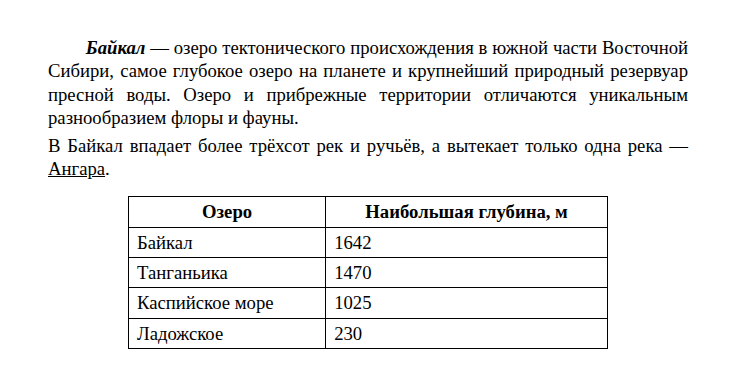
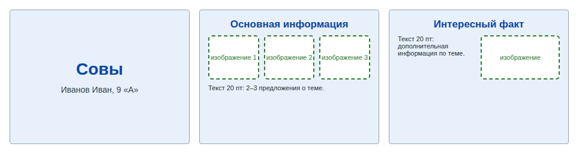
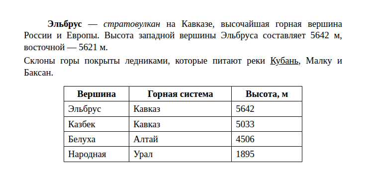
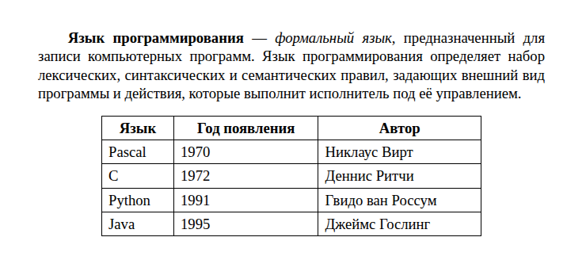
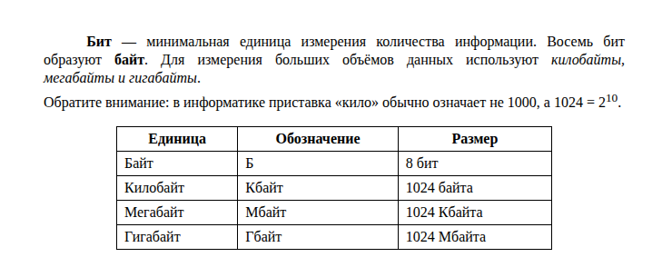
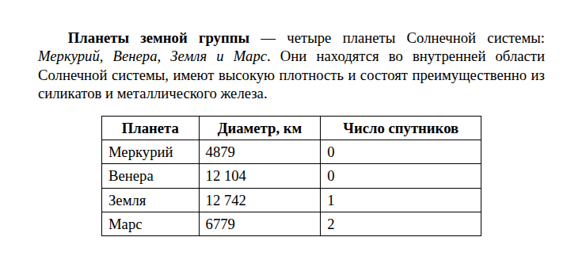
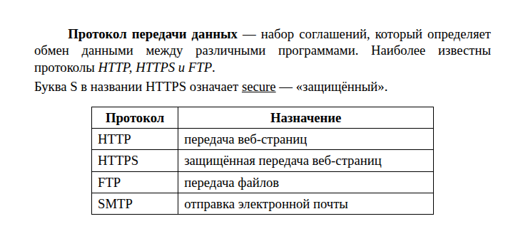

# Задание 13. Презентация (13.1) или текстовый документ (13.2)

| Часть | Ответ | Балл | Время на экзамене | Сложность |
|---|---|---|---|---|
| 2 (на компьютере) | файл `.odp` или `.odt` | 2 | 20–25 мин | повышенная |

**Что проверяют:** умение создавать презентации (13.1) **или** форматировать текст и таблицы (13.2). Выполняется **одно** из двух заданий на выбор.

**Теория:** [Текстовый редактор и презентации](../theory/12-office.md).

> [!IMPORTANT]
> С 2026 года задание выполняется в **LibreOffice**: презентацию сохраняют в формате `.odp` (Impress), текст — в `.odt` (Writer). Дома можно тренироваться и в MS Office, но обязательно попробуйте LibreOffice: он [бесплатный](https://ru.libreoffice.org/download/).

## Что выбрать

Попробуйте оба варианта на тренировках ниже и засеките время. Выберите тот, в котором делаете **меньше ошибок**, а не тот, что «интереснее».

---

## 13.2. Текстовый документ — разбор

### Условие

> Создайте в текстовом редакторе документ и напишите в нём следующий текст, точно воспроизведя всё оформление текста, имеющееся в образце.
>
> Данный текст должен быть набран шрифтом размером **14 пунктов** обычного начертания. Отступ первой строки первого абзаца основного текста — **1 см**. Расстояние между строками текста не менее одинарного, но не более полуторного междустрочного интервала.
>
> Основной текст выровнен **по ширине**; в ключевых словах первого абзаца применено полужирное и курсивное начертание; во втором абзаце одно слово подчёркнуто.
>
> Таблица выровнена **по центру**; ширина таблицы меньше ширины основного текста. Текст в первой строке таблицы — полужирный, выровнен по центру; в остальных ячейках — выравнивание по левому краю.

**Образец:**

### Пошагово в LibreOffice Writer

1. **Набор текста.** Сначала наберите весь текст без форматирования. Тире: в Writer дефис с пробелами между словами (`озеро - самое`) после набора следующего слова сам превращается в тире (автозамена). Если не сработало: **Вставка → Специальный символ → «—»**. В Word длинное тире: `Ctrl` + `Alt` + `-` на цифровой клавиатуре.
2. **Шрифт.** Выделите всё (`Ctrl+A`), задайте размер **14**. Шрифт — любой обычный (Times New Roman / Liberation Serif), если не сказано иначе.
3. **Выравнивание по ширине**: `Ctrl+J`.
4. **Отступ первой строки**: курсор в первый абзац → **Формат → Абзац → Отступы и интервалы → Первая строка: 1 см**.
5. **Междустрочный интервал**: там же, «Междустрочный интервал: Одинарный» (или 1,15 / полуторный — в допустимых пределах).
6. **Начертание**: выделите «Байкал» → `Ctrl+B` и `Ctrl+I`; «Ангара» → `Ctrl+U`.
7. **Таблица**: **Таблица → Вставить таблицу** (`Ctrl+F12`), 2 столбца, 5 строк. Заполните.
8. **Ширина и выравнивание таблицы**: правой кнопкой по таблице → **Свойства таблицы → Таблица → Выравнивание: По центру**, ширину уменьшите (например, 12 см).
9. **Первая строка таблицы**: выделите → `Ctrl+B` и `Ctrl+E` (по центру). Остальные ячейки — `Ctrl+L`.
10. **Сохранить**: **Файл → Сохранить как** → тип «Текст ODF (.odt)», имя — как скажет организатор.

### В MS Word

Всё то же самое: отступ первой строки — **Главная → Абзац (значок в углу) → Первая строка: Отступ 1 см**; таблица — **Вставка → Таблица**; выравнивание таблицы — **Макет → Свойства → Таблица → По центру**.

### Чек-лист самопроверки 13.2

- [ ] Текст набран без опечаток (сверьте по словам с образцом).
- [ ] Размер шрифта везде одинаковый и равен заданному.
- [ ] Выравнивание основного текста — по ширине.
- [ ] Отступ первой строки сделан через «Абзац», а **не пробелами**.
- [ ] Полужирный, курсив, подчёркивание — ровно там, где в образце.
- [ ] В таблице нужное число строк и столбцов, она по центру и уже текста.
- [ ] Первая строка таблицы — полужирная и по центру.
- [ ] Индексы (H₂O, 2¹⁰) сделаны через верхний/нижний индекс, а не уменьшенным шрифтом.
- [ ] Файл сохранён в нужном формате.

---

## 13.1. Презентация — разбор

### Условие (сокращённо)

> Используя информацию и иллюстративный материал, содержащийся в каталоге «Совы», создайте презентацию из **трёх слайдов** на тему «Совы». В презентации должны использоваться простые шаблоны оформления, единый стиль, фон слайдов одинаковый (не белый).
>
> 1. Первый слайд — титульный: название презентации; в подзаголовке — информация об авторе.
> 2. Второй слайд — основная информация: заголовок, три изображения, текст.
> 3. Третий слайд — дополнительная информация: заголовок, изображение, текст.
>
> Размер шрифта: название на титульном слайде — **40 пт**; подзаголовок титульного слайда и заголовки слайдов — **24 пт**; основной текст — **20 пт**. Текст не должен перекрывать изображения или сливаться с фоном.

**Примерная схема результата:**

### Пошагово в LibreOffice Impress

1. **Файл → Создать → Презентация**. Справа на панели «Свойства» выберите **макет** «Заголовок, текст» для слайдов.
2. **Фон**: **Слайд → Свойства слайда → Фон → Цвет** (светлый, не белый) → на вопрос «Применить ко всем слайдам?» — **Да**.
3. **Слайд 1**: макет «Титульный слайд». Заголовок «Совы» — **40 пт**; подзаголовок «Иванов Иван, 9 «А»» — **24 пт**.
4. **Слайд 2** (**Слайд → Новый слайд**): заголовок 24 пт; **Вставка → Изображение** — три картинки, выровнять в ряд (Формат → Выравнивание); текстовый блок 20 пт.
5. **Слайд 3**: заголовок 24 пт, текст 20 пт слева, изображение справа.
6. Проверка в режиме показа (`F5`): ничего не перекрывается и не выходит за края.
7. **Файл → Сохранить как** → «Презентация ODF (.odp)».

### В PowerPoint

Фон — **Конструктор → Формат фона → Применить ко всем**; макеты — **Главная → Макет**; картинки — **Вставка → Рисунки**.

### Чек-лист самопроверки 13.1

- [ ] Ровно **три** слайда.
- [ ] Единый фон (не белый) и единый стиль на всех слайдах.
- [ ] Слайд 1: название 40 пт, подзаголовок с автором 24 пт.
- [ ] Заголовки слайдов 2 и 3 — 24 пт; основной текст — 20 пт.
- [ ] На слайде 2 — три изображения, на слайде 3 — одно (или сколько требует условие).
- [ ] Текст не перекрывает картинки и хорошо читается на фоне.
- [ ] Ничего не выходит за границы слайда.
- [ ] Файл сохранён в `.odp` (или нужном формате).

---

## Ловушки

> [!WARNING]
> - **13.2:** отступ пробелами, лишние пустые строки, `Enter` в середине абзаца, дефис вместо тире.
> - **13.2:** таблица растянута на всю ширину, а нужно уже текста.
> - **13.1:** белый фон или разные фоны на слайдах.
> - **13.1:** размер шрифта «на глаз». Всегда проверяйте число в поле размера шрифта.
> - Файл не сохранён или сохранён не в том формате. **Сохраняйтесь сразу и регулярно** (`Ctrl+S`).

## Тренировка

Для 13.2 сделайте документ по образцу и проверьте себя по чек-листу выше. Для 13.1 подберите картинки сами (на экзамене их дают в каталоге задания). Засекайте время: цель — уложиться в **20 минут**.

<!-- BEGIN:generated -->

### Задача 1 (13.1). Презентация «Байкал»

Используя информацию и иллюстративный материал о теме «**Байкал**», создайте презентацию из **трёх слайдов**.

В презентации должны использоваться простые шаблоны оформления: следует использовать единый стиль оформления всех слайдов, фон слайдов должен быть одинаковым (не белым).

1. **Первый слайд** — титульный слайд с названием презентации; в подзаголовке титульного слайда в качестве информации об авторе презентации указывается ваше имя (или идентификационный номер).
2. **Второй слайд** — основная информация в соответствии с заданием, размещённая по образцу (заголовок, три изображения, подписи к ним или текст).
3. **Третий слайд** — дополнительная информация по теме: заголовок, одно изображение и текст.

Размер шрифта: для названия презентации на титульном слайде — **40 пунктов**; для подзаголовка на титульном слайде и заголовков слайдов — **24 пункта**; для основного текста — **20 пунктов**.

Текст не должен перекрывать основные изображения или сливаться с фоном.

Информация для слайдов: Байкал — самое глубокое озеро на планете (1642 м). В нём около 20 % мировых запасов озёрной пресной воды. В озере живёт байкальская нерпа — единственный ластоногий Байкала.

Изображения найдите самостоятельно (на экзамене их дают в каталоге задания). Сохраните презентацию в формате **.odp** (LibreOffice Impress) или **.pptx** (PowerPoint).

Как проверить

Пройдите по [чек-листу 13.1](#чек-лист-самопроверки-131). Каждый пункт — обязателен.

### Задача 2 (13.1). Презентация «Солнечная система»

Используя информацию и иллюстративный материал о теме «**Солнечная система**», создайте презентацию из **трёх слайдов**.

В презентации должны использоваться простые шаблоны оформления: следует использовать единый стиль оформления всех слайдов, фон слайдов должен быть одинаковым (не белым).

1. **Первый слайд** — титульный слайд с названием презентации; в подзаголовке титульного слайда в качестве информации об авторе презентации указывается ваше имя (или идентификационный номер).
2. **Второй слайд** — основная информация в соответствии с заданием, размещённая по образцу (заголовок, три изображения, подписи к ним или текст).
3. **Третий слайд** — дополнительная информация по теме: заголовок, одно изображение и текст.

Размер шрифта: для названия презентации на титульном слайде — **40 пунктов**; для подзаголовка на титульном слайде и заголовков слайдов — **24 пункта**; для основного текста — **20 пунктов**.

Текст не должен перекрывать основные изображения или сливаться с фоном.

Информация для слайдов: Солнечная система состоит из Солнца и обращающихся вокруг него космических объектов. В неё входят восемь планет: Меркурий, Венера, Земля, Марс, Юпитер, Сатурн, Уран и Нептун. Крупнейшая планета — Юпитер.

Изображения найдите самостоятельно (на экзамене их дают в каталоге задания). Сохраните презентацию в формате **.odp** (LibreOffice Impress) или **.pptx** (PowerPoint).

Как проверить

Пройдите по [чек-листу 13.1](#чек-лист-самопроверки-131). Каждый пункт — обязателен.

### Задача 3 (13.1). Презентация «Устройство компьютера»

Используя информацию и иллюстративный материал о теме «**Устройство компьютера**», создайте презентацию из **трёх слайдов**.

В презентации должны использоваться простые шаблоны оформления: следует использовать единый стиль оформления всех слайдов, фон слайдов должен быть одинаковым (не белым).

1. **Первый слайд** — титульный слайд с названием презентации; в подзаголовке титульного слайда в качестве информации об авторе презентации указывается ваше имя (или идентификационный номер).
2. **Второй слайд** — основная информация в соответствии с заданием, размещённая по образцу (заголовок, три изображения, подписи к ним или текст).
3. **Третий слайд** — дополнительная информация по теме: заголовок, одно изображение и текст.

Размер шрифта: для названия презентации на титульном слайде — **40 пунктов**; для подзаголовка на титульном слайде и заголовков слайдов — **24 пункта**; для основного текста — **20 пунктов**.

Текст не должен перекрывать основные изображения или сливаться с фоном.

Информация для слайдов: Основные устройства компьютера: процессор обрабатывает данные, оперативная память хранит их во время работы, накопитель (жёсткий диск или SSD) хранит данные долговременно. Клавиатура и мышь — устройства ввода, монитор и принтер — вывода.

Изображения найдите самостоятельно (на экзамене их дают в каталоге задания). Сохраните презентацию в формате **.odp** (LibreOffice Impress) или **.pptx** (PowerPoint).

Как проверить

Пройдите по [чек-листу 13.1](#чек-лист-самопроверки-131). Каждый пункт — обязателен.

### Задача 4 (13.1). Презентация «Подсолнечник»

Используя информацию и иллюстративный материал о теме «**Подсолнечник**», создайте презентацию из **трёх слайдов**.

В презентации должны использоваться простые шаблоны оформления: следует использовать единый стиль оформления всех слайдов, фон слайдов должен быть одинаковым (не белым).

1. **Первый слайд** — титульный слайд с названием презентации; в подзаголовке титульного слайда в качестве информации об авторе презентации указывается ваше имя (или идентификационный номер).
2. **Второй слайд** — основная информация в соответствии с заданием, размещённая по образцу (заголовок, три изображения, подписи к ним или текст).
3. **Третий слайд** — дополнительная информация по теме: заголовок, одно изображение и текст.

Размер шрифта: для названия презентации на титульном слайде — **40 пунктов**; для подзаголовка на титульном слайде и заголовков слайдов — **24 пункта**; для основного текста — **20 пунктов**.

Текст не должен перекрывать основные изображения или сливаться с фоном.

Информация для слайдов: Подсолнечник — однолетнее растение семейства Астровые. Его соцветие-корзинка в молодом возрасте поворачивается вслед за Солнцем. Из семян подсолнечника получают растительное масло.

Изображения найдите самостоятельно (на экзамене их дают в каталоге задания). Сохраните презентацию в формате **.odp** (LibreOffice Impress) или **.pptx** (PowerPoint).

Как проверить

Пройдите по [чек-листу 13.1](#чек-лист-самопроверки-131). Каждый пункт — обязателен.

### Задача 5 (13.1). Презентация «Пингвины»

Используя информацию и иллюстративный материал о теме «**Пингвины**», создайте презентацию из **трёх слайдов**.

В презентации должны использоваться простые шаблоны оформления: следует использовать единый стиль оформления всех слайдов, фон слайдов должен быть одинаковым (не белым).

1. **Первый слайд** — титульный слайд с названием презентации; в подзаголовке титульного слайда в качестве информации об авторе презентации указывается ваше имя (или идентификационный номер).
2. **Второй слайд** — основная информация в соответствии с заданием, размещённая по образцу (заголовок, три изображения, подписи к ним или текст).
3. **Третий слайд** — дополнительная информация по теме: заголовок, одно изображение и текст.

Размер шрифта: для названия презентации на титульном слайде — **40 пунктов**; для подзаголовка на титульном слайде и заголовков слайдов — **24 пункта**; для основного текста — **20 пунктов**.

Текст не должен перекрывать основные изображения или сливаться с фоном.

Информация для слайдов: Пингвины — нелетающие морские птицы Южного полушария. Крылья пингвинов превратились в ласты, поэтому они отлично плавают. Самый крупный вид — императорский пингвин.

Изображения найдите самостоятельно (на экзамене их дают в каталоге задания). Сохраните презентацию в формате **.odp** (LibreOffice Impress) или **.pptx** (PowerPoint).

Как проверить

Пройдите по [чек-листу 13.1](#чек-лист-самопроверки-131). Каждый пункт — обязателен.

### Задача 6 (13.2). Документ «Эльбрус»

Создайте в текстовом редакторе документ и напишите в нём следующий текст, точно воспроизведя всё оформление текста, имеющееся в образце.

Данный текст должен быть набран шрифтом размером **14 пунктов** обычного начертания. Отступ первой строки первого абзаца основного текста — **1,25 см**. Расстояние между строками текста не менее одинарного, но не более полуторного междустрочного интервала.

Основной текст выровнен **по ширине**; в ключевых словах первого абзаца применено полужирное и курсивное начертание; во втором абзаце одно слово подчёркнуто.

Таблица (5 строк, 3 столбца) выровнена **по центру**; ширина таблицы меньше ширины основного текста. Текст в первой строке таблицы — полужирный, выровнен по центру; в остальных ячейках — выравнивание по левому краю.

При этом допустимо, чтобы ширина вашего текста отличалась от ширины текста в примере, поскольку ширина текста зависит от размеров страницы и полей. В этом случае разбиение текста на строки должно соответствовать стандартной ширине абзаца.

**Образец:**

Как проверить

Пройдите по [чек-листу 13.2](#чек-лист-самопроверки-132). Положите свой документ рядом с образцом и сравните построчно.

### Задача 7 (13.2). Документ «Языки программирования»

Создайте в текстовом редакторе документ и напишите в нём следующий текст, точно воспроизведя всё оформление текста, имеющееся в образце.

Данный текст должен быть набран шрифтом размером **14 пунктов** обычного начертания. Отступ первой строки первого абзаца основного текста — **1,0 см**. Расстояние между строками текста не менее одинарного, но не более полуторного междустрочного интервала.

Основной текст выровнен **по ширине**; в ключевых словах первого абзаца применено полужирное и курсивное начертание.

Таблица (5 строк, 3 столбца) выровнена **по центру**; ширина таблицы меньше ширины основного текста. Текст в первой строке таблицы — полужирный, выровнен по центру; в остальных ячейках — выравнивание по левому краю.

При этом допустимо, чтобы ширина вашего текста отличалась от ширины текста в примере, поскольку ширина текста зависит от размеров страницы и полей. В этом случае разбиение текста на строки должно соответствовать стандартной ширине абзаца.

**Образец:**

Как проверить

Пройдите по [чек-листу 13.2](#чек-лист-самопроверки-132). Положите свой документ рядом с образцом и сравните построчно.

### Задача 8 (13.2). Документ «Единицы измерения информации»

Создайте в текстовом редакторе документ и напишите в нём следующий текст, точно воспроизведя всё оформление текста, имеющееся в образце.

Данный текст должен быть набран шрифтом размером **12 пунктов** обычного начертания. Отступ первой строки первого абзаца основного текста — **1,25 см**. Расстояние между строками текста не менее одинарного, но не более полуторного междустрочного интервала.

Основной текст выровнен **по ширине**; в ключевых словах первого абзаца применено полужирное и курсивное начертание; есть нижний или верхний индекс.

Таблица (5 строк, 3 столбца) выровнена **по центру**; ширина таблицы меньше ширины основного текста. Текст в первой строке таблицы — полужирный, выровнен по центру; в остальных ячейках — выравнивание по левому краю.

При этом допустимо, чтобы ширина вашего текста отличалась от ширины текста в примере, поскольку ширина текста зависит от размеров страницы и полей. В этом случае разбиение текста на строки должно соответствовать стандартной ширине абзаца.

**Образец:**

Как проверить

Пройдите по [чек-листу 13.2](#чек-лист-самопроверки-132). Положите свой документ рядом с образцом и сравните построчно.

### Задача 9 (13.2). Документ «Планеты земной группы»

Создайте в текстовом редакторе документ и напишите в нём следующий текст, точно воспроизведя всё оформление текста, имеющееся в образце.

Данный текст должен быть набран шрифтом размером **14 пунктов** обычного начертания. Отступ первой строки первого абзаца основного текста — **1,0 см**. Расстояние между строками текста не менее одинарного, но не более полуторного междустрочного интервала.

Основной текст выровнен **по ширине**; в ключевых словах первого абзаца применено полужирное и курсивное начертание.

Таблица (5 строк, 3 столбца) выровнена **по центру**; ширина таблицы меньше ширины основного текста. Текст в первой строке таблицы — полужирный, выровнен по центру; в остальных ячейках — выравнивание по левому краю.

При этом допустимо, чтобы ширина вашего текста отличалась от ширины текста в примере, поскольку ширина текста зависит от размеров страницы и полей. В этом случае разбиение текста на строки должно соответствовать стандартной ширине абзаца.

**Образец:**

Как проверить

Пройдите по [чек-листу 13.2](#чек-лист-самопроверки-132). Положите свой документ рядом с образцом и сравните построчно.

### Задача 10 (13.2). Документ «Протоколы передачи данных»

Создайте в текстовом редакторе документ и напишите в нём следующий текст, точно воспроизведя всё оформление текста, имеющееся в образце.

Данный текст должен быть набран шрифтом размером **14 пунктов** обычного начертания. Отступ первой строки первого абзаца основного текста — **1,25 см**. Расстояние между строками текста не менее одинарного, но не более полуторного междустрочного интервала.

Основной текст выровнен **по ширине**; в ключевых словах первого абзаца применено полужирное и курсивное начертание; во втором абзаце одно слово подчёркнуто.

Таблица (5 строк, 2 столбца) выровнена **по центру**; ширина таблицы меньше ширины основного текста. Текст в первой строке таблицы — полужирный, выровнен по центру; в остальных ячейках — выравнивание по левому краю.

При этом допустимо, чтобы ширина вашего текста отличалась от ширины текста в примере, поскольку ширина текста зависит от размеров страницы и полей. В этом случае разбиение текста на строки должно соответствовать стандартной ширине абзаца.

**Образец:**

Как проверить

Пройдите по [чек-листу 13.2](#чек-лист-самопроверки-132). Положите свой документ рядом с образцом и сравните построчно.

<!-- END:generated -->

---

[← Задание 12](12-file-masks.md) · [К оглавлению](../README.md) · [Задание 14 →](14-spreadsheets.md)
