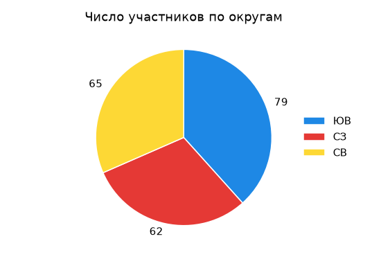

# Задание 14. Обработка данных в электронной таблице

| Часть | Ответ | Балл | Время на экзамене | Сложность |
|---|---|---|---|---|
| 2 (на компьютере) | файл `.ods` | 3 | 20–25 мин | высокая |

**Что проверяют:** умение проводить обработку большого массива данных с помощью электронной таблицы: формулы, функции, диаграммы.

**Теория:** [Электронные таблицы](../theory/11-spreadsheets.md).

## Как оценивается

Обычно в задании три пункта: два вопроса (ответы в ячейки, например H2 и H3) и диаграмма.

| Балл | Что сделано |
|---|---|
| 3 | верно все три пункта |
| 2 | верно два пункта из трёх |
| 1 | верно один пункт |
| 0 | ничего не верно |

## Разбор

Файл: [`materials/task14/example.xlsx`](../materials/task14/example.xlsx) (откройте в LibreOffice Calc или Excel).

> В электронную таблицу занесли данные о тестировании учеников по выбранным ими предметам. В столбце A записан код округа, в котором учится ученик; в столбце B — фамилия; в столбце C — выбранный учеником предмет; в столбце D — тестовый балл. Всего в электронную таблицу были занесены данные по 806 ученикам.
>
> |   | A | B | C | D |
> |---|---|---|---|---|
> | **1** | **округ** | **фамилия** | **предмет** | **баллы** |
> | **2** | СЗ | Ученик 1 | химия | 763 |
> | **3** | В | Ученик 2 | химия | 404 |
> | **4** | В | Ученик 3 | математика | 407 |
> | **5** | СЗ | Ученик 4 | география | 850 |
>
> 1. Сколько учеников в Юго-Восточном округе (**ЮВ**) выбрали в качестве любимого предмета **математику**? Ответ запишите в ячейку **H2**.
> 2. Каков средний тестовый балл у учеников Юго-Западного округа (**ЮЗ**)? Ответ запишите в ячейку **H3** с точностью не менее двух знаков после запятой.
> 3. Постройте круговую диаграмму, отображающую соотношение числа участников из округов с кодами «В», «Ц» и «С». Левый верхний угол диаграммы разместите вблизи ячейки **G6**. В поле диаграммы должны присутствовать легенда и числовые значения данных.

### Шаг 0. Посмотрите на данные

Данные занимают строки 2…807 (806 учеников + заголовок). Нажмите `Ctrl+End`: курсор прыгнет в последнюю заполненную ячейку, и вы увидите номер последней строки.

### Вопрос 1 — два условия

В ячейку **H2**:

```
=СЧЁТЕСЛИМН(A2:A807;"ЮВ";C2:C807;"математика")
```

Результат: **14**.

> [!NOTE]
> В вопросе «математику», а в таблице — «математика». Условие пишем **так, как в ячейках**.

### Вопрос 2 — среднее по условию

В ячейку **H3**:

```
=СРЗНАЧЕСЛИ(A2:A807;"ЮЗ";D2:D807)
```

Результат: **599,51** (точнее 599,5131…). Оставьте формулу, ничего не округляйте до целых.

### Вопрос 3 — диаграмма

1. В свободных ячейках, например J1:K3, сделайте маленькую таблицу:

   | J | K |
   |---|---|
   | В | `=СЧЁТЕСЛИ(A2:A807;"В")` |
   | Ц | `=СЧЁТЕСЛИ(A2:A807;"Ц")` |
   | С | `=СЧЁТЕСЛИ(A2:A807;"С")` |

   Получится: В — **84**, Ц — **84**, С — **96**.

2. Выделите J1:K3 → **Вставка → Диаграмма → Круговая** → «Первый столбец как подпись» → включить **легенду** → Готово.
3. Правой кнопкой по диаграмме → **Вставить подписи данных** (значения).
4. Перетащите диаграмму так, чтобы её левый верхний угол оказался у ячейки G6.



### Шаг 4. Сохраните

**Файл → Сохранить как** → формат `.ods` (на экзамене — с именем, которое скажет организатор).

## Ловушки

> [!WARNING]
> - **Неполный диапазон.** `A2:A100` вместо `A2:A807` — ответ неверный. Проверяйте последнюю строку через `Ctrl+End`.
> - **Лишние пробелы или другая буква.** «С» (русская) и «C» (латинская) — разные символы! Если `СЧЁТЕСЛИ` выдаёт 0, скопируйте значение прямо из ячейки таблицы в формулу.
> - **Порядок аргументов** у `СРЗНАЧЕСЛИ` (диапазон условия, условие, диапазон среднего) и у `СРЗНАЧЕСЛИМН` (сначала диапазон среднего).
> - **Испортили исходные данные** сортировкой части столбцов. Не сортируйте — считайте формулами.
> - **Диаграмма без подписей значений или без легенды** — пункт не засчитают.
> - **Ответ записан не в ту ячейку.**

## Тренировка

Скачайте файлы из каталога [`materials/task14`](../materials/task14) и выполните задания. Ответы посчитаны программой по тем же данным.

<!-- BEGIN:generated -->

### Тренировка 1. Файл [`practice-1.xlsx`](../materials/task14/practice-1.xlsx)

В электронную таблицу занесли данные о тестировании учеников по выбранным ими предметам.

В столбце A записан код округа, в котором учится ученик; в столбце B — фамилия; в столбце C — выбранный учеником предмет; в столбце D — тестовый балл.

Всего в электронную таблицу были занесены данные по 654 ученикам.

Первые строки таблицы:

|   | A | B | C | D |
|---|---|---|---|---|
| **1** | **округ** | **фамилия** | **предмет** | **баллы** |
| **2** | ЮЗ | Ученик 1 | химия | 427 |
| **3** | Ц | Ученик 2 | биология | 901 |
| **4** | Ю | Ученик 3 | английский язык | 460 |
| **5** | ЮВ | Ученик 4 | обществознание | 553 |


Выполните задание:

1. Сколько учеников в Центральном округе (**Ц**) выбрали в качестве любимого предмета **информатику**? Ответ на этот вопрос запишите в ячейку **H2** таблицы.
2. Каков средний тестовый балл у учеников Юго-Восточного округа (**ЮВ**)? Ответ на этот вопрос запишите в ячейку **H3** таблицы с точностью не менее двух знаков после запятой.
3. Постройте круговую диаграмму, отображающую соотношение числа участников из округов с кодами «ЮВ», «СЗ» и «СВ». Левый верхний угол диаграммы разместите вблизи ячейки **G6**. В поле диаграммы должны присутствовать легенда (обозначение, какой сектор диаграммы соответствует каким данным) и числовые значения данных, по которым построена диаграмма.

<details><summary>Ответы</summary>

1. **9**
2. **550,16**
3. **ЮВ — 79; СЗ — 62; СВ — 65** (значения для диаграммы)

</details>

### Тренировка 2. Файл [`practice-2.xlsx`](../materials/task14/practice-2.xlsx)

В электронную таблицу занесли данные наблюдения за погодой в течение 2024 года. В столбце A записана дата наблюдения, в столбце B — среднесуточная температура воздуха (°C), в столбце C — количество осадков (мм), в столбце D — атмосферное давление (мм рт. ст.), в столбце E — направление ветра, в столбце F — средняя скорость ветра (м/с).

Всего в таблицу были занесены данные по 366 дням.

Первые строки таблицы:

|   | A | B | C | D | E | F |
|---|---|---|---|---|---|---|
| **1** | **дата** | **температура** | **осадки** | **давление** | **ветер** | **скорость ветра** |
| **2** | 01.01.2024 | -16,9 | 0,0 | 745 | В | 9,5 |
| **3** | 02.01.2024 | -10,7 | 8,4 | 761 | С | 7,1 |
| **4** | 03.01.2024 | -15,2 | 0,8 | 758 | ЮВ | 6,7 |
| **5** | 04.01.2024 | -16,8 | 0,0 | 745 | ЮЗ | 7,0 |


Выполните задание:

1. Какова средняя температура воздуха в **ноябре** 2024 года? Ответ на этот вопрос запишите в ячейку **H2** таблицы с точностью не менее двух знаков после запятой.
2. Сколько дней дул **юго-западный** ветер (**ЮЗ**) со скоростью **более 6 м/с**? Ответ на этот вопрос запишите в ячейку **H3** таблицы.
3. Постройте круговую диаграмму, отображающую соотношение количества дней, когда дул ветер направлений «С», «З» и «СЗ». Левый верхний угол диаграммы разместите вблизи ячейки **G6**. В поле диаграммы должны присутствовать легенда и числовые значения данных, по которым построена диаграмма.

<details><summary>Ответы</summary>

1. **-2,03**
2. **20**
3. **С — 58; З — 47; СЗ — 41** (значения для диаграммы)

</details>

### Тренировка 3. Файл [`practice-3.xlsx`](../materials/task14/practice-3.xlsx)

В электронную таблицу занесли данные о калорийности продуктов. В столбце A записан продукт; в столбце B — содержание в нём жиров; в столбце C — содержание белков; в столбце D — содержание углеводов; в столбце E — калорийность этого продукта (все значения — на 100 г продукта).

Всего в электронную таблицу были занесены данные по 543 продуктам.

Первые строки таблицы:

|   | A | B | C | D | E |
|---|---|---|---|---|---|
| **1** | **продукт** | **жиры, г** | **белки, г** | **углеводы, г** | **калорийность, ккал** |
| **2** | Мёд-1 | 11,1 | 1,7 | 65,1 | 367 |
| **3** | Овсянка-2 | 37,7 | 7,0 | 8,2 | 400 |
| **4** | Креветки-3 | 15,6 | 12,7 | 48,0 | 383 |
| **5** | Пшено-4 | 25,6 | 7,6 | 57,4 | 490 |


Выполните задание:

1. Сколько продуктов в таблице содержат **меньше 10 г жиров** и **меньше 15 г белков**? Запишите число этих продуктов в ячейку **H2** таблицы.
2. Какова средняя калорийность продуктов, у которых содержание **углеводов больше 20 г**? Ответ на этот вопрос запишите в ячейку **H3** таблицы с точностью не менее двух знаков после запятой.
3. Постройте круговую диаграмму, отображающую соотношение количества продуктов, у которых калорийность **меньше 200** ккал, **от 200 до 400** ккал включительно и **больше 400** ккал. Левый верхний угол диаграммы разместите вблизи ячейки **G6**. В поле диаграммы должны присутствовать легенда и числовые значения данных, по которым построена диаграмма.

<details><summary>Ответы</summary>

1. **72**
2. **433,79**
3. **меньше 200 — 68; от 200 до 400 — 213; больше 400 — 262** (значения для диаграммы)

</details>

### Тренировка 4. Файл [`practice-4.xlsx`](../materials/task14/practice-4.xlsx)

В электронную таблицу занесли данные о продажах канцтоваров в сети магазинов. В столбце A записано название магазина; в столбце B — товар; в столбце C — количество проданных единиц; в столбце D — цена одной единицы товара (руб.).

Всего в электронную таблицу были занесены данные по 537 продажам.

Первые строки таблицы:

|   | A | B | C | D |
|---|---|---|---|---|
| **1** | **магазин** | **товар** | **количество** | **цена, руб.** |
| **2** | Заречный | краски | 22 | 280 |
| **3** | Лесной | дневник | 1 | 190 |
| **4** | Заречный | рюкзак | 11 | 2400 |
| **5** | Северный | ластик | 6 | 20 |


Выполните задание:

1. Сколько всего единиц товара «**пенал**» продано в магазине «**Северный**»? Ответ на этот вопрос запишите в ячейку **H2** таблицы.
2. В столбце **E** для каждой записи вычислите стоимость покупки (количество × цена). Какова общая выручка магазина «**Южный**»? Ответ на этот вопрос запишите в ячейку **H3** таблицы.
3. Постройте круговую диаграмму, отображающую соотношение числа записей о продажах в магазинах «Заречный», «Лесной» и «Центральный». Левый верхний угол диаграммы разместите вблизи ячейки **G6**. В поле диаграммы должны присутствовать легенда и числовые значения данных, по которым построена диаграмма.

<details><summary>Ответы</summary>

1. **270**
2. **726195**
3. **Заречный — 96; Лесной — 103; Центральный — 117** (значения для диаграммы)

</details>

<!-- END:generated -->

---

[← Задание 13](13-presentation-text.md) · [К оглавлению](../README.md) · [Задание 15 →](15-robot.md)
