# Задание 15. Алгоритм для исполнителя Робот

| Часть | Ответ | Балл | Время на экзамене | Сложность |
|---|---|---|---|---|
| 2 (на компьютере) | файл с алгоритмом (`.kum` или `.txt`) | 2 | 15–20 мин | высокая |

**Что проверяют:** умение создать и выполнить циклический алгоритм для формального исполнителя.

**Теория:** [КуМир: исполнитель Робот](../theory/08-kumir.md).

> [!IMPORTANT]
> С 2025 года задание 15 (Робот) **обязательное** вместе с заданием 16: раньше нужно было выбрать одно из двух. Без Робота максимум не набрать.

## Как оценивается

| Балл | Условие |
|---|---|
| 2 | алгоритм правильно работает при **всех** допустимых исходных данных |
| 1 | Робот не разбивается, выполнение завершается, неправильно закрашенных и незакрашенных клеток **не больше 10** |
| 0 | Робот разбился, зациклился или ошибок больше 10 |

Отсюда стратегия: даже не уверены в идеальном решении — напишите алгоритм, который **точно не разобьёт Робота** и **точно завершится**. Это уже шанс на 1 балл.

## Карта подтипов

| № | Подтип | Как узнать по условию | Частота |
|---|---|---|---|
| [15.1](#подтип-151-вдоль-одной-стены) | Вдоль одной стены | одна горизонтальная или вертикальная стена | иногда |
| [15.2](#подтип-152-углы-и-замкнутые-области) | Углы и замкнутые области | стены буквой Г, П, комната | **часто** |
| [15.3](#подтип-153-проходы-и-условия-внутри-цикла) | Проходы, коридоры, «через одну» | «в стене есть проход», «коридор», «двери» | **часто** |
| [15.4](#подтип-154-лестницы) | Лестницы | «лестница поднимается…», «ступени» | **часто** в 2025–2026 (банк и Статград) |

## Главная идея: разбить путь на участки, у каждого — своё условие

Любой алгоритм для Робота — это несколько **участков**. На каждом участке Робот идёт в одну сторону и что-то делает, **пока выполняется одно условие**:

```
нц пока <условие участка>
  закрасить        | если на этом участке надо красить
  <шаг>
кц
<переход к следующему участку>
```

Три вопроса для каждого участка:

1. **Какое условие истинно всё время, пока Робот идёт вдоль участка, и ложно сразу после его конца?** Обычно «сверху стена», «справа свободно», «снизу свободно».
2. **Где окажется Робот после цикла?** Цикл «пока» останавливается на **первой** клетке, где условие ложно. Часто это клетка **за концом** стены, и она **не** закрашена.
3. **Как перейти к следующему участку**, не врезавшись в стену?

### Почему сначала «закрасить», потом шаг

```
нц пока сверху стена
  закрасить
  вправо
кц
```

Условие проверяется **перед** каждым повтором. Робот красит клетку, где стоит (а под стеной он стоит, раз условие истинно), и только потом шагает. Если поменять порядок («шаг, потом закрасить»), он пропустит первую клетку и закрасит лишнюю — ту, что за концом стены.

---

## Подтип 15.1. Вдоль одной стены

### Как решать

Один участок — один цикл. Главное — правильно выбрать условие и стартовую клетку.

| Где Робот | Что красить | Цикл |
|---|---|---|
| под стеной у левого конца | клетки под стеной | `нц пока сверху стена` · `закрасить` · `вправо` · `кц` |
| где-то под стеной | клетки под стеной | сначала `нц пока сверху стена` · `влево` · `кц` · `вправо`, потом как выше |
| слева от вертикальной стены у верха | клетки левее стены | `нц пока справа стена` · `закрасить` · `вниз` · `кц` |

### Два способа для «через одну»

Требуется закрасить клетки под стеной через одну, начиная с первой.

**Способ 1. Два шага за повтор.** После второго шага Робот может выйти за стену на 2 клетки — на бесконечном поле это безопасно:

<!-- robot:r16 -->
```
использовать Робот
алг
нач
  нц пока сверху стена
    закрасить
    вправо
    вправо
  кц
кон
```

**Способ 2. Второй шаг только под стеной.** Робот не уходит дальше, чем нужно:

<!-- robot:r16 -->
```
использовать Робот
алг
нач
  нц пока сверху стена
    закрасить
    вправо
    если сверху стена то
      вправо
    все
  кц
кон
```

Оба алгоритма проверены программой на сотнях стен разной длины.

### Проверка за 30 секунд

Мысленно запустите алгоритм на стене **длиной 1** и на стене длиной 2–3. Если на короткой стене всё правильно, на длинной обычно тоже.

### Тренировка

<!-- BEGIN:sub:15.1 -->

#### Тренировка 15.1.1. Стена с двух сторон

На бесконечном поле имеется горизонтальная стена. Длина стены неизвестна. Робот находится в клетке непосредственно **под** стеной у её левого конца.

Требуется закрасить все клетки, расположенные непосредственно **под** стеной и непосредственно **над** стеной.

При исполнении алгоритма Робот не должен разрушиться, выполнение алгоритма должно завершиться. Конечное расположение Робота может быть произвольным. Алгоритм должен решать задачу для любого допустимого расположения стен и любого расположения и размера проходов внутри стен.

| Пример поля | Нужно закрасить |
|---|---|
| 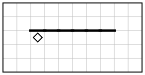 | 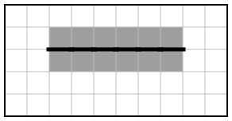 |

<details><summary>Решение</summary>

```
использовать Робот
алг
нач
  нц пока сверху стена
    закрасить
    вправо
  кц
  вверх
  влево
  нц пока снизу стена
    закрасить
    влево
  кц
кон
```

Решение проверено на 300 полях со случайными размерами стен.

</details>

#### Тренировка 15.1.2. Робот где-то под стеной

На бесконечном поле имеется горизонтальная стена. Длина стены неизвестна. Робот находится в одной из клеток, расположенных непосредственно под стеной. Где именно — неизвестно.

Требуется закрасить все клетки, расположенные непосредственно ниже стены.

При исполнении алгоритма Робот не должен разрушиться, выполнение алгоритма должно завершиться. Конечное расположение Робота может быть произвольным. Алгоритм должен решать задачу для любого допустимого расположения стен и любого расположения и размера проходов внутри стен.

| Пример поля | Нужно закрасить |
|---|---|
| 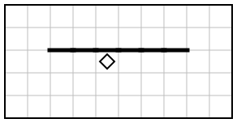 | 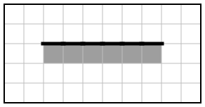 |

<details><summary>Решение</summary>

```
использовать Робот
алг
нач
  нц пока сверху стена
    влево
  кц
  вправо
  нц пока сверху стена
    закрасить
    вправо
  кц
кон
```

Решение проверено на 300 полях со случайными размерами стен.

</details>

#### Тренировка 15.1.3. Через одну

На бесконечном поле имеется горизонтальная стена. Длина стены неизвестна. Робот находится в клетке непосредственно под стеной у её левого конца.

Требуется закрасить клетки под стеной **через одну**, начиная с клетки, в которой находится Робот (первая клетка закрашена, вторая — нет, третья — закрашена и т. д.).

При исполнении алгоритма Робот не должен разрушиться, выполнение алгоритма должно завершиться. Конечное расположение Робота может быть произвольным. Алгоритм должен решать задачу для любого допустимого расположения стен и любого расположения и размера проходов внутри стен.

| Пример поля | Нужно закрасить |
|---|---|
|  | 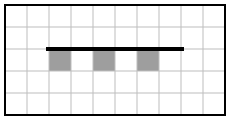 |

<details><summary>Решение</summary>

```
использовать Робот
алг
нач
  нц пока сверху стена
    закрасить
    вправо
    вправо
  кц
кон
```

Решение проверено на 300 полях со случайными размерами стен.

</details>

<!-- END:sub:15.1 -->

---

## Подтип 15.2. Углы и замкнутые области

### Как выглядит на экзамене

> На бесконечном поле имеется горизонтальная стена. Длина стены неизвестна. От правого конца стены вниз отходит вертикальная стена, также неизвестной длины. Робот находится в клетке, расположенной непосредственно **над** горизонтальной стеной у её левого конца.
>
> Требуется закрасить все клетки, расположенные непосредственно **ниже** горизонтальной стены и **левее** вертикальной стены.

| Было | Нужно закрасить |
|---|---|
| 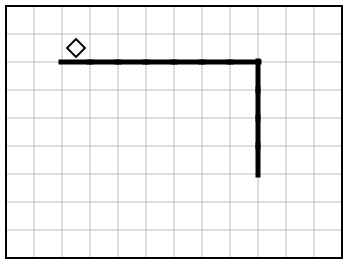 | 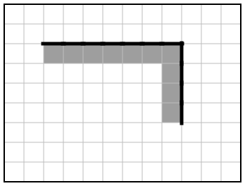 |

### Способ 1. Три участка

1. **Попасть под стену.** Робот над стеной, а красить нужно под ней. Обойти можно только слева: влево, вниз, вправо.
2. **Под горизонтальной стеной до угла.** Условие «пока справа свободно»: в углу справа стоит вертикальная стена, и цикл остановится **в угловой клетке**, не врезавшись.
3. **Вниз вдоль вертикальной стены.** Условие «пока справа стена»; угловая клетка закрасится здесь.

<!-- robot:r01 -->
```
использовать Робот
алг
нач
  | 1. обходим левый конец стены
  влево
  вниз
  вправо
  | 2. под горизонтальной стеной до угла
  нц пока справа свободно
    закрасить
    вправо
  кц
  | 3. вдоль вертикальной стены вниз
  нц пока справа стена
    закрасить
    вниз
  кц
кон
```

### Способ 2. Составное условие

Второй участок можно описать точнее: «пока **сверху стена и справа свободно**». Так видно, что Робот идёт именно под стеной и именно до угла:

<!-- robot:r01 -->
```
использовать Робот
алг
нач
  влево
  вниз
  вправо
  нц пока сверху стена и справа свободно
    закрасить
    вправо
  кц
  нц пока справа стена
    закрасить
    вниз
  кц
кон
```

### Комнаты

Для прямоугольной комнаты, огороженной стенами, путь по периметру — это 4 участка: «пока справа свободно → вправо», «пока снизу свободно → вниз», «пока слева свободно → влево», «пока сверху свободно → вверх». Каждый цикл останавливается в углу, а следующий начинается из него.

### Проверка за 30 секунд

Проверьте два крайних случая: горизонтальная стена длиной 1 (тогда второй участок не выполнится ни разу, и угол закрасит третий) и вертикальная стена длиной 1.

### Тренировка

<!-- BEGIN:sub:15.2 -->

#### Тренировка 15.2.1. Внутренний угол

На бесконечном поле имеется вертикальная стена. От её нижнего конца **влево** отходит горизонтальная стена. Длины стен неизвестны. Робот находится в клетке, расположенной непосредственно левее вертикальной стены у её верхнего конца.

Требуется закрасить все клетки, расположенные непосредственно левее вертикальной стены и выше горизонтальной стены.

При исполнении алгоритма Робот не должен разрушиться, выполнение алгоритма должно завершиться. Конечное расположение Робота может быть произвольным. Алгоритм должен решать задачу для любого допустимого расположения стен и любого расположения и размера проходов внутри стен.

| Пример поля | Нужно закрасить |
|---|---|
| 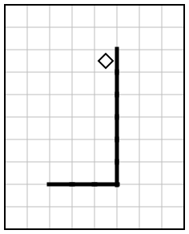 | 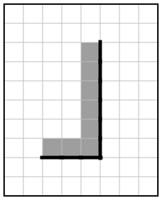 |

<details><summary>Решение</summary>

```
использовать Робот
алг
нач
  нц пока снизу свободно
    закрасить
    вниз
  кц
  нц пока снизу стена
    закрасить
    влево
  кц
кон
```

Решение проверено на 300 полях со случайными размерами стен.

</details>

#### Тренировка 15.2.2. Стена буквой П

На бесконечном поле имеются горизонтальная стена и две вертикальные стены, отходящие вниз от её концов (получается фигура в виде буквы П). Длины всех стен неизвестны, вертикальные стены могут быть разной длины. Робот находится **внутри** фигуры в клетке под левым концом горизонтальной стены.

Требуется закрасить все клетки внутри фигуры, примыкающие к стенам.

При исполнении алгоритма Робот не должен разрушиться, выполнение алгоритма должно завершиться. Конечное расположение Робота может быть произвольным. Алгоритм должен решать задачу для любого допустимого расположения стен и любого расположения и размера проходов внутри стен.

| Пример поля | Нужно закрасить |
|---|---|
| 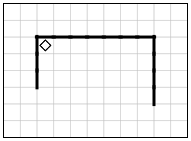 | 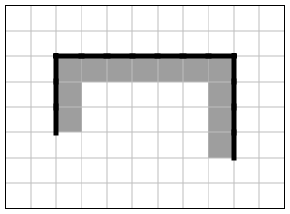 |

<details><summary>Решение</summary>

```
использовать Робот
алг
нач
  нц пока слева стена
    закрасить
    вниз
  кц
  нц пока сверху свободно
    вверх
  кц
  нц пока справа свободно
    закрасить
    вправо
  кц
  нц пока справа стена
    закрасить
    вниз
  кц
кон
```

Решение проверено на 300 полях со случайными размерами стен.

</details>

#### Тренировка 15.2.3. Периметр комнаты

Робот находится в левом верхнем углу прямоугольной комнаты, огороженной со всех сторон стенами. Размеры комнаты неизвестны (каждый размер — не меньше двух клеток).

Требуется закрасить все клетки комнаты, примыкающие к стенам (клетки по периметру комнаты).

При исполнении алгоритма Робот не должен разрушиться, выполнение алгоритма должно завершиться. Конечное расположение Робота может быть произвольным. Алгоритм должен решать задачу для любого допустимого расположения стен и любого расположения и размера проходов внутри стен.

| Пример поля | Нужно закрасить |
|---|---|
| 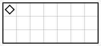 | 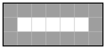 |

<details><summary>Решение</summary>

```
использовать Робот
алг
нач
  нц пока справа свободно
    закрасить
    вправо
  кц
  нц пока снизу свободно
    закрасить
    вниз
  кц
  нц пока слева свободно
    закрасить
    влево
  кц
  нц пока сверху свободно
    закрасить
    вверх
  кц
кон
```

Решение проверено на 300 полях со случайными размерами стен.

</details>

<!-- END:sub:15.2 -->

---

## Подтип 15.3. Проходы и условия внутри цикла

### Главный приём: `если` внутри `нц пока`

Когда красить нужно **не все** клетки участка, цикл остаётся тем же, а решение «красить или нет» принимает `если`:

```
нц пока слева стена          | идём, пока не кончится коридор
  если справа свободно то    | красим только напротив проходов
    закрасить
  все
  вниз
кц
```

### Стена с проходами: два вложенных цикла

Если в стене **несколько** проходов, «пока сверху стена» остановится на первом проходе. Как отличить проход от конца стены? Сделать ещё шаг: если сверху снова стена — это был проход, если нет — стена кончилась (по условию два прохода рядом не стоят).

<!-- robot:r11 -->
```
использовать Робот
алг
нач
  нц пока сверху стена
    нц пока сверху стена
      закрасить
      вправо
    кц
    вправо        | шаг через проход (или за конец стены)
  кц
кон
```

### Проверка за 30 секунд

Проверьте поле, где проход стоит **сразу после первой клетки** стены и **перед последней**. Именно там чаще всего ломаются алгоритмы с проходами.

### Тренировка

<!-- BEGIN:sub:15.3 -->

#### Тренировка 15.3.1. Горизонтальный коридор

На бесконечном поле имеются две горизонтальные стены одинаковой длины, расположенные одна под другой так, что между ними образуется горизонтальный коридор шириной в одну клетку. Длина стен неизвестна. Робот находится в клетке слева от входа в коридор (клетка, правее которой начинается коридор).

Требуется закрасить все клетки коридора.

При исполнении алгоритма Робот не должен разрушиться, выполнение алгоритма должно завершиться. Конечное расположение Робота может быть произвольным. Алгоритм должен решать задачу для любого допустимого расположения стен и любого расположения и размера проходов внутри стен.

| Пример поля | Нужно закрасить |
|---|---|
| 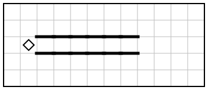 | 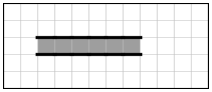 |

<details><summary>Решение</summary>

```
использовать Робот
алг
нач
  вправо
  нц пока сверху стена
    закрасить
    вправо
  кц
кон
```

Решение проверено на 300 полях со случайными размерами стен.

</details>

#### Тренировка 15.3.2. Стена с проходом (горизонтальная)

На бесконечном поле имеется горизонтальная стена, в которой есть проход шириной в одну клетку. Длина стены и место прохода неизвестны; известно, что проход не находится у края стены. Робот находится в клетке непосредственно **под** стеной у её левого конца.

Требуется закрасить все клетки, расположенные непосредственно **под** стеной **левее** прохода, и все клетки, расположенные непосредственно **над** стеной **правее** прохода. Клетку прохода закрашивать не нужно.

При исполнении алгоритма Робот не должен разрушиться, выполнение алгоритма должно завершиться. Конечное расположение Робота может быть произвольным. Алгоритм должен решать задачу для любого допустимого расположения стен и любого расположения и размера проходов внутри стен.

| Пример поля | Нужно закрасить |
|---|---|
|  | 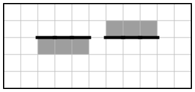 |

<details><summary>Решение</summary>

```
использовать Робот
алг
нач
  нц пока сверху стена
    закрасить
    вправо
  кц
  вверх
  вправо
  нц пока снизу стена
    закрасить
    вправо
  кц
кон
```

Решение проверено на 300 полях со случайными размерами стен.

</details>

#### Тренировка 15.3.3. Стена с несколькими проходами

На бесконечном поле имеется горизонтальная стена, в которой есть несколько проходов шириной в одну клетку. Длина стены, число и расположение проходов неизвестны. Известно, что никакие два прохода не расположены рядом и проходов нет у концов стены. Робот находится в клетке непосредственно под стеной у её левого конца.

Требуется закрасить все клетки, расположенные непосредственно под стеной (под проходами клетки закрашивать не нужно).

При исполнении алгоритма Робот не должен разрушиться, выполнение алгоритма должно завершиться. Конечное расположение Робота может быть произвольным. Алгоритм должен решать задачу для любого допустимого расположения стен и любого расположения и размера проходов внутри стен.

| Пример поля | Нужно закрасить |
|---|---|
| 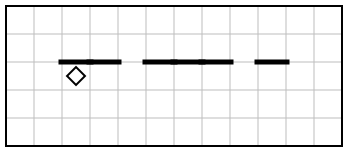 | 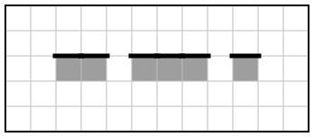 |

<details><summary>Решение</summary>

```
использовать Робот
алг
нач
  нц пока сверху стена
    нц пока сверху стена
      закрасить
      вправо
    кц
    вправо
  кц
кон
```

Решение проверено на 300 полях со случайными размерами стен.

</details>

#### Тренировка 15.3.4. Коридор с дверями

На бесконечном поле имеется вертикальный коридор шириной в одну клетку. Левая стена коридора сплошная, в правой стене есть несколько проходов («дверей») шириной в одну клетку. Длина коридора, число и расположение дверей неизвестны; известно, что у концов коридора дверей нет. Робот находится в верхней клетке коридора.

Требуется закрасить все клетки коридора, расположенные напротив дверей (у которых справа нет стены).

При исполнении алгоритма Робот не должен разрушиться, выполнение алгоритма должно завершиться. Конечное расположение Робота может быть произвольным. Алгоритм должен решать задачу для любого допустимого расположения стен и любого расположения и размера проходов внутри стен.

| Пример поля | Нужно закрасить |
|---|---|
| 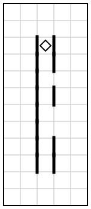 | 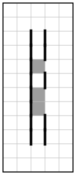 |

<details><summary>Решение</summary>

```
использовать Робот
алг
нач
  нц пока слева стена
    если справа свободно то
      закрасить
    все
    вниз
  кц
кон
```

Решение проверено на 300 полях со случайными размерами стен.

</details>

<!-- END:sub:15.3 -->

---

## Подтип 15.4. Лестницы

*Встречаются в открытом банке (например, № 37738 в каталоге «Решу ОГЭ») и в тренировочных работах Статграда 2026 года, в том числе со ступенями высотой две клетки.*

### Как выглядит

> На бесконечном поле имеется лестница, которая поднимается слева направо. Высота каждой ступени — 1 клетка, ширина — 1 клетка. Количество ступеней неизвестно. Робот находится в клетке над самой нижней ступенью. Требуется закрасить все клетки, расположенные непосредственно над ступенями лестницы.

| Было | Нужно закрасить |
|---|---|
| 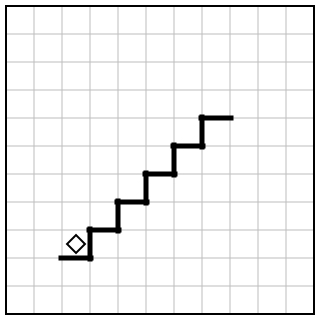 | 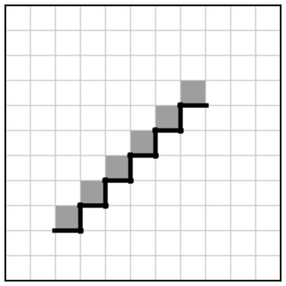 |

### Как устроена лестница

Над каждой ступенью: **снизу стена** (сама ступень). Если впереди следующая ступень, **справа стена** (её подъём). Над последней ступенью справа свободно, а после шага вправо снизу уже нет стены.

### Способ 1. «Если впереди подъём — сначала вверх»

<!-- robot:r22 -->
```
использовать Робот
алг
нач
  нц пока снизу стена
    закрасить
    если справа стена то
      вверх
    все
    вправо
  кц
кон
```

### Способ 2. «Подниматься, пока справа стена» (для ступеней любой высоты)

Если ступени высотой 2 клетки или разной высоты, `если` поднимет Робота только на одну клетку, и он врежется. Цикл поднимается столько, сколько нужно:

<!-- robot:r22 -->
```
использовать Робот
алг
нач
  нц пока снизу стена
    закрасить
    нц пока справа стена
      вверх
    кц
    вправо
  кц
кон
```

Этот алгоритм решает и лестницу со ступенями высотой 1, и со ступенями высотой 2, и со ступенями разной высоты. Поэтому, если сомневаетесь, какой высоты ступени, пишите именно так.

### Лестница вверх, потом вниз

Спуск — отдельный участок со своим условием: после шага вправо **под Роботом пусто**, значит, следующая ступень ниже. Решение — в тренировке 15.4.3.

### Проверка за 30 секунд

Проверьте лестницу из **одной** ступени: Робот должен закрасить одну клетку и остановиться, не врезавшись.

### Тренировка

<!-- BEGIN:sub:15.4 -->

#### Тренировка 15.4.1. Лестница вверх

На бесконечном поле имеется лестница, которая поднимается слева направо. Высота каждой ступени — 1 клетка, ширина — 1 клетка. Количество ступеней неизвестно. Робот находится в клетке над самой нижней ступенью.

Требуется закрасить все клетки, расположенные непосредственно над ступенями лестницы.

При исполнении алгоритма Робот не должен разрушиться, выполнение алгоритма должно завершиться. Конечное расположение Робота может быть произвольным. Алгоритм должен решать задачу для любого допустимого расположения стен и любого расположения и размера проходов внутри стен.

| Пример поля | Нужно закрасить |
|---|---|
|  |  |

<details><summary>Решение</summary>

```
использовать Робот
алг
нач
  нц пока снизу стена
    закрасить
    если справа стена то
      вверх
    все
    вправо
  кц
кон
```

Решение проверено на 300 полях со случайными размерами стен.

</details>

#### Тренировка 15.4.2. Ступени разной высоты

На бесконечном поле имеется лестница, которая поднимается слева направо. Ширина каждой ступени — 1 клетка, а высота ступеней разная (каждая ступень — от 1 до 3 клеток). Количество ступеней неизвестно. Робот находится в клетке над самой нижней ступенью.

Требуется закрасить все клетки, расположенные непосредственно над ступенями лестницы.

При исполнении алгоритма Робот не должен разрушиться, выполнение алгоритма должно завершиться. Конечное расположение Робота может быть произвольным. Алгоритм должен решать задачу для любого допустимого расположения стен и любого расположения и размера проходов внутри стен.

| Пример поля | Нужно закрасить |
|---|---|
| 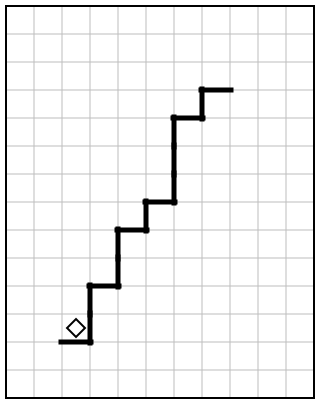 | 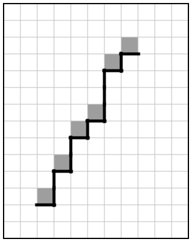 |

<details><summary>Решение</summary>

```
использовать Робот
алг
нач
  нц пока снизу стена
    закрасить
    нц пока справа стена
      вверх
    кц
    вправо
  кц
кон
```

Решение проверено на 300 полях со случайными размерами стен.

</details>

#### Тренировка 15.4.3. Лестница вверх и вниз

На бесконечном поле имеется лестница. Сначала она поднимается слева направо, затем опускается тоже слева направо; верхняя площадка имеет ширину 1 клетку. Правее спуска лестница переходит в горизонтальную стену (пол). Высота каждой ступени — 1 клетка, ширина — 1 клетка. Количество ступеней подъёма и спуска неизвестно. Робот находится в клетке над самой нижней ступенью подъёма.

Требуется закрасить все клетки, расположенные непосредственно над ступенями подъёма, над верхней площадкой и над ступенями спуска. Клетки над полом закрашивать не нужно.

При исполнении алгоритма Робот не должен разрушиться, выполнение алгоритма должно завершиться. Конечное расположение Робота может быть произвольным. Алгоритм должен решать задачу для любого допустимого расположения стен и любого расположения и размера проходов внутри стен.

| Пример поля | Нужно закрасить |
|---|---|
| 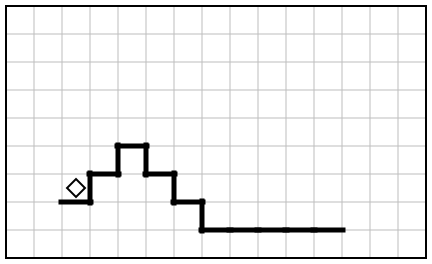 | 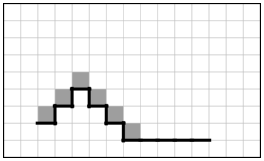 |

<details><summary>Решение</summary>

```
использовать Робот
алг
нач
  | подъём: пока справа стена, впереди ещё ступень вверх
  нц пока справа стена
    закрасить
    вверх
    вправо
  кц
  | верхняя площадка
  закрасить
  | спуск: после шага вправо под Роботом пусто, значит, ступень ниже
  вправо
  нц пока снизу свободно
    вниз
    закрасить
    вправо
  кц
кон
```

Решение проверено на 300 полях со случайными размерами стен.

</details>

<!-- END:sub:15.4 -->

---

## Как проверять в КуМире

1. **Робот → Редактировать обстановку**: нарисуйте поле из условия (стены — щелчком по границе клетки, Робота — перетаскиванием).
2. Запустите алгоритм и сравните закрашенные клетки с рисунком «нужно закрасить».
3. **Измените размеры**: удлините стену, укоротите её до 1 клетки, переставьте проход. Запустите ещё раз.
4. Если на экзамене среды «Робот» нет, алгоритм записывают в текстовый файл `.txt` по тем же правилам.

## Ловушки

> [!WARNING]
> - **Шаг в стену.** Перед каждым ходом спросите себя: «А там точно свободно на любом поле?»
> - **`нц 5 раз`** вместо «пока» — работает только на поле с рисунка.
> - **Угловая клетка** не закрашена или закрашена лишняя клетка за концом стены.
> - **Бесконечный цикл**: условие никогда не становится ложным (например, `нц пока справа свободно` на бесконечном поле без стены справа).
> - **Синтаксис**: забыли `кц` или `все`; написали `пока справа свободно` без `нц`.

---

[← Задание 14](14-spreadsheets.md) · [К оглавлению](../README.md) · [Задание 16 →](16-programming.md)
