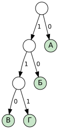

# Кодирование и декодирование

> Нужна для задания: [2 — расшифровка сообщения](../tasks/02-decoding.md).

## Основные понятия

**Кодирование** — замена каждого символа сообщения его **кодом** (цепочкой из символов другого алфавита, например из `0` и `1`).
**Декодирование** (расшифровка) — обратный процесс: по цепочке восстановить исходное сообщение.

| Вид кода | Что это | Пример |
|---|---|---|
| **Равномерный** | У всех символов коды одинаковой длины | А = 00, Б = 01, В = 10, Г = 11 |
| **Неравномерный** | Длины кодов разные | А = 0, Б = 10, В = 110, Г = 111 |

Равномерный код всегда декодируется однозначно: режем цепочку на куски одинаковой длины.
С неравномерным кодом сложнее: одну цепочку иногда можно прочитать **несколькими способами**.

## Условие Фано (префиксный код)

> **Условие Фано:** ни один код не является **началом** (префиксом) другого кода.

Если условие Фано выполнено, цепочка расшифровывается **однозначно**, и читать её можно просто слева направо.

Префиксный код удобно рисовать деревом: 0 — шаг влево, 1 — шаг вправо, буквы стоят только в **листьях**.



Код А = 0, Б = 10, В = 110, Г = 111. Буквы только в листьях, значит, ни один код не является началом другого.

Пример: `0110100111` → 0 | 110 | 10 | 0 | 111 → **АВБАГ**.

## Если условие Фано не выполнено

Тогда приходится **перебирать** варианты. Пример таблицы из задания ОГЭ:

| А | Д | К | Н | О | С |
|---|---|---|---|---|---|
| 01 | 100 | 101 | 10 | 111 | 000 |

Здесь Н = `10` — начало кодов Д = `100` и К = `101`. Встретив `10…`, нужно проверить все варианты.

### Метод перебора

Идём по цепочке слева направо. В каждой точке смотрим, **какие коды могут начинаться здесь**, и ветвимся.

Цепочка `1011110`:

```
1011110
├─ К(101) → 1110
│    └─ О(111) → 0      ✗ (кода «0» нет — тупик)
└─ Н(10) → 11110
     └─ О(111) → 10
          └─ Н(10) → ∅  ✓  НОН
```

Расшифровка одна: **НОН**.

> [!TIP]
> Иногда удобнее **идти с конца**: смотрим, какими кодами может заканчиваться цепочка. В таблице выше на `0` оканчиваются только Н (`10`), Д (`100`) и С (`000`). Если цепочка оканчивается на `1`, последняя буква — А, К или О.

## Типичные формулировки задания 2

1. **«Даны три цепочки. Найдите ту, которая имеет только одну расшифровку»** — перебираем каждую, пока не найдём ту, у которой ровно один вариант. Как только у цепочки нашлось два варианта, она точно не подходит.
2. **«Расшифруйте сообщение, если буквы в нём не повторяются»** — дополнительное условие отсекает лишние варианты.
3. **«Сколько букв в сообщении»** — сначала расшифровываем, потом считаем.

## Как не запутаться

1. Выпишите таблицу кодов отдельно и отметьте, какие коды — начала других.
2. Ставьте вертикальные черты прямо в цепочке: `10|111|10`.
3. Каждый найденный вариант **закодируйте обратно** и сравните с исходной цепочкой. Это лучшая проверка.

## Частые ошибки

> [!WARNING]
> - Нашли одну расшифровку и не проверили, нет ли второй.
> - Пропустили символ при переписывании длинной цепочки. Переписывайте группами по 3–4 символа.
> - В задачах со значками (•, –, ~, *) перепутали похожие символы.

---

[← К оглавлению](../README.md) · [Задание 2 →](../tasks/02-decoding.md)
