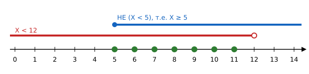

# Алгебра логики

> Нужна для заданий: [3 — значение логического выражения](../tasks/03-logic.md), [6 — условный оператор](../tasks/06-program-if.md), [8 — поисковые запросы](../tasks/08-search-queries.md), [15](../tasks/15-robot.md) и [16](../tasks/16-programming.md).

## Высказывания

**Высказывание** — утверждение, о котором можно сказать, истинно оно или ложно.
«X > 5» при X = 7 — **истинно** (1), при X = 3 — **ложно** (0).

## Три главные операции

| Операция | Обозначения | Истинна, когда… |
|---|---|---|
| **НЕ** (отрицание, инверсия) | ¬A, `not`, `не` | A ложно |
| **И** (конъюнкция, логическое умножение) | A ∧ B, A & B, `and`, `и` | **оба** истинны |
| **ИЛИ** (дизъюнкция, логическое сложение) | A ∨ B, A \| B, `or`, `или` | **хотя бы одно** истинно |

### Таблица истинности

| A | B | НЕ A | A И B | A ИЛИ B |
|---|---|---|---|---|
| 0 | 0 | 1 | 0 | 0 |
| 0 | 1 | 1 | 0 | 1 |
| 1 | 0 | 0 | 0 | 1 |
| 1 | 1 | 0 | 1 | 1 |

Запомнить: **И** похоже на умножение (1·1 = 1, остальное 0), **ИЛИ** — на сложение (0 только при 0 + 0).

## Порядок действий

1. скобки;
2. **НЕ**;
3. **И**;
4. **ИЛИ**.

`НЕ A ИЛИ B И C` читается как `(НЕ A) ИЛИ (B И C)`.

## Отрицание сравнений

| Выражение | НЕ (выражение) |
|---|---|
| X < 5 | X ≥ 5 |
| X > 5 | X ≤ 5 |
| X ≤ 5 | X > 5 |
| X ≥ 5 | X < 5 |
| X = 5 | X ≠ 5 |
| X чётное | X нечётное |

> [!WARNING]
> Отрицание «X < 5» — это «X **≥** 5», а не «X > 5». Граничное число 5 попадает в отрицание!

## Законы де Моргана

$$\neg(A \land B) = \neg A \lor \neg B \qquad \neg(A \lor B) = \neg A \land \neg B$$

Словами: «неверно, что *оба*» = «хотя бы одно неверно»; «неверно, что *хотя бы одно*» = «оба неверны».

Это главный приём для формулировки «найдите X, для которого высказывание **ложно**»: ложность выражения = истинность его отрицания.

## Решение задания 3 через числовую прямую

> Найдите наименьшее натуральное X, для которого **истинно**: НЕ (X < 5) И (X < 12).

НЕ (X < 5) → X ≥ 5. Нужно, чтобы одновременно X ≥ 5 и X < 12:



Подходят 5, 6, …, 11. Наименьшее — **5** (наибольшее было бы 11).

### Если просят «ложно»

> Наибольшее X, для которого **ложно**: (X > 3) ИЛИ (X чётное).

ИЛИ ложно, только когда **обе** части ложны: X ≤ 3 **и** X нечётное → X ∈ {…, 1, 3}. Наибольшее — **3**.

### Алгоритм

1. Раскройте НЕ: замените каждое «НЕ (…)» на противоположное сравнение.
2. Если просят «ложно», возьмите отрицание всего выражения (де Морган: И ↔ ИЛИ).
3. Нарисуйте промежутки на числовой прямой.
4. Найдите крайнее подходящее число (учтите чётность, если она есть).
5. **Проверка:** подставьте ответ и соседнее число в исходное выражение.

## Задания со словами (именами, городами)

> Для какого имени истинно: НЕ (первая буква гласная) И (последняя буква согласная)?
> 1) Анна 2) Борис 3) Ирина 4) Вера

Перепишем: первая буква **согласная** И последняя **согласная**.

| Имя | 1-я согласная? | Последняя согласная? | И |
|---|---|---|---|
| Анна | 0 | 0 | 0 |
| Борис | 1 | 1 | **1** |
| Ирина | 0 | 0 | 0 |
| Вера | 1 | 0 | 0 |

Ответ: **Борис**.

> [!NOTE]
> Гласные русского алфавита: **А, Е, Ё, И, О, У, Ы, Э, Ю, Я**. Буквы Й, Ь, Ъ — не гласные.

## Логика в программах

В Python:

```python
x = 7
print(not (x < 5) and x < 12)   # True
print(x > 3 or x % 2 == 0)      # True
```

В КуМире (Робот): `если справа свободно и не снизу свободно то …`

---

[← К оглавлению](../README.md) · [Задание 3 →](../tasks/03-logic.md)
