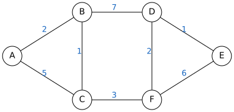
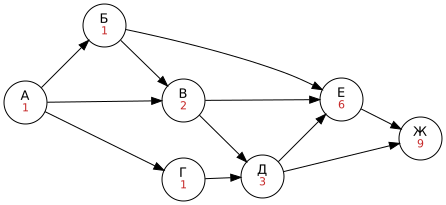

# Графы, таблицы, схемы

> Нужна для заданий: [4 — кратчайший путь](../tasks/04-shortest-path.md), [9 — количество путей](../tasks/09-graph-paths.md), [12 — дерево каталогов](../tasks/12-file-masks.md).

## Что такое граф

**Граф** — набор **вершин** (точек) и **рёбер** (линий между ними). Вершины — города, рёбра — дороги.

| Вид графа | Особенность |
|---|---|
| **Неориентированный** | По ребру можно идти в обе стороны |
| **Ориентированный** | Рёбра — стрелки (дуги): идти можно только по стрелке |
| **Взвешенный** | У каждого ребра есть число (вес): длина, стоимость, время |
| **Дерево** | Связный граф без циклов; между любыми двумя вершинами ровно один путь |

## Весовая таблица (матрица смежности)

Взвешенный граф часто задают **таблицей**: на пересечении строки и столбца стоит длина дороги, пустая клетка — дороги нет.

|   | A | B | C | D | E | F |
|---|---|---|---|---|---|---|
| **A** |  | 2 | 5 |  |  |  |
| **B** | 2 |  | 1 | 7 |  |  |
| **C** | 5 | 1 |  |  |  | 3 |
| **D** |  | 7 |  |  | 1 | 2 |
| **E** |  |  |  | 1 |  | 6 |
| **F** |  |  | 3 | 2 | 6 |  |

Таблица **симметрична** относительно диагонали: дорога A–B — это и строка A, и строка B.

> [!TIP]
> Первым делом **нарисуйте граф по таблице**. Ставьте вершины кругом, проводите рёбра, подписывайте веса. С рисунком ошибиться намного сложнее.

## Кратчайший путь (задание 4)

### Способ 1 — перебор путей (когда вершин 5–6)

Выписываем все разумные пути из A в E и считаем длину:

| Путь | Длина |
|---|---|
| A → B → D → E | 2 + 7 + 1 = 10 |
| A → C → F → E | 5 + 3 + 6 = 14 |
| A → B → C → F → E | 2 + 1 + 3 + 6 = 12 |
| A → B → C → F → D → E | 2 + 1 + 3 + 2 + 1 = **9** |
| A → C → F → D → E | 5 + 3 + 2 + 1 = 11 |

Кратчайший — **9**. Обратите внимание: самый короткий путь здесь проходит через **все** вершины. Путь с меньшим числом рёбер не обязательно короче!

### Способ 2 — метод пометок (алгоритм Дейкстры, упрощённо)

1. Пометка старта = 0, остальных = ∞.
2. Берём **непосещённую вершину с наименьшей пометкой** и смотрим её соседей: если «пометка вершины + вес ребра» меньше пометки соседа, обновляем её.
3. Вершину отмечаем как посещённую. Повторяем, пока не дойдём до цели.

| Шаг | A | B | C | D | E | F | Выбрана |
|---|---|---|---|---|---|---|---|
| 0 | **0** | ∞ | ∞ | ∞ | ∞ | ∞ | A |
| 1 | ✓ | **2** | 5 | ∞ | ∞ | ∞ | B |
| 2 | ✓ | ✓ | **3** | 9 | ∞ | ∞ | C |
| 3 | ✓ | ✓ | ✓ | 9 | ∞ | **6** | F |
| 4 | ✓ | ✓ | ✓ | **8** | 12 | ✓ | D |
| 5 | ✓ | ✓ | ✓ | ✓ | **9** | ✓ | E |

Ответ: **9**.

### Варианты вопроса

- **«…проходящего через пункт C»**: кратчайший путь A → C плюс кратчайший путь C → E.
- **«…не проходящего через пункт B»**: мысленно удаляем вершину B со всеми её рёбрами и ищем заново.

## Количество путей в ориентированном графе (задание 9)

**Главная идея:** число путей в вершину = **сумма** чисел путей во все вершины, **из которых стрелки ведут в неё**.

1. Стартовой вершине пишем 1.
2. Идём по вершинам **в таком порядке, чтобы все входящие в вершину уже были посчитаны**.
3. Для каждой вершины складываем числа у вершин, из которых в неё входят стрелки.

| Вершина | Входящие стрелки из | Число путей |
|---|---|---|
| А | — | 1 |
| Б | А | 1 |
| В | А, Б | 1 + 1 = 2 |
| Г | А | 1 |
| Д | В, Г | 2 + 1 = 3 |
| Е | Б, В, Д | 1 + 2 + 3 = 6 |
| Ж | Д, Е | 3 + 6 = **9** |

### «Проходящих через вершину X»

Число путей = (пути из старта в X) × (пути из X в финиш).

Вторую часть считают так же, только теперь X — стартовая вершина с числом 1. Например, в графе выше путей из А в Ж через Д: (А → Д) = 3, (Д → Ж) = 2 (напрямую и через Е), всего 3 · 2 = **6**.

### «Не проходящих через вершину X»

Считаем как обычно, но вершине X ставим **0**: тогда пути через неё не дойдут до финиша.

> [!WARNING]
> - Считайте вершину, только когда **все** входящие в неё уже посчитаны.
> - Не перепутайте направление стрелки: в сумму идут вершины, **из которых** стрелка входит.
> - Внимательно смотрите на стрелки, которые идут «через одну» и «назад» по рисунку.

## Деревья

**Дерево** — граф без циклов. У дерева есть **корень**; вершины без потомков называют **листьями**. Дерево каталогов на компьютере тоже дерево (см. [файловую систему](10-files.md)).

---

[← К оглавлению](../README.md) · [Задание 4 →](../tasks/04-shortest-path.md) · [Задание 9 →](../tasks/09-graph-paths.md)
