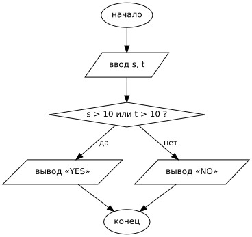
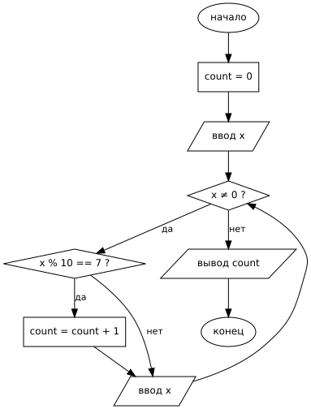

# Алгоритмы и исполнители

> Нужна для заданий: [5 — исполнитель](../tasks/05-executor.md), [6 — программа с условием](../tasks/06-program-if.md), [15 — Робот](../tasks/15-robot.md), [16 — программа](../tasks/16-programming.md).

## Алгоритм

**Алгоритм** — понятная и точная последовательность действий, приводящая к результату.

Свойства алгоритма:

| Свойство | Смысл |
|---|---|
| Дискретность | Состоит из отдельных шагов |
| Понятность | Каждая команда есть в системе команд исполнителя |
| Определённость (детерминированность) | После каждого шага ясно, что делать дальше |
| Результативность (конечность) | Завершается за конечное число шагов |
| Массовость | Решает целый класс задач, а не одну |

**Исполнитель** — тот, кто выполняет алгоритм (человек, Робот, компьютер). **СКИ** (система команд исполнителя) — все команды, которые он понимает.

## Базовые конструкции

| Конструкция | Python | КуМир |
|---|---|---|
| Следование | команды друг за другом | команды друг за другом |
| Ветвление | `if … else …` | `если … то … иначе … все` |
| Цикл с условием | `while условие:` | `нц пока условие … кц` |
| Цикл со счётчиком | `for i in range(n):` | `нц N раз … кц` |

Блок-схемы ветвления и цикла:

| Ветвление | Цикл с условием |
|---|---|
|  |  |

## Формальные исполнители (задание 5)

У исполнителя обычно две команды с номерами, например:

1. **прибавь 3**
2. **умножь на b**

Программа — строка из номеров команд: `12121`.

### Тип 1: известна программа, найти параметр b

> Программа 11211 переводит число 2 в число 70. Найдите b.

Проходим программу, держа b буквой:

| Шаг | Команда | Значение |
|---|---|---|
| старт | — | 2 |
| 1 | прибавь 3 | 5 |
| 1 | прибавь 3 | 8 |
| 2 | умножь на b | 8b |
| 1 | прибавь 3 | 8b + 3 |
| 1 | прибавь 3 | 8b + 6 |

$8b + 6 = 70 \Rightarrow 8b = 64 \Rightarrow$ **b = 8**.

Проверка: 2 → 5 → 8 → 64 → 67 → 70 ✓.

> [!TIP]
> Получилось дробное или отрицательное b? Ищите ошибку в вычислениях: на ОГЭ ответ всегда натуральный. И всегда делайте проверку, прогнав программу с найденным b.

### Тип 2: составить программу

> Команды: 1 — прибавь 2, 2 — умножь на 3. Получите из 1 число 33, не более 5 команд.

Удобно идти **от конца к началу**, обращая команды (вычесть 2 / разделить на 3):

- 33 делится на 3 → 33 ← 11 (команда 2)
- 11 на 3 не делится → 11 ← 9 (команда 1)
- 9 → 9 ← 3 (команда 2)
- 3 → 3 ← 1 (команда 2)

Читаем с начала: 1 → 3 → 9 → 11 → 33: **2212**. Четыре команды, укладываемся.

> [!WARNING]
> При обратном ходе делить можно только нацело. Если вариантов несколько (и делится, и вычитается), пробуйте оба.

## Трассировка программы (задание 6)

**Трассировка** — пошаговое выполнение программы «на бумаге» с записью значений переменных в таблицу.

```python
s = int(input())
t = int(input())
if s > 10 or t > 10:
    print("YES")
else:
    print("NO")
```

| (s, t) | s > 10 | t > 10 | ИЛИ | Вывод |
|---|---|---|---|---|
| (1, 2) | 0 | 0 | 0 | NO |
| (11, 2) | 1 | 0 | 1 | YES |
| (1, 12) | 0 | 1 | 1 | YES |
| (10, 10) | 0 | 0 | 0 | NO |

Для таких заданий не нужно разбираться в языке целиком: достаточно понять **условие в `if`** и проверить каждую пару.

### Задание с параметром A

> `if s > A or t > 7`. Пары: (1, 8), (5, 3), (9, 6), (12, 2), (7, 7). При каком наименьшем целом A программа напечатает «NO» 3 раза?

«NO» печатается, когда **оба** условия ложны: s ≤ A **и** t ≤ 7.

1. Пара (1, 8): t = 8 > 7, всегда «YES».
2. Остальные (5, 3), (9, 6), (12, 2), (7, 7) дают «NO», если s ≤ A.
3. Значения s у этих пар: 5, 7, 9, 12. Чтобы «NO» было ровно 3: A ≥ 9 (s = 5, 7, 9 дают «NO») и A < 12.
4. Наименьшее A = **9**.

---

[← К оглавлению](../README.md) · [Задание 5 →](../tasks/05-executor.md) · [Задание 6 →](../tasks/06-program-if.md)
