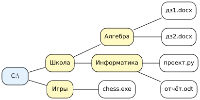

# Файловая система и поиск файлов

> Нужна для заданий: [11 — поиск информации в файлах](../tasks/11-search-in-files.md), [12 — подсчёт файлов](../tasks/12-file-masks.md).

## Файлы и каталоги

**Файл** — именованная область данных на диске. **Каталог** (папка) — «контейнер» для файлов и других каталогов.

Имя файла = **имя** + **точка** + **расширение**: `отчёт.odt`, `photo-01.jpg`. Расширение говорит о типе файла.

| Тип | Расширения |
|---|---|
| Текст | `.txt`, `.doc`, `.docx`, `.odt`, `.rtf`, `.pdf` |
| Веб-страница | `.htm`, `.html` |
| Изображение | `.jpg`, `.jpeg`, `.png`, `.gif`, `.bmp` |
| Звук | `.mp3`, `.wav`, `.ogg` |
| Видео | `.mp4`, `.avi`, `.mkv` |
| Таблица | `.xls`, `.xlsx`, `.ods`, `.csv` |
| Презентация | `.ppt`, `.pptx`, `.odp` |
| Программа на Python | `.py` |
| Исполняемый файл | `.exe` (Windows) |
| Архив | `.zip`, `.rar`, `.7z` |

## Дерево каталогов и путь



**Полный (абсолютный) путь** — от корня до файла: `C:\Школа\Информатика\проект.py`.
В Linux корень обозначается `/`, разделитель тоже `/`: `/home/user/Школа/Информатика/проект.py`.

## Маски файлов

| Символ | Значит | Пример | Подходит |
|---|---|---|---|
| `*` | любое количество любых символов (в том числе ноль) | `*.txt` | `a.txt`, `отчёт.txt`, `.txt` |
| `?` | ровно один любой символ | `photo-?.jpg` | `photo-1.jpg`, но не `photo-12.jpg` |

Примеры:

- `*.jpg` — все файлы с расширением jpg;
- `article-*.*` — все файлы, имя которых начинается с `article-`;
- `??.*` — файлы, имя которых (без расширения) из двух символов.

## Задание 12: посчитать файлы

На экзамене вам дают каталог с файлами (часто литературные тексты, картинки и т. д.). Типичные вопросы:

- сколько файлов с расширением `.txt` в каталоге и всех его подкаталогах;
- сколько файлов объёмом больше N Кбайт;
- какой общий объём файлов определённого типа.

### Способ 1 — Проводник Windows

1. Откройте нужный каталог.
2. В строке поиска (справа вверху) введите маску: `*.txt`. Поиск идёт **по всем подкаталогам**.
3. Внизу окна появится **«Элементов: N»**. Это и есть ответ.
4. Для размера: в поиске можно набрать `*.jpg размер:>20КБ` (англ. `size:>20KB`) или включить вид **«Таблица»** и отсортировать по столбцу **«Размер»**.

> [!WARNING]
> Поиск Windows иногда находит не только файлы, но и **папки**, если имя подходит под маску. Проверьте, что в результатах только файлы, и дождитесь завершения поиска: зелёная полоска в адресной строке должна дойти до конца.

### Способ 2 — файловый менеджер Linux (Альт, Astra, РЕД ОС)

На экзамене всё чаще стоит российская ОС на Linux. В файловых менеджерах **Dolphin**, **Caja**, **Nautilus** есть поиск (Ctrl+F) с учётом подкаталогов. Количество найденных элементов обычно показано в строке состояния.

### Способ 3 — командная строка

Linux:

```bash
find . -type f -name "*.txt" | wc -l          # количество .txt
find . -type f -name "*.jpg" -size +20k | wc -l   # .jpg больше 20 Кбайт
```

> [!NOTE]
> `-size +20k` в `find` — это «больше 20 Кбайт», округлённо вверх до целых килобайт. Для пограничных случаев надёжнее способ 4.

Windows (PowerShell):

```powershell
(Get-ChildItem -Recurse -File -Filter *.txt).Count
(Get-ChildItem -Recurse -File -Filter *.jpg | Where-Object Length -gt 20KB).Count
```

### Способ 4 — Python (если разрешено пользоваться средой программирования)

```python
import os

count = 0
for folder, subfolders, files in os.walk("."):     # "." — текущий каталог
    for name in files:
        path = os.path.join(folder, name)
        if name.endswith(".jpg") and os.path.getsize(path) > 20 * 1024:
            count += 1
print(count)
```

## Задание 11: найти информацию в текстах

Нужно найти в файлах слово или фразу и ответить на вопрос по найденному тексту.

### Способ 1 — поиск по содержимому в Проводнике

В Windows в строке поиска: `содержимое:"набравший 85 баллов"` (англ. `content:`). Ищет **внутри** текстовых файлов. Потом откройте найденный файл и найдите фразу (Ctrl+F).

### Способ 2 — командная строка

```bash
grep -rl "набравший 85" .         # имена файлов, где есть фраза
grep -rn "набравший 85" .         # сами строки с номером
```

PowerShell:

```powershell
Get-ChildItem -Recurse -File | Select-String "набравший 85"
```

### Способ 3 — Python

```python
import os

phrase = "набравший 85"
for folder, _, files in os.walk("."):
    for name in files:
        if name.endswith((".txt", ".htm", ".html")):
            path = os.path.join(folder, name)
            with open(path, encoding="utf-8", errors="ignore") as f:
                text = f.read()
            if phrase in text:
                print(path)
```

> [!TIP]
> - Ищите **короткую** и **редкую** часть фразы: из-за переносов строк и разных кавычек длинная фраза может не найтись.
> - Слово в тексте может стоять в другой форме: ищите основу (`шахмат` вместо `шахматный`).
> - Если файлы `.docx` или `.odt`, `grep` не найдёт текст внутри (они сжаты). Используйте поиск ОС или откройте файлы в редакторе.

---

[← К оглавлению](../README.md) · [Задание 11 →](../tasks/11-search-in-files.md) · [Задание 12 →](../tasks/12-file-masks.md)
