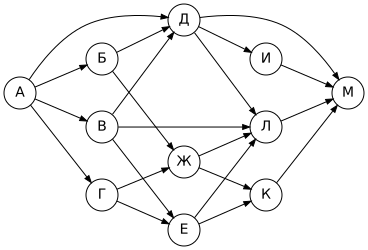
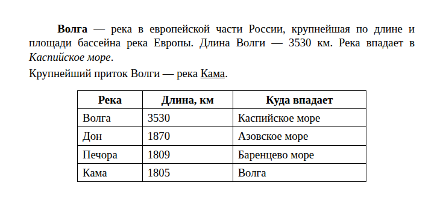
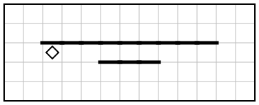
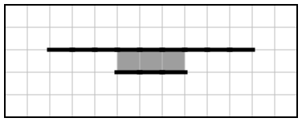

# Вариант 2

| Время | Заданий | Максимум |
|---|---|---|
| 2 ч 30 мин (150 минут) | 16 | 21 балл |

**Как выполнять.** Задания 1–10 решайте без компьютера и записывайте ответы на листок. Задания 11–16 выполняйте на компьютере. Ответы — в самом конце файла, под спойлером. Не подглядывайте до конца работы!

**Материалы:** каталог [`materials/archive`](../materials/archive) (задания 11, 12), файл [`materials/task14/variant-02.xlsx`](../materials/task14/variant-02.xlsx) (задание 14). Для задания 15 нужна среда КуМир, для 16 — Python.

Если времени мало (1 час), сделайте за одно занятие задания 1–12, а 13–16 — за следующее.

## Часть 1

### Задание 1

В кодировке КОИ-8 каждый символ кодируется 8 битами. Петя написал текст (в нём нет лишних пробелов):

«Грач, дятел, синица, соловей, ласточка, трясогузка – птицы».

Ученик вычеркнул из списка название одной птицы. Заодно он вычеркнул ставшие лишними запятую и пробел — два пробела не должны идти подряд.

При этом размер нового предложения в данной кодировке оказался на 8 байт меньше, чем размер исходного предложения. Напишите в ответе вычеркнутое название птицы.

### Задание 2

Дима шифрует русские слова, записывая вместо каждой буквы её код:

| А | Д | К | Н | О | С |
|---|---|---|---|---|---|
| `01` | `100` | `101` | `10` | `111` | `000` |

Некоторые цепочки можно расшифровать не одним способом. Даны три кодовые цепочки:

- `101011011110`
- `10011100010101`
- `00001100`

Найдите среди них ту, которая имеет только одну расшифровку, и запишите в ответе расшифрованное слово.

### Задание 3

Для какого из приведённых имён **истинно** высказывание:

**НЕ (Вторая буква гласная) И НЕ (Первая буква гласная)**?

1) Павел
2) Глеб
3) Ольга
4) Олег

В ответе запишите имя.

### Задание 4

Между населёнными пунктами A, B, C, D, E, F построены дороги, протяжённость которых (в километрах) приведена в таблице.

|   | A | B | C | D | E | F |
|---|---|---|---|---|---|---|
| **A** |  |  | 4 |  |  | 1 |
| **B** |  |  | 2 | 2 | 9 | 9 |
| **C** | 4 | 2 |  |  |  |  |
| **D** |  | 2 |  |  | 9 | 1 |
| **E** |  | 9 |  | 9 |  | 4 |
| **F** | 1 | 9 |  | 1 | 4 |  |

Определите длину кратчайшего пути между пунктами A и F, проходящего через пункт E. Передвигаться можно только по дорогам, протяжённость которых указана в таблице.

### Задание 5

У исполнителя Омега две команды, которым присвоены номера:

1. **вычти 3**
2. **умножь на b**

(b — неизвестное натуральное число; b ≥ 2).

Выполняя первую из них, Омега уменьшает число на экране на 3, а выполняя вторую, умножает это число на b. Программа для исполнителя Омега — это последовательность номеров команд.

Известно, что программа **11121** переводит число 55 в число 135. Определите значение b.

### Задание 6

Ниже приведена программа, записанная на языке Python.

```python
s = int(input())
t = int(input())
if s > 6 and t < 8:
    print("YES")
else:
    print("NO")
```

Было проведено 9 запусков программы, при которых в качестве значений переменных s и t вводились следующие пары чисел:

(0, 10), (-3, 8), (9, 14), (11, 11), (5, 12), (10, 7), (10, 5), (12, -1), (6, 9).

Сколько было запусков, при которых программа напечатала «NO»?

### Задание 7

Доступ к файлу **math.pdf**, находящемуся на сервере **map.su**, осуществляется по протоколу **http**. Фрагменты адреса файла закодированы буквами от А до Ж. Запишите последовательность этих букв, кодирующую адрес указанного файла в сети Интернет.

А) `su`
Б) `http`
В) `math.`
Г) `map.`
Д) `pdf`
Е) `/`
Ж) `://`

### Задание 8

В языке запросов поискового сервера для обозначения логической операции «ИЛИ» используется символ «|», а для обозначения логической операции «И» — символ «&».

В таблице приведены запросы и количество найденных по ним страниц некоторого сегмента сети Интернет.

| Запрос | Найдено страниц (в тысячах) |
|---|---|
| Рыбка & Рыбак | 150 |
| Рыбка | 1160 |
| Рыбак | 2910 |

Какое количество страниц (в тысячах) будет найдено по запросу **Рыбка | Рыбак**?

Считается, что все запросы выполнялись практически одновременно, так что набор страниц, содержащих все искомые слова, не изменялся за время выполнения запросов.

### Задание 9

На рисунке — схема дорог, связывающих города А, Б, В, Г, Д, Е, Ж, И, К, Л, М. По каждой дороге можно двигаться только в одном направлении, указанном стрелкой.



Сколько существует различных путей из города А в город М, не проходящих через город И?

### Задание 10

Среди приведённых ниже трёх чисел, записанных в различных системах счисления, найдите минимальное и запишите его в ответе в десятичной системе счисления. В ответе запишите только число, основание системы счисления указывать не нужно.

141<sub>8</sub>, E7<sub>16</sub>, 1110001<sub>2</sub>

## Часть 2

Задания этой части выполняются на компьютере.

### Задание 11

В одной из статей архива рассказывается об ученице, набравшей на олимпиаде 94 балла из 100. По какому предмету проходила эта олимпиада? Ответ запишите так, как он указан в тексте (например: «химии»).

Ищите в каталоге `materials/archive`.

### Задание 12

Сколько файлов с расширением **.png** объёмом **более 40 Кбайт** содержится в каталоге **archive** и всех его подкаталогах? В ответе укажите только число.

### Задание 13

Выберите **одно** из заданий: 13.1 или 13.2.

#### 13.1. Презентация «Шахматы»

Используя информацию и иллюстративный материал о теме «**Шахматы**», создайте презентацию из **трёх слайдов**.

В презентации должны использоваться простые шаблоны оформления: следует использовать единый стиль оформления всех слайдов, фон слайдов должен быть одинаковым (не белым).

1. **Первый слайд** — титульный слайд с названием презентации; в подзаголовке титульного слайда в качестве информации об авторе презентации указывается ваше имя (или идентификационный номер).
2. **Второй слайд** — основная информация в соответствии с заданием, размещённая по образцу (заголовок, три изображения, подписи к ним или текст).
3. **Третий слайд** — дополнительная информация по теме: заголовок, одно изображение и текст.

Размер шрифта: для названия презентации на титульном слайде — **40 пунктов**; для подзаголовка на титульном слайде и заголовков слайдов — **24 пункта**; для основного текста — **20 пунктов**.

Текст не должен перекрывать основные изображения или сливаться с фоном.

Информация для слайдов: Шахматы — настольная логическая игра для двух игроков. У каждого игрока по 16 фигур: король, ферзь, две ладьи, два слона, два коня и восемь пешек. Цель игры — поставить мат королю соперника.

Изображения найдите самостоятельно (на экзамене их дают в каталоге задания). Сохраните презентацию в формате **.odp** (LibreOffice Impress) или **.pptx** (PowerPoint).

#### 13.2. Документ «Волга»

Создайте в текстовом редакторе документ и напишите в нём следующий текст, точно воспроизведя всё оформление текста, имеющееся в образце.

Данный текст должен быть набран шрифтом размером **14 пунктов** обычного начертания. Отступ первой строки первого абзаца основного текста — **1,25 см**. Расстояние между строками текста не менее одинарного, но не более полуторного междустрочного интервала.

Основной текст выровнен **по ширине**; в ключевых словах первого абзаца применено полужирное и курсивное начертание; во втором абзаце одно слово подчёркнуто.

Таблица (5 строк, 3 столбца) выровнена **по центру**; ширина таблицы меньше ширины основного текста. Текст в первой строке таблицы — полужирный, выровнен по центру; в остальных ячейках — выравнивание по левому краю.

При этом допустимо, чтобы ширина вашего текста отличалась от ширины текста в примере, поскольку ширина текста зависит от размеров страницы и полей. В этом случае разбиение текста на строки должно соответствовать стандартной ширине абзаца.

**Образец:**



### Задание 14

Откройте файл [`variant-02.xlsx`](../materials/task14/variant-02.xlsx).

В электронную таблицу занесли данные наблюдения за погодой в течение 2025 года. В столбце A записана дата наблюдения, в столбце B — среднесуточная температура воздуха (°C), в столбце C — количество осадков (мм), в столбце D — атмосферное давление (мм рт. ст.), в столбце E — направление ветра, в столбце F — средняя скорость ветра (м/с).

Всего в таблицу были занесены данные по 365 дням.

Первые строки таблицы:

|   | A | B | C | D | E | F |
|---|---|---|---|---|---|---|
| **1** | **дата** | **температура** | **осадки** | **давление** | **ветер** | **скорость ветра** |
| **2** | 01.01.2025 | -13,7 | 0,0 | 732 | З | 11,0 |
| **3** | 02.01.2025 | -20,1 | 0,0 | 761 | СЗ | 0,7 |
| **4** | 03.01.2025 | -16,1 | 0,0 | 746 | СВ | 1,7 |
| **5** | 04.01.2025 | -15,7 | 3,2 | 738 | ЮВ | 5,9 |


Выполните задание:

1. Какова средняя температура воздуха в **декабре** 2025 года? Ответ на этот вопрос запишите в ячейку **H2** таблицы с точностью не менее двух знаков после запятой.
2. Сколько дней дул **юго-западный** ветер (**ЮЗ**) со скоростью **более 7 м/с**? Ответ на этот вопрос запишите в ячейку **H3** таблицы.
3. Постройте круговую диаграмму, отображающую соотношение количества дней, когда дул ветер направлений «ЮЗ», «С» и «Ю». Левый верхний угол диаграммы разместите вблизи ячейки **G6**. В поле диаграммы должны присутствовать легенда и числовые значения данных, по которым построена диаграмма.

Полученную таблицу сохраните в формате `.ods`.

### Задание 15

Исполнитель Робот умеет перемещаться по лабиринту, начерченному на плоскости, разбитой на клетки. Система команд и проверок — [в теории](../theory/08-kumir.md).

На бесконечном поле имеются две горизонтальные стены. Верхняя стена длиннее нижней, нижняя стена целиком расположена под верхней на расстоянии одной клетки (между ними — коридор). Длины стен и смещение нижней стены неизвестны; известно, что левые концы стен **не совпадают** и правые концы стен **не совпадают**. Робот находится в клетке под левым концом верхней стены.

Требуется закрасить все клетки, у которых есть стена и **сверху**, и **снизу**.

При исполнении алгоритма Робот не должен разрушиться, выполнение алгоритма должно завершиться. Конечное расположение Робота может быть произвольным. Алгоритм должен решать задачу для любого допустимого расположения стен и любого расположения и размера проходов внутри стен.

| Пример поля | Нужно закрасить |
|---|---|
|  |  |

Алгоритм может быть выполнен в среде КуМир или записан в текстовом редакторе.

### Задание 16

Напишите программу, которая в последовательности натуральных чисел определяет сумму всех двузначных чисел. Программа должна вывести одно число — сумму двузначных чисел.

Программа получает на вход натуральные числа, количество введённых чисел неизвестно, последовательность чисел заканчивается числом 0 (0 — признак окончания ввода, не входит в последовательность). Количество чисел не превышает 1000. Введённые числа не превышают 30 000.

**Пример работы программы:**

| Входные данные | Выходные данные |
|---|---|
| 162<br>57<br>114<br>191<br>341<br>275<br>0 | 57 |

---

## Ответы

<details><summary>Показать ответы и решения</summary>

**Задания 1–12** (по 1 баллу):

| № | Ответ |
|---|---|
| 1 | синица |
| 2 | САД |
| 3 | Глеб |
| 4 | 9 |
| 5 | 3 |
| 6 | 6 |
| 7 | БЖГАЕВД |
| 8 | 3920 |
| 9 | 15 |
| 10 | 97 |
| 11 | обществознанию |
| 12 | 1 |

**Задание 13** (2 балла): Проверка по чек-листам: [13.1](../tasks/13-presentation-text.md#чек-лист-самопроверки-131), [13.2](../tasks/13-presentation-text.md#чек-лист-самопроверки-132).

**Задание 14** (3 балла):

1. **-5,99**
2. **19**
3. **ЮЗ — 57; С — 27; Ю — 54** (значения для диаграммы)

**Задание 15** (2 балла), один из возможных алгоритмов:

```
использовать Робот
алг
нач
  нц пока сверху стена
    если снизу стена то
      закрасить
    все
    вправо
  кц
кон
```

**Задание 16** (2 балла), один из возможных вариантов программы:

```python
s = 0
x = int(input())
while x != 0:
    if 10 <= x <= 99:
        s += x
    x = int(input())
print(s)
```

Тесты для проверки:

| № | Вход | Выход |
|---|---|---|
| 1 | 162<br>57<br>114<br>191<br>341<br>275<br>0 | 57 |
| 2 | 240<br>202<br>193<br>158<br>191<br>142<br>0 | 0 |
| 3 | 10<br>188<br>252<br>375<br>271<br>190<br>0 | 10 |
| 4 | 209<br>171<br>130<br>112<br>362<br>32<br>237<br>0 | 32 |

**Перевод в оценку:** 0–4 → «2», 5–10 → «3», 11–16 → «4», 17–21 → «5».

</details>


[← Все варианты](README.md) · [К оглавлению](../README.md)
