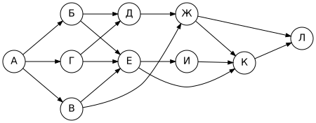
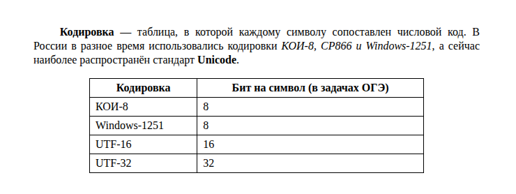
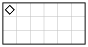
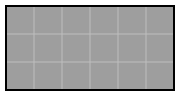

# Вариант 3

| Время | Заданий | Максимум |
|---|---|---|
| 2 ч 30 мин (150 минут) | 16 | 21 балл |

**Как выполнять.** Задания 1–10 решайте без компьютера и записывайте ответы на листок. Задания 11–16 выполняйте на компьютере. Ответы — в самом конце файла, под спойлером. Не подглядывайте до конца работы!

**Материалы:** каталог [`materials/archive`](../materials/archive) (задания 11, 12), файл [`materials/task14/variant-03.xlsx`](../materials/task14/variant-03.xlsx) (задание 14). Для задания 15 нужна среда КуМир, для 16 — Python.

Если времени мало (1 час), сделайте за одно занятие задания 1–12, а 13–16 — за следующее.

## Часть 1

### Задание 1

В кодировке UTF-16 каждый символ кодируется 16 битами. Костя написал текст (в нём нет лишних пробелов):

«Амур, Кама, Урал, Волга, Ангара, Печора – реки России».

Ученик вычеркнул из списка название одной реки. Заодно он вычеркнул ставшие лишними запятую и пробел — два пробела не должны идти подряд.

При этом размер нового предложения в данной кодировке оказался на 14 байт меньше, чем размер исходного предложения. Напишите в ответе вычеркнутое название реки.

### Задание 2

Мальчики играли в шпионов и закодировали сообщение придуманным шифром. В сообщении присутствуют только буквы из приведённого фрагмента кодовой таблицы:

| А | Б | В | Г | Д | Е | Ж | З |
|---|---|---|---|---|---|---|---|
| `•–` | `–•••` | `•––` | `––•` | `–••` | `•` | `•••–` | `––••` |

Определите, какое сообщение закодировано в строчке

`–••••–••––•––•••––`

Известно, что буквы в сообщении не повторяются. В ответе запишите сообщение.

### Задание 3

Напишите наибольшее натуральное число X, для которого ложно высказывание:

**НЕ (X < 26) ИЛИ (X нечётное)**

### Задание 4

Между населёнными пунктами A, B, C, D, E, F построены дороги, протяжённость которых (в километрах) приведена в таблице.

|   | A | B | C | D | E | F |
|---|---|---|---|---|---|---|
| **A** |  | 2 | 7 | 2 | 9 |  |
| **B** | 2 |  |  | 3 |  | 9 |
| **C** | 7 |  |  | 1 |  |  |
| **D** | 2 | 3 | 1 |  | 4 | 3 |
| **E** | 9 |  |  | 4 |  | 7 |
| **F** |  | 9 |  | 3 | 7 |  |

Определите длину кратчайшего пути между пунктами A и F. Передвигаться можно только по дорогам, протяжённость которых указана в таблице.

### Задание 5

У исполнителя Удвоитель две команды:

1. **прибавь 5**
2. **умножь на 2**

Запишите порядок команд в программе, которая преобразует число 1 в число 96 и содержит не более пяти команд, указывая лишь номера команд.

### Задание 6

Ниже приведена программа, записанная на языке Python.

```python
s = int(input())
t = int(input())
if not (s > A) or t > 6:
    print("YES")
else:
    print("NO")
```

Было проведено 9 запусков программы, при которых в качестве значений переменных s и t вводились следующие пары чисел:

(6, 14), (11, 15), (15, -5), (3, 9), (0, -2), (6, -4), (1, 0), (4, -4), (2, -4).

Укажите наименьшее целое значение параметра A, при котором для указанных входных данных программа напечатает «YES» 7 раз.

### Задание 7

Доступ к файлу **song.mp3**, находящемуся на сервере **news.org**, осуществляется по протоколу **http**. Фрагменты адреса файла закодированы буквами от А до Ж. Запишите последовательность этих букв, кодирующую адрес указанного файла в сети Интернет.

А) `song.`
Б) `org`
В) `://`
Г) `news.`
Д) `mp3`
Е) `/`
Ж) `http`

### Задание 8

В языке запросов поискового сервера для обозначения логической операции «ИЛИ» используется символ «|», а для обозначения логической операции «И» — символ «&».

В таблице приведены запросы и количество найденных по ним страниц некоторого сегмента сети Интернет.

| Запрос | Найдено страниц (в тысячах) |
|---|---|
| Шахматы | 2310 |
| Шашки | 1670 |
| Шахматы \| Шашки | 3700 |

Какое количество страниц (в тысячах) будет найдено по запросу **Шахматы & Шашки**?

Считается, что все запросы выполнялись практически одновременно, так что набор страниц, содержащих все искомые слова, не изменялся за время выполнения запросов.

### Задание 9

На рисунке — схема дорог, связывающих города А, Б, В, Г, Д, Е, Ж, И, К, Л. По каждой дороге можно двигаться только в одном направлении, указанном стрелкой.



Сколько существует различных путей из города А в город Л, не проходящих через город Г?

### Задание 10

Среди приведённых ниже трёх чисел, записанных в различных системах счисления, найдите максимальное и запишите его в ответе в десятичной системе счисления. В ответе запишите только число, основание системы счисления указывать не нужно.

36<sub>16</sub>, 101000<sub>2</sub>, 226<sub>8</sub>

## Часть 2

Задания этой части выполняются на компьютере.

### Задание 11

В одной из статей архива рассказывается об ученице, набравшей на олимпиаде 63 балла из 100. По какому предмету проходила эта олимпиада? Ответ запишите так, как он указан в тексте (например: «химии»).

Ищите в каталоге `materials/archive`.

### Задание 12

Сколько файлов с расширением **.jpg** содержится в подкаталогах каталога **archive/2025**? В ответе укажите только число.

### Задание 13

Выберите **одно** из заданий: 13.1 или 13.2.

#### 13.1. Презентация «Дельфины»

Используя информацию и иллюстративный материал о теме «**Дельфины**», создайте презентацию из **трёх слайдов**. В презентации должны содержаться краткие иллюстрированные сведения по теме. Все слайды должны быть выполнены в едином стиле, каждый слайд должен быть озаглавлен.

**Требования к оформлению презентации**

1. Ровно три слайда **без анимации**. Параметры страницы (слайда): экран **16:9**, ориентация альбомная.
2. **Первый слайд** — титульный: название презентации; в подзаголовке — идентификационный номер участника экзамена (на тренировке — любой номер).
3. **Второй слайд** — основная информация, по макету: заголовок слайда, два блока текста, два изображения.
4. **Третий слайд** — дополнительная информация, по макету: заголовок слайда, три изображения, три блока текста.
5. В презентации используется **единый тип шрифта**. Размер шрифта: название на титульном слайде — **40 пт**; подзаголовок титульного слайда и заголовки слайдов — **24 пт**; основной текст — **20 пт**.
6. Текст не перекрывает изображения и не сливается с фоном; изображения не искажены (масштабируются пропорционально).

Информация для слайдов: Дельфины — морские млекопитающие из отряда китообразных. Они дышат атмосферным воздухом, ориентируются с помощью эхолокации и живут группами.

Изображения подберите самостоятельно (на экзамене их дают в каталоге задания). Сохраните презентацию в формате **.odp** (LibreOffice Impress).

**Макет слайдов:**


#### 13.2. Документ «Кодировки»

Создайте в текстовом редакторе документ и напишите в нём следующий текст, точно воспроизведя всё оформление текста, имеющееся в образце.

Данный текст должен быть набран шрифтом размером **12 пунктов** обычного начертания. Отступ первой строки первого абзаца основного текста — **1,0 см**. Расстояние между строками текста не менее одинарного, но не более полуторного междустрочного интервала.

Основной текст выровнен **по ширине**; в ключевых словах первого абзаца применено полужирное и курсивное начертание.

Таблица (5 строк, 2 столбца) выровнена **по центру**; ширина таблицы меньше ширины основного текста. Текст в первой строке таблицы — полужирный, выровнен по центру; в остальных ячейках — выравнивание по левому краю.

Интервал между текстом и таблицей не менее 12 пунктов, но не более 24 пунктов.

При этом допустимо, чтобы ширина вашего текста отличалась от ширины текста в примере, поскольку ширина текста зависит от размеров страницы и полей. В этом случае разбиение текста на строки должно соответствовать стандартной ширине абзаца.

**Образец:**



### Задание 14

Откройте файл [`variant-03.xlsx`](../materials/task14/variant-03.xlsx).

В электронную таблицу занесли данные о калорийности продуктов. В столбце A записан продукт; в столбце B — содержание в нём жиров; в столбце C — содержание белков; в столбце D — содержание углеводов; в столбце E — калорийность этого продукта (все значения — на 100 г продукта).

Всего в электронную таблицу были занесены данные по 649 продуктам.

Первые строки таблицы:

|   | A | B | C | D | E |
|---|---|---|---|---|---|
| **1** | **продукт** | **жиры, г** | **белки, г** | **углеводы, г** | **калорийность, ккал** |
| **2** | Яблоко-1 | 25,2 | 27,8 | 0,7 | 341 |
| **3** | Лук-2 | 17,3 | 17,9 | 51,0 | 431 |
| **4** | Яблоко-3 | 33,5 | 10,9 | 32,7 | 476 |
| **5** | Вишня-4 | 11,3 | 9,3 | 54,3 | 356 |


Выполните задание:

1. Сколько продуктов в таблице содержат **меньше 5 г жиров** и **меньше 15 г белков**? Запишите число этих продуктов в ячейку **H2** таблицы.
2. Какова средняя калорийность продуктов, у которых содержание **углеводов больше 10 г**? Ответ на этот вопрос запишите в ячейку **H3** таблицы с точностью не менее двух знаков после запятой.
3. Постройте круговую диаграмму, отображающую соотношение количества продуктов, у которых калорийность **меньше 200** ккал, **от 200 до 400** ккал включительно и **больше 400** ккал. Левый верхний угол диаграммы разместите вблизи ячейки **G6**. В поле диаграммы должны присутствовать легенда и числовые значения данных, по которым построена диаграмма.

Полученную таблицу сохраните в формате `.ods`.

### Задание 15

Исполнитель Робот умеет перемещаться по лабиринту, начерченному на плоскости, разбитой на клетки. Система команд и проверок — [в теории](../theory/08-kumir.md).

Робот находится в левом верхнем углу прямоугольной комнаты, огороженной со всех сторон стенами. Размеры комнаты неизвестны.

Требуется закрасить **все** клетки комнаты.

При исполнении алгоритма Робот не должен разрушиться, выполнение алгоритма должно завершиться. Конечное расположение Робота может быть произвольным. Алгоритм должен решать задачу для любого допустимого расположения стен и любого расположения и размера проходов внутри стен.

| Пример поля | Нужно закрасить |
|---|---|
|  |  |

Алгоритм может быть выполнен в среде КуМир или записан в текстовом редакторе.

### Задание 16

Напишите программу, которая в последовательности натуральных чисел определяет минимальное чётное число. Программа должна вывести одно число — минимальное чётное число.

Программа получает на вход количество чисел в последовательности, а затем сами числа. Количество чисел не превышает 1000. Введённые числа — натуральные, не превышают 30 000. В последовательности всегда имеется хотя бы одно чётное число.

**Пример работы программы:**

| Входные данные | Выходные данные |
|---|---|
| 6<br>96<br>220<br>428<br>632<br>342<br>612 | 96 |

---

## Ответы

<details><summary>Показать ответы и решения</summary>

**Задания 1–12** (по 1 баллу):

| № | Ответ |
|---|---|
| 1 | Волга |
| 2 | БЕДГЗВ |
| 3 | 24 |
| 4 | 5 |
| 5 | 12222 |
| 6 | 4 |
| 7 | ЖВГБЕАД |
| 8 | 280 |
| 9 | 8 |
| 10 | 150 |
| 11 | информатике |
| 12 | 4 |

**Задание 13** (2 балла): Проверка по чек-листам: [13.1](../tasks/13-presentation-text.md#чек-лист-самопроверки-131), [13.2](../tasks/13-presentation-text.md#чек-лист-самопроверки-132).

**Задание 14** (3 балла):

1. **46**
2. **405,01**
3. **меньше 200 — 66; от 200 до 400 — 299; больше 400 — 284** (значения для диаграммы)

**Задание 15** (2 балла), один из возможных алгоритмов:

```
использовать Робот
алг
нач
  нц пока снизу свободно
    нц пока справа свободно
      закрасить
      вправо
    кц
    закрасить
    нц пока слева свободно
      влево
    кц
    вниз
  кц
  нц пока справа свободно
    закрасить
    вправо
  кц
  закрасить
кон
```

**Задание 16** (2 балла), один из возможных вариантов программы:

```python
n = int(input())
mn = 30001
for i in range(n):
    x = int(input())
    if x % 2 == 0 and x < mn:
        mn = x
print(mn)
```

Тесты для проверки:

| № | Вход | Выход |
|---|---|---|
| 1 | 6<br>96<br>220<br>428<br>632<br>342<br>612 | 96 |
| 2 | 6<br>456<br>529<br>230<br>780<br>762<br>995 | 230 |
| 3 | 6<br>246<br>708<br>912<br>305<br>683<br>464 | 246 |
| 4 | 8<br>268<br>296<br>563<br>606<br>862<br>37<br>59<br>393 | 268 |

**Перевод в оценку:** 0–4 → «2», 5–10 → «3», 11–16 → «4», 17–21 → «5».

</details>


[← Все варианты](README.md) · [К оглавлению](../README.md)
