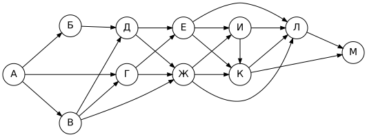
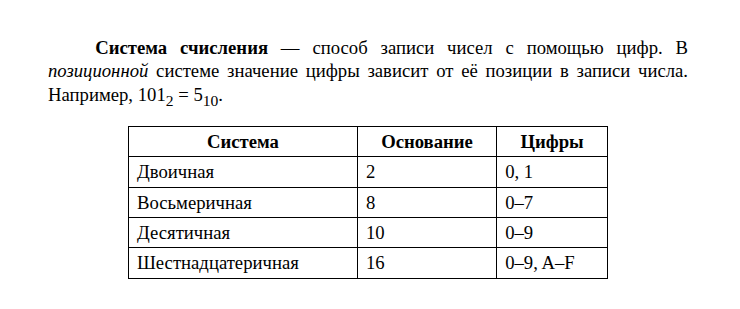
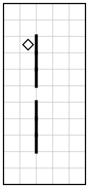
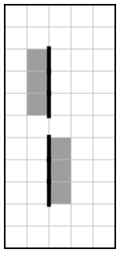

# Вариант 4

| Время | Заданий | Максимум |
|---|---|---|
| 2 ч 30 мин (150 минут) | 16 | 21 балл |

**Как выполнять.** Задания 1–10 решайте без компьютера и записывайте ответы на листок. Задания 11–16 выполняйте на компьютере. Ответы — в самом конце файла, под спойлером. Не подглядывайте до конца работы!

**Материалы:** каталог [`materials/archive`](../materials/archive) (задания 11, 12), файл [`materials/task14/variant-04.xlsx`](../materials/task14/variant-04.xlsx) (задание 14). Для задания 15 нужна среда КуМир, для 16 — Python.

Если времени мало (1 час), сделайте за одно занятие задания 1–12, а 13–16 — за следующее.

## Часть 1

### Задание 1

Статья, набранная на компьютере, содержит 32 страницы, на каждой странице 40 строк, в каждой строке 32 символа. Определите информационный объём текста в кодировке, в которой каждый символ кодируется 8 битами. Ответ дайте в килобайтах.

### Задание 2

Костя шифрует русские слова, записывая вместо каждой буквы её код:

| А | Д | К | Н | О | С |
|---|---|---|---|---|---|
| `01` | `100` | `101` | `10` | `111` | `000` |

Некоторые цепочки можно расшифровать не одним способом. Даны три кодовые цепочки:

- `10111000`
- `101011011110`
- `100111101`

Найдите среди них ту, которая имеет только одну расшифровку, и запишите в ответе расшифрованное слово.

### Задание 3

Напишите наибольшее натуральное число X, для которого истинно высказывание:

**(X < 49) И НЕ (X чётное)**

### Задание 4

Между населёнными пунктами A, B, C, D, E построены дороги, протяжённость которых (в километрах) приведена в таблице.

|   | A | B | C | D | E |
|---|---|---|---|---|---|
| **A** |  |  | 8 | 6 |  |
| **B** |  |  | 6 |  | 8 |
| **C** | 8 | 6 |  |  |  |
| **D** | 6 |  |  |  | 4 |
| **E** |  | 8 |  | 4 |  |

Определите длину кратчайшего пути между пунктами A и E, проходящего через пункт C. Передвигаться можно только по дорогам, протяжённость которых указана в таблице.

### Задание 5

У исполнителя Гамма две команды, которым присвоены номера:

1. **вычти 3**
2. **умножь на b**

(b — неизвестное натуральное число; b ≥ 2).

Выполняя первую из них, Гамма уменьшает число на экране на 3, а выполняя вторую, умножает это число на b. Программа для исполнителя Гамма — это последовательность номеров команд.

Известно, что программа **12121** переводит число 35 в число 2562. Определите значение b.

### Задание 6

Ниже приведена программа, записанная на языке Python.

```python
s = int(input())
t = int(input())
if s < 7 and t > 8:
    print("YES")
else:
    print("NO")
```

Было проведено 9 запусков программы, при которых в качестве значений переменных s и t вводились следующие пары чисел:

(8, -4), (-2, 15), (0, -1), (4, -2), (4, 3), (8, -1), (-1, -4), (-4, 3), (-5, 13).

Сколько было запусков, при которых программа напечатала «YES»?

### Задание 7

Доступ к файлу **list.txt**, находящемуся на сервере **news.org**, осуществляется по протоколу **ftp**. Фрагменты адреса файла закодированы буквами от А до Ж. Запишите последовательность этих букв, кодирующую адрес указанного файла в сети Интернет.

А) `org`
Б) `news.`
В) `/`
Г) `://`
Д) `txt`
Е) `list.`
Ж) `ftp`

### Задание 8

В языке запросов поискового сервера для обозначения логической операции «ИЛИ» используется символ «|», а для обозначения логической операции «И» — символ «&».

В таблице приведены запросы и количество найденных по ним страниц некоторого сегмента сети Интернет.

| Запрос | Найдено страниц (в тысячах) |
|---|---|
| Петербург | 2730 |
| Москва | 3130 |
| Москва \| Петербург | 5610 |

Какое количество страниц (в тысячах) будет найдено по запросу **Москва & Петербург**?

Считается, что все запросы выполнялись практически одновременно, так что набор страниц, содержащих все искомые слова, не изменялся за время выполнения запросов.

### Задание 9

На рисунке — схема дорог, связывающих города А, Б, В, Г, Д, Е, Ж, И, К, Л, М. По каждой дороге можно двигаться только в одном направлении, указанном стрелкой.



Сколько существует различных путей из города А в город М, не проходящих через город Ж?

### Задание 10

Переведите число 216 из десятичной системы счисления в двоичную систему счисления. Сколько значащих нулей содержит полученное число? В ответе укажите одно число.

## Часть 2

Задания этой части выполняются на компьютере.

### Задание 11

В одной из статей архива упоминается спортсмен по фамилии Соболев. Какое место он занял? В ответе запишите слово (например: «первое»).

Ищите в каталоге `materials/archive`.

### Задание 12

Сколько файлов с расширением **.png** содержится в каталоге **archive** и всех его подкаталогах? В ответе укажите только число.

### Задание 13

Выберите **одно** из заданий: 13.1 или 13.2.

#### 13.1. Презентация «Северное сияние»

Используя информацию и иллюстративный материал о теме «**Северное сияние**», создайте презентацию из **трёх слайдов**.

В презентации должны использоваться простые шаблоны оформления: следует использовать единый стиль оформления всех слайдов, фон слайдов должен быть одинаковым (не белым).

1. **Первый слайд** — титульный слайд с названием презентации; в подзаголовке титульного слайда в качестве информации об авторе презентации указывается ваше имя (или идентификационный номер).
2. **Второй слайд** — основная информация в соответствии с заданием, размещённая по образцу (заголовок, три изображения, подписи к ним или текст).
3. **Третий слайд** — дополнительная информация по теме: заголовок, одно изображение и текст.

Размер шрифта: для названия презентации на титульном слайде — **40 пунктов**; для подзаголовка на титульном слайде и заголовков слайдов — **24 пункта**; для основного текста — **20 пунктов**.

Текст не должен перекрывать основные изображения или сливаться с фоном.

Информация для слайдов: Северное сияние (полярное сияние) — свечение верхних слоёв атмосферы, которое возникает, когда заряженные частицы солнечного ветра сталкиваются с атомами газов. Чаще всего его наблюдают в высоких широтах.

Изображения найдите самостоятельно (на экзамене их дают в каталоге задания). Сохраните презентацию в формате **.odp** (LibreOffice Impress) или **.pptx** (PowerPoint).

#### 13.2. Документ «Системы счисления»

Создайте в текстовом редакторе документ и напишите в нём следующий текст, точно воспроизведя всё оформление текста, имеющееся в образце.

Данный текст должен быть набран шрифтом размером **14 пунктов** обычного начертания. Отступ первой строки первого абзаца основного текста — **1,25 см**. Расстояние между строками текста не менее одинарного, но не более полуторного междустрочного интервала.

Основной текст выровнен **по ширине**; в ключевых словах первого абзаца применено полужирное и курсивное начертание; есть нижний или верхний индекс.

Таблица (5 строк, 3 столбца) выровнена **по центру**; ширина таблицы меньше ширины основного текста. Текст в первой строке таблицы — полужирный, выровнен по центру; в остальных ячейках — выравнивание по левому краю.

При этом допустимо, чтобы ширина вашего текста отличалась от ширины текста в примере, поскольку ширина текста зависит от размеров страницы и полей. В этом случае разбиение текста на строки должно соответствовать стандартной ширине абзаца.

**Образец:**



### Задание 14

Откройте файл [`variant-04.xlsx`](../materials/task14/variant-04.xlsx).

В электронную таблицу занесли данные о продажах канцтоваров в сети магазинов. В столбце A записано название магазина; в столбце B — товар; в столбце C — количество проданных единиц; в столбце D — цена одной единицы товара (руб.).

Всего в электронную таблицу были занесены данные по 664 продажам.

Первые строки таблицы:

|   | A | B | C | D |
|---|---|---|---|---|
| **1** | **магазин** | **товар** | **количество** | **цена, руб.** |
| **2** | Центральный | альбом | 9 | 120 |
| **3** | Южный | карандаш | 8 | 15 |
| **4** | Южный | альбом | 5 | 120 |
| **5** | Заречный | ручка | 14 | 30 |


Выполните задание:

1. Сколько всего единиц товара «**краски**» продано в магазине «**Северный**»? Ответ на этот вопрос запишите в ячейку **H2** таблицы.
2. В столбце **E** для каждой записи вычислите стоимость покупки (количество × цена). Какова общая выручка магазина «**Южный**»? Ответ на этот вопрос запишите в ячейку **H3** таблицы.
3. Постройте круговую диаграмму, отображающую соотношение числа записей о продажах в магазинах «Лесной», «Центральный» и «Заречный». Левый верхний угол диаграммы разместите вблизи ячейки **G6**. В поле диаграммы должны присутствовать легенда и числовые значения данных, по которым построена диаграмма.

Полученную таблицу сохраните в формате `.ods`.

### Задание 15

Исполнитель Робот умеет перемещаться по лабиринту, начерченному на плоскости, разбитой на клетки. Система команд и проверок — [в теории](../theory/08-kumir.md).

На бесконечном поле имеется вертикальная стена, в которой есть проход шириной в одну клетку. Длина стены и место прохода неизвестны; известно, что проход не находится у края стены. Робот находится в клетке непосредственно **слева** от стены у её верхнего конца.

Требуется закрасить все клетки, расположенные непосредственно **левее** стены **выше** прохода, и все клетки, расположенные непосредственно **правее** стены **ниже** прохода.

При исполнении алгоритма Робот не должен разрушиться, выполнение алгоритма должно завершиться. Конечное расположение Робота может быть произвольным. Алгоритм должен решать задачу для любого допустимого расположения стен и любого расположения и размера проходов внутри стен.

| Пример поля | Нужно закрасить |
|---|---|
|  |  |

Алгоритм может быть выполнен в среде КуМир или записан в текстовом редакторе.

### Задание 16

Напишите программу, которая в последовательности натуральных чисел определяет количество чисел, оканчивающихся на 4 и кратных 3. Программа должна вывести одно число.

Программа получает на вход натуральные числа, количество введённых чисел неизвестно, последовательность чисел заканчивается числом 0 (0 — признак окончания ввода, не входит в последовательность). Количество чисел не превышает 1000. Введённые числа не превышают 30 000.

**Пример работы программы:**

| Входные данные | Выходные данные |
|---|---|
| 36<br>83<br>18<br>35<br>10<br>41<br>0 | 0 |

---

## Ответы

<details><summary>Показать ответы и решения</summary>

**Задания 1–12** (по 1 баллу):

| № | Ответ |
|---|---|
| 1 | 40 |
| 2 | НОС |
| 3 | 47 |
| 4 | 22 |
| 5 | 9 |
| 6 | 2 |
| 7 | ЖГБАВЕД |
| 8 | 250 |
| 9 | 24 |
| 10 | 4 |
| 11 | третье |
| 12 | 14 |

**Задание 13** (2 балла): Проверка по чек-листам: [13.1](../tasks/13-presentation-text.md#чек-лист-самопроверки-131), [13.2](../tasks/13-presentation-text.md#чек-лист-самопроверки-132).

**Задание 14** (3 балла):

1. **96**
2. **804095**
3. **Лесной — 127; Центральный — 137; Заречный — 135** (значения для диаграммы)

**Задание 15** (2 балла), один из возможных алгоритмов:

```
использовать Робот
алг
нач
  нц пока справа стена
    закрасить
    вниз
  кц
  вправо
  вниз
  нц пока слева стена
    закрасить
    вниз
  кц
кон
```

**Задание 16** (2 балла), один из возможных вариантов программы:

```python
count = 0
x = int(input())
while x != 0:
    if x % 10 == 4 and x % 3 == 0:
        count += 1
    x = int(input())
print(count)
```

Тесты для проверки:

| № | Вход | Выход |
|---|---|---|
| 1 | 36<br>83<br>18<br>35<br>10<br>41<br>0 | 0 |
| 2 | 84<br>91<br>10<br>72<br>42<br>100<br>0 | 1 |
| 3 | 84<br>44<br>54<br>5<br>62<br>13<br>0 | 2 |
| 4 | 54<br>24<br>48<br>84<br>76<br>49<br>0 | 3 |

**Перевод в оценку:** 0–4 → «2», 5–10 → «3», 11–16 → «4», 17–21 → «5».

</details>


[← Все варианты](README.md) · [К оглавлению](../README.md)
