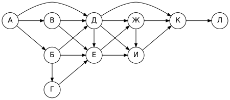
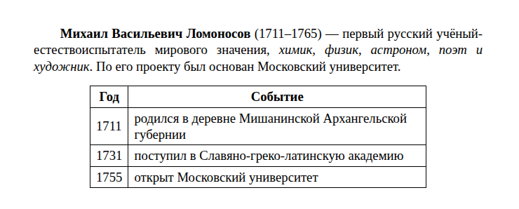
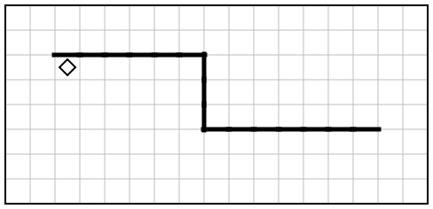
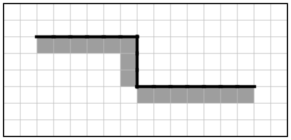

# Вариант 5

| Время | Заданий | Максимум |
|---|---|---|
| 2 ч 30 мин (150 минут) | 16 | 21 балл |

**Как выполнять.** Задания 1–10 решайте без компьютера и записывайте ответы на листок. Задания 11–16 выполняйте на компьютере. Ответы — в самом конце файла, под спойлером. Не подглядывайте до конца работы!

**Материалы:** каталог [`materials/archive`](../materials/archive) (задания 11, 12), файл [`materials/task14/variant-05.xlsx`](../materials/task14/variant-05.xlsx) (задание 14). Для задания 15 нужна среда КуМир, для 16 — Python.

Если времени мало (1 час), сделайте за одно занятие задания 1–12, а 13–16 — за следующее.

## Часть 1

### Задание 1

В кодировке Windows-1251 каждый символ кодируется 8 битами. Маша написала текст (в нём нет лишних пробелов):

«Репа, огурец, капуста, морковь, патиссон, баклажан – овощи».

Ученик вычеркнул из списка название одного овоща. Заодно он вычеркнул ставшие лишними запятую и пробел — два пробела не должны идти подряд.

При этом размер нового предложения в данной кодировке оказался на 64 бита меньше, чем размер исходного предложения. Напишите в ответе вычеркнутое название овоща.

### Задание 2

Мальчики играли в шпионов и закодировали сообщение придуманным шифром. В сообщении присутствуют только буквы из приведённого фрагмента кодовой таблицы:

| А | Б | В | Г | Д | Е | Ж | З |
|---|---|---|---|---|---|---|---|
| `•–` | `–•••` | `•––` | `––•` | `–••` | `•` | `•••–` | `––••` |

Определите, какое сообщение закодировано в строчке

`–••••••–•––•–•`

Известно, что буквы в сообщении не повторяются. В ответе запишите сообщение.

### Задание 3

Для какого из приведённых имён **истинно** высказывание:

**(Первая буква гласная) И НЕ (Количество букв чётное)**?

1) Эмма
2) Ирина
3) Вера
4) Глеб

В ответе запишите имя.

### Задание 4

Между населёнными пунктами A, B, C, D, E, F построены дороги, протяжённость которых (в километрах) приведена в таблице.

|   | A | B | C | D | E | F |
|---|---|---|---|---|---|---|
| **A** |  | 9 | 5 |  |  | 2 |
| **B** | 9 |  |  | 5 |  | 6 |
| **C** | 5 |  |  | 2 | 7 |  |
| **D** |  | 5 | 2 |  | 3 | 4 |
| **E** |  |  | 7 | 3 |  |  |
| **F** | 2 | 6 |  | 4 |  |  |

Определите длину кратчайшего пути между пунктами A и F, проходящего через пункт B. Передвигаться можно только по дорогам, протяжённость которых указана в таблице.

### Задание 5

У исполнителя Омега две команды, которым присвоены номера:

1. **вычти 5**
2. **умножь на b**

(b — неизвестное натуральное число; b ≥ 2).

Выполняя первую из них, Омега уменьшает число на экране на 5, а выполняя вторую, умножает это число на b. Программа для исполнителя Омега — это последовательность номеров команд.

Известно, что программа **22122** переводит число 11 в число 846. Определите значение b.

### Задание 6

Ниже приведена программа, записанная на языке Python.

```python
s = int(input())
t = int(input())
if s > 6 or t > A:
    print("YES")
else:
    print("NO")
```

Было проведено 9 запусков программы, при которых в качестве значений переменных s и t вводились следующие пары чисел:

(14, -2), (-1, 8), (3, -3), (-4, 9), (1, -5), (14, 5), (-5, -4), (5, 4), (-1, 7).

Укажите количество целых значений параметра A, при которых для указанных входных данных программа напечатает «NO» 6 раз.

### Задание 7

Доступ к файлу **org.odt**, находящемуся на сервере **lib.ru**, осуществляется по протоколу **ftp**. Фрагменты адреса файла закодированы буквами от А до Ж. Запишите последовательность этих букв, кодирующую адрес указанного файла в сети Интернет.

А) `/`
Б) `://`
В) `ru`
Г) `ftp`
Д) `odt`
Е) `org.`
Ж) `lib.`

### Задание 8

В языке запросов поискового сервера для обозначения логической операции «ИЛИ» используется символ «|», а для обозначения логической операции «И» — символ «&».

В таблице приведены запросы и количество найденных по ним страниц некоторого сегмента сети Интернет.

| Запрос | Найдено страниц (в тысячах) |
|---|---|
| Пушкин & Лермонтов | 260 |
| Пушкин | 2220 |
| Лермонтов | 710 |

Какое количество страниц (в тысячах) будет найдено по запросу **Пушкин | Лермонтов**?

Считается, что все запросы выполнялись практически одновременно, так что набор страниц, содержащих все искомые слова, не изменялся за время выполнения запросов.

### Задание 9

На рисунке — схема дорог, связывающих города А, Б, В, Г, Д, Е, Ж, И, К, Л. По каждой дороге можно двигаться только в одном направлении, указанном стрелкой.



Сколько существует различных путей из города А в город Л?

### Задание 10

Переведите число 311<sub>16</sub> в десятичную систему счисления. В ответе запишите полученное число.

## Часть 2

Задания этой части выполняются на компьютере.

### Задание 11

В одной из статей архива рассказывается об ученице, набравшей на олимпиаде 88 баллов из 100. По какому предмету проходила эта олимпиада? Ответ запишите так, как он указан в тексте (например: «химии»).

Ищите в каталоге `materials/archive`.

### Задание 12

Сколько файлов с расширением **.txt** содержится в подкаталогах каталога **archive/2025**? В ответе укажите только число.

### Задание 13

Выберите **одно** из заданий: 13.1 или 13.2.

#### 13.1. Презентация «Волга»

Используя информацию и иллюстративный материал о теме «**Волга**», создайте презентацию из **трёх слайдов**.

В презентации должны использоваться простые шаблоны оформления: следует использовать единый стиль оформления всех слайдов, фон слайдов должен быть одинаковым (не белым).

1. **Первый слайд** — титульный слайд с названием презентации; в подзаголовке титульного слайда в качестве информации об авторе презентации указывается ваше имя (или идентификационный номер).
2. **Второй слайд** — основная информация в соответствии с заданием, размещённая по образцу (заголовок, три изображения, подписи к ним или текст).
3. **Третий слайд** — дополнительная информация по теме: заголовок, одно изображение и текст.

Размер шрифта: для названия презентации на титульном слайде — **40 пунктов**; для подзаголовка на титульном слайде и заголовков слайдов — **24 пункта**; для основного текста — **20 пунктов**.

Текст не должен перекрывать основные изображения или сливаться с фоном.

Информация для слайдов: Волга — самая длинная река Европы (3530 км). Она начинается на Валдайской возвышенности и впадает в Каспийское море. На Волге стоят Тверь, Ярославль, Нижний Новгород, Казань, Самара, Волгоград и Астрахань.

Изображения найдите самостоятельно (на экзамене их дают в каталоге задания). Сохраните презентацию в формате **.odp** (LibreOffice Impress) или **.pptx** (PowerPoint).

#### 13.2. Документ «М. В. Ломоносов»

Создайте в текстовом редакторе документ и напишите в нём следующий текст, точно воспроизведя всё оформление текста, имеющееся в образце.

Данный текст должен быть набран шрифтом размером **14 пунктов** обычного начертания. Отступ первой строки первого абзаца основного текста — **1,0 см**. Расстояние между строками текста не менее одинарного, но не более полуторного междустрочного интервала.

Основной текст выровнен **по ширине**; в ключевых словах первого абзаца применено полужирное и курсивное начертание.

Таблица (4 строки, 2 столбца) выровнена **по центру**; ширина таблицы меньше ширины основного текста. Текст в первой строке таблицы — полужирный, выровнен по центру; в остальных ячейках — выравнивание по левому краю.

При этом допустимо, чтобы ширина вашего текста отличалась от ширины текста в примере, поскольку ширина текста зависит от размеров страницы и полей. В этом случае разбиение текста на строки должно соответствовать стандартной ширине абзаца.

**Образец:**



### Задание 14

Откройте файл [`variant-05.xlsx`](../materials/task14/variant-05.xlsx).

В электронную таблицу занесли данные о тестировании учеников по выбранным ими предметам.

В столбце A записан код округа, в котором учится ученик; в столбце B — фамилия; в столбце C — выбранный учеником предмет; в столбце D — тестовый балл.

Всего в электронную таблицу были занесены данные по 680 ученикам.

Первые строки таблицы:

|   | A | B | C | D |
|---|---|---|---|---|
| **1** | **округ** | **фамилия** | **предмет** | **баллы** |
| **2** | Ю | Ученик 1 | история | 751 |
| **3** | Ю | Ученик 2 | история | 183 |
| **4** | СВ | Ученик 3 | география | 313 |
| **5** | СВ | Ученик 4 | английский язык | 953 |


Выполните задание:

1. Сколько учеников в Центральном округе (**Ц**) выбрали в качестве любимого предмета **физику**? Ответ на этот вопрос запишите в ячейку **H2** таблицы.
2. Каков средний тестовый балл у учеников Южного округа (**Ю**)? Ответ на этот вопрос запишите в ячейку **H3** таблицы с точностью не менее двух знаков после запятой.
3. Постройте круговую диаграмму, отображающую соотношение числа участников из округов с кодами «СЗ», «Ю» и «ЮВ». Левый верхний угол диаграммы разместите вблизи ячейки **G6**. В поле диаграммы должны присутствовать легенда (обозначение, какой сектор диаграммы соответствует каким данным) и числовые значения данных, по которым построена диаграмма.

Полученную таблицу сохраните в формате `.ods`.

### Задание 15

Исполнитель Робот умеет перемещаться по лабиринту, начерченному на плоскости, разбитой на клетки. Система команд и проверок — [в теории](../theory/08-kumir.md).

На бесконечном поле имеются три стены: верхняя горизонтальная, вертикальная, отходящая вниз от правого конца верхней стены, и нижняя горизонтальная, отходящая **вправо** от нижнего конца вертикальной стены. Длины всех стен неизвестны. Робот находится в клетке непосредственно под верхней стеной у её левого конца.

Требуется закрасить все клетки, расположенные непосредственно под верхней стеной, левее вертикальной стены и под нижней стеной.

При исполнении алгоритма Робот не должен разрушиться, выполнение алгоритма должно завершиться. Конечное расположение Робота может быть произвольным. Алгоритм должен решать задачу для любого допустимого расположения стен и любого расположения и размера проходов внутри стен.

| Пример поля | Нужно закрасить |
|---|---|
|  |  |

Алгоритм может быть выполнен в среде КуМир или записан в текстовом редакторе.

### Задание 16

Напишите программу, которая в последовательности натуральных чисел определяет количество чисел, кратных 7, и их сумму. Программа должна вывести два числа: сначала количество, затем сумму (каждое число — в отдельной строке).

Программа получает на вход натуральные числа, количество введённых чисел неизвестно, последовательность чисел заканчивается числом 0 (0 — признак окончания ввода, не входит в последовательность). Количество чисел не превышает 1000. Введённые числа не превышают 30 000.

**Пример работы программы:**

| Входные данные | Выходные данные |
|---|---|
| 38<br>62<br>7<br>77<br>83<br>25<br>0 | 2<br>84 |

---

## Ответы

<details><summary>Показать ответы и решения</summary>

**Задания 1–12** (по 1 баллу):

| № | Ответ |
|---|---|
| 1 | огурец |
| 2 | БЖВАЕ |
| 3 | Ирина |
| 4 | 14 |
| 5 | 3 |
| 6 | 1 |
| 7 | ГБЖВАЕД |
| 8 | 2670 |
| 9 | 30 |
| 10 | 785 |
| 11 | географии |
| 12 | 4 |

**Задание 13** (2 балла): Проверка по чек-листам: [13.1](../tasks/13-presentation-text.md#чек-лист-самопроверки-131), [13.2](../tasks/13-presentation-text.md#чек-лист-самопроверки-132).

**Задание 14** (3 балла):

1. **7**
2. **569,24**
3. **СЗ — 81; Ю — 76; ЮВ — 87** (значения для диаграммы)

**Задание 15** (2 балла), один из возможных алгоритмов:

```
использовать Робот
алг
нач
  нц пока справа свободно
    закрасить
    вправо
  кц
  нц пока справа стена
    закрасить
    вниз
  кц
  вправо
  нц пока сверху стена
    закрасить
    вправо
  кц
кон
```

**Задание 16** (2 балла), один из возможных вариантов программы:

```python
count = 0
s = 0
x = int(input())
while x != 0:
    if x % 7 == 0:
        count += 1
        s += x
    x = int(input())
print(count)
print(s)
```

Тесты для проверки:

| № | Вход | Выход |
|---|---|---|
| 1 | 38<br>62<br>7<br>77<br>83<br>25<br>0 | 2<br>84 |
| 2 | 62<br>92<br>30<br>61<br>0 | 0<br>0 |
| 3 | 58<br>81<br>28<br>89<br>7<br>83<br>0 | 2<br>35 |
| 4 | 56<br>13<br>86<br>58<br>29<br>78<br>0 | 1<br>56 |

**Перевод в оценку:** 0–4 → «2», 5–10 → «3», 11–16 → «4», 17–21 → «5».

</details>


[← Все варианты](README.md) · [К оглавлению](../README.md)
