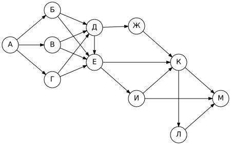
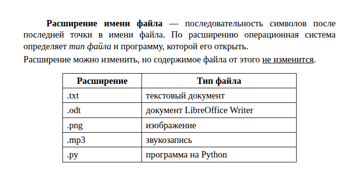
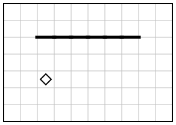
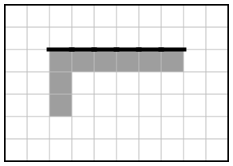

# Вариант 6

| Время | Заданий | Максимум |
|---|---|---|
| 2 ч 30 мин (150 минут) | 16 | 21 балл |

**Как выполнять.** Задания 1–10 решайте без компьютера и записывайте ответы на листок. Задания 11–16 выполняйте на компьютере. Ответы — в самом конце файла, под спойлером. Не подглядывайте до конца работы!

**Материалы:** каталог [`materials/archive`](../materials/archive) (задания 11, 12), файл [`materials/task14/variant-06.xlsx`](../materials/task14/variant-06.xlsx) (задание 14). Для задания 15 нужна среда КуМир, для 16 — Python.

Если времени мало (1 час), сделайте за одно занятие задания 1–12, а 13–16 — за следующее.

## Часть 1

### Задание 1

В кодировке Windows-1251 каждый символ кодируется 8 битами. Аня написала текст (в нём нет лишних пробелов):

«Дон, Урал, Кама, Иртыш, Печора, Ангара, Енисей – реки России».

Ученик вычеркнул из списка название одной реки. Заодно он вычеркнул ставшие лишними запятую и пробел — два пробела не должны идти подряд.

При этом размер нового предложения в данной кодировке оказался на 56 бит меньше, чем размер исходного предложения. Напишите в ответе вычеркнутое название реки.

### Задание 2

Маша шифрует русские слова, записывая вместо каждой буквы её код:

| А | Д | К | Н | О | С |
|---|---|---|---|---|---|
| `01` | `100` | `101` | `10` | `111` | `000` |

Некоторые цепочки можно расшифровать не одним способом. Даны три кодовые цепочки:

- `100111101`
- `10011100010101`
- `10111110001`

Найдите среди них ту, которая имеет только одну расшифровку, и запишите в ответе расшифрованное слово.

### Задание 3

Напишите наименьшее натуральное число X, для которого ложно высказывание:

**(X > 42) ИЛИ (X < 28)**

### Задание 4

Между населёнными пунктами A, B, C, D, E построены дороги, протяжённость которых (в километрах) приведена в таблице.

|   | A | B | C | D | E |
|---|---|---|---|---|---|
| **A** |  | 2 | 1 | 6 |  |
| **B** | 2 |  | 7 | 4 | 9 |
| **C** | 1 | 7 |  | 7 |  |
| **D** | 6 | 4 | 7 |  | 9 |
| **E** |  | 9 |  | 9 |  |

Определите длину кратчайшего пути между пунктами A и E, проходящего через пункт D. Передвигаться можно только по дорогам, протяжённость которых указана в таблице.

### Задание 5

У исполнителя Утроитель две команды:

1. **прибавь 5**
2. **умножь на 3**

Запишите порядок команд в программе, которая преобразует число 6 в число 312 и содержит не более пяти команд, указывая лишь номера команд.

### Задание 6

Ниже приведена программа, записанная на языке Python.

```python
s = int(input())
t = int(input())
if s + t > 8:
    print("YES")
else:
    print("NO")
```

Было проведено 9 запусков программы, при которых в качестве значений переменных s и t вводились следующие пары чисел:

(-2, 11), (9, 13), (4, 4), (15, -4), (7, 1), (5, -2), (2, 9), (3, 8), (6, 5).

Сколько было запусков, при которых программа напечатала «YES»?

### Задание 7

Доступ к файлу **ftp.jpg**, находящемуся на сервере **obr.org**, осуществляется по протоколу **http**. Фрагменты адреса файла закодированы буквами от А до Ж. Запишите последовательность этих букв, кодирующую адрес указанного файла в сети Интернет.

А) `http`
Б) `obr.`
В) `://`
Г) `jpg`
Д) `org`
Е) `/`
Ж) `ftp.`

### Задание 8

В языке запросов поискового сервера для обозначения логической операции «ИЛИ» используется символ «|», а для обозначения логической операции «И» — символ «&».

В таблице приведены запросы и количество найденных по ним страниц некоторого сегмента сети Интернет.

| Запрос | Найдено страниц (в тысячах) |
|---|---|
| Рыбка \| Рыбак | 4670 |
| Рыбка | 2880 |
| Рыбак | 2140 |

Какое количество страниц (в тысячах) будет найдено по запросу **Рыбка & Рыбак**?

Считается, что все запросы выполнялись практически одновременно, так что набор страниц, содержащих все искомые слова, не изменялся за время выполнения запросов.

### Задание 9

На рисунке — схема дорог, связывающих города А, Б, В, Г, Д, Е, Ж, И, К, Л, М. По каждой дороге можно двигаться только в одном направлении, указанном стрелкой.



Сколько существует различных путей из города А в город М, не проходящих через город Е?

### Задание 10

Среди приведённых ниже трёх чисел, записанных в различных системах счисления, найдите минимальное и запишите его в ответе в десятичной системе счисления. В ответе запишите только число, основание системы счисления указывать не нужно.

B8<sub>16</sub>, 1110010<sub>2</sub>, 36<sub>8</sub>

## Часть 2

Задания этой части выполняются на компьютере.

### Задание 11

В одной из статей архива рассказывается об ученике, набравшем на олимпиаде 95 баллов из 100. По какому предмету проходила эта олимпиада? Ответ запишите так, как он указан в тексте (например: «химии»).

Ищите в каталоге `materials/archive`.

### Задание 12

Каков общий объём (в Кбайтах) всех файлов в каталоге **archive/photo** и его подкаталогах? Ответ округлите до целого числа.

### Задание 13

Выберите **одно** из заданий: 13.1 или 13.2.

#### 13.1. Презентация «Ромашка»

Используя информацию и иллюстративный материал о теме «**Ромашка**», создайте презентацию из **трёх слайдов**.

В презентации должны использоваться простые шаблоны оформления: следует использовать единый стиль оформления всех слайдов, фон слайдов должен быть одинаковым (не белым).

1. **Первый слайд** — титульный слайд с названием презентации; в подзаголовке титульного слайда в качестве информации об авторе презентации указывается ваше имя (или идентификационный номер).
2. **Второй слайд** — основная информация в соответствии с заданием, размещённая по образцу (заголовок, три изображения, подписи к ним или текст).
3. **Третий слайд** — дополнительная информация по теме: заголовок, одно изображение и текст.

Размер шрифта: для названия презентации на титульном слайде — **40 пунктов**; для подзаголовка на титульном слайде и заголовков слайдов — **24 пункта**; для основного текста — **20 пунктов**.

Текст не должен перекрывать основные изображения или сливаться с фоном.

Информация для слайдов: Ромашка аптечная — однолетнее растение семейства Астровые. Её соцветия используют в медицине. Ромашку легко узнать по белым лепесткам и жёлтой серединке.

Изображения найдите самостоятельно (на экзамене их дают в каталоге задания). Сохраните презентацию в формате **.odp** (LibreOffice Impress) или **.pptx** (PowerPoint).

#### 13.2. Документ «Расширения файлов»

Создайте в текстовом редакторе документ и напишите в нём следующий текст, точно воспроизведя всё оформление текста, имеющееся в образце.

Данный текст должен быть набран шрифтом размером **14 пунктов** обычного начертания. Отступ первой строки первого абзаца основного текста — **1,25 см**. Расстояние между строками текста не менее одинарного, но не более полуторного междустрочного интервала.

Основной текст выровнен **по ширине**; в ключевых словах первого абзаца применено полужирное и курсивное начертание; во втором абзаце одно слово подчёркнуто.

Таблица (6 строк, 2 столбца) выровнена **по центру**; ширина таблицы меньше ширины основного текста. Текст в первой строке таблицы — полужирный, выровнен по центру; в остальных ячейках — выравнивание по левому краю.

При этом допустимо, чтобы ширина вашего текста отличалась от ширины текста в примере, поскольку ширина текста зависит от размеров страницы и полей. В этом случае разбиение текста на строки должно соответствовать стандартной ширине абзаца.

**Образец:**



### Задание 14

Откройте файл [`variant-06.xlsx`](../materials/task14/variant-06.xlsx).

В электронную таблицу занесли данные наблюдения за погодой в течение 2024 года. В столбце A записана дата наблюдения, в столбце B — среднесуточная температура воздуха (°C), в столбце C — количество осадков (мм), в столбце D — атмосферное давление (мм рт. ст.), в столбце E — направление ветра, в столбце F — средняя скорость ветра (м/с).

Всего в таблицу были занесены данные по 366 дням.

Первые строки таблицы:

|   | A | B | C | D | E | F |
|---|---|---|---|---|---|---|
| **1** | **дата** | **температура** | **осадки** | **давление** | **ветер** | **скорость ветра** |
| **2** | 01.01.2024 | -15,2 | 0,1 | 736 | Ю | 0,8 |
| **3** | 02.01.2024 | -17,5 | 0,0 | 740 | В | 11,1 |
| **4** | 03.01.2024 | -10,9 | 0,0 | 730 | З | 10,8 |
| **5** | 04.01.2024 | -12,6 | 1,0 | 766 | З | 10,7 |


Выполните задание:

1. Какова средняя температура воздуха в **августе** 2024 года? Ответ на этот вопрос запишите в ячейку **H2** таблицы с точностью не менее двух знаков после запятой.
2. Сколько дней дул **южный** ветер (**Ю**) со скоростью **более 7 м/с**? Ответ на этот вопрос запишите в ячейку **H3** таблицы.
3. Постройте круговую диаграмму, отображающую соотношение количества дней, когда дул ветер направлений «СЗ», «С» и «З». Левый верхний угол диаграммы разместите вблизи ячейки **G6**. В поле диаграммы должны присутствовать легенда и числовые значения данных, по которым построена диаграмма.

Полученную таблицу сохраните в формате `.ods`.

### Задание 15

Исполнитель Робот умеет перемещаться по лабиринту, начерченному на плоскости, разбитой на клетки. Система команд и проверок — [в теории](../theory/08-kumir.md).

На бесконечном поле имеется горизонтальная стена. Длина стены неизвестна. Робот находится ниже стены в столбце, соответствующем левому концу стены, на неизвестном расстоянии от неё.

Требуется закрасить клетку, в которой находится Робот, все клетки между Роботом и стеной, а также все клетки, расположенные непосредственно под стеной.

При исполнении алгоритма Робот не должен разрушиться, выполнение алгоритма должно завершиться. Конечное расположение Робота может быть произвольным. Алгоритм должен решать задачу для любого допустимого расположения стен и любого расположения и размера проходов внутри стен.

| Пример поля | Нужно закрасить |
|---|---|
|  |  |

Алгоритм может быть выполнен в среде КуМир или записан в текстовом редакторе.

### Задание 16

Напишите программу, которая в последовательности натуральных чисел определяет максимальное число, оканчивающееся на 6. Программа должна вывести одно число — максимальное число, оканчивающееся на 6.

Программа получает на вход натуральные числа, количество введённых чисел неизвестно, последовательность чисел заканчивается числом 0 (0 — признак окончания ввода, не входит в последовательность). Количество чисел не превышает 1000. Введённые числа не превышают 30 000. В последовательности всегда имеется хотя бы одно число, оканчивающееся на 6.

**Пример работы программы:**

| Входные данные | Выходные данные |
|---|---|
| 6182<br>9960<br>18845<br>20126<br>11872<br>484<br>0 | 20126 |

---

## Ответы

<details><summary>Показать ответы и решения</summary>

**Задания 1–12** (по 1 баллу):

| № | Ответ |
|---|---|
| 1 | Иртыш |
| 2 | КОДА |
| 3 | 28 |
| 4 | 15 |
| 5 | 12212 |
| 6 | 6 |
| 7 | АВБДЕЖГ |
| 8 | 350 |
| 9 | 6 |
| 10 | 30 |
| 11 | информатике |
| 12 | 232 |

**Задание 13** (2 балла): Проверка по чек-листам: [13.1](../tasks/13-presentation-text.md#чек-лист-самопроверки-131), [13.2](../tasks/13-presentation-text.md#чек-лист-самопроверки-132).

**Задание 14** (3 балла):

1. **12,68**
2. **20**
3. **СЗ — 35; С — 45; З — 38** (значения для диаграммы)

**Задание 15** (2 балла), один из возможных алгоритмов:

```
использовать Робот
алг
нач
  нц пока сверху свободно
    закрасить
    вверх
  кц
  нц пока сверху стена
    закрасить
    вправо
  кц
кон
```

**Задание 16** (2 балла), один из возможных вариантов программы:

```python
mx = 0
x = int(input())
while x != 0:
    if x % 10 == 6 and x > mx:
        mx = x
    x = int(input())
print(mx)
```

Тесты для проверки:

| № | Вход | Выход |
|---|---|---|
| 1 | 6182<br>9960<br>18845<br>20126<br>11872<br>484<br>0 | 20126 |
| 2 | 8896<br>21826<br>24887<br>5146<br>4439<br>24137<br>0 | 21826 |
| 3 | 10983<br>10504<br>25564<br>5706<br>0 | 5706 |
| 4 | 5118<br>25076<br>10258<br>22376<br>26831<br>8738<br>10800<br>12524<br>18804<br>1305<br>0 | 25076 |

**Перевод в оценку:** 0–4 → «2», 5–10 → «3», 11–16 → «4», 17–21 → «5».

</details>


[← Все варианты](README.md) · [К оглавлению](../README.md)
