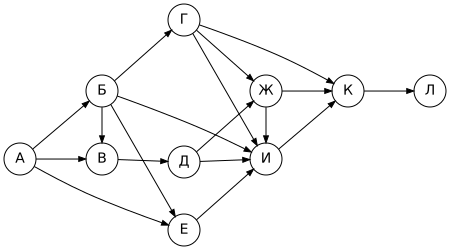
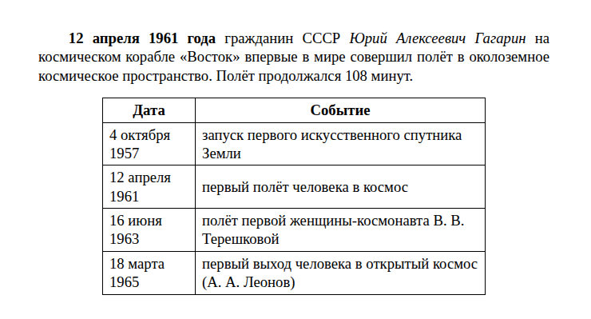
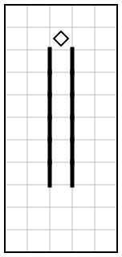
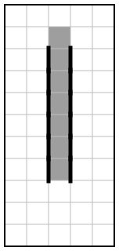

# Вариант 7

| Время | Заданий | Максимум |
|---|---|---|
| 2 ч 30 мин (150 минут) | 16 | 21 балл |

**Как выполнять.** Задания 1–10 решайте без компьютера и записывайте ответы на листок. Задания 11–16 выполняйте на компьютере. Ответы — в самом конце файла, под спойлером. Не подглядывайте до конца работы!

**Материалы:** каталог [`materials/archive`](../materials/archive) (задания 11, 12), файл [`materials/task14/variant-07.xlsx`](../materials/task14/variant-07.xlsx) (задание 14). Для задания 15 нужна среда КуМир, для 16 — Python.

Если времени мало (1 час), сделайте за одно занятие задания 1–12, а 13–16 — за следующее.

## Часть 1

### Задание 1

Реферат, набранный на компьютере, содержит 20 страниц, на каждой странице 64 строки, в каждой строке 60 символов. Определите информационный объём текста в кодировке, в которой каждый символ кодируется 8 битами. Ответ дайте в килобайтах.

### Задание 2

Мальчики играли в шпионов и закодировали сообщение придуманным шифром. В сообщении присутствуют только буквы из приведённого фрагмента кодовой таблицы:

| А | Б | В | Г | Д | Е | Ж | З |
|---|---|---|---|---|---|---|---|
| `•–` | `–•••` | `•––` | `––•` | `–••` | `•` | `•••–` | `––••` |

Определите, какое сообщение закодировано в строчке

`––•–•••–•••••–––•••––`

Известно, что буквы в сообщении не повторяются. В ответе запишите сообщение.

### Задание 3

Напишите наименьшее натуральное число X, для которого истинно высказывание:

**НЕ (X > 55) И (X чётное)**

### Задание 4

Между населёнными пунктами A, B, C, D, E построены дороги, протяжённость которых (в километрах) приведена в таблице.

|   | A | B | C | D | E |
|---|---|---|---|---|---|
| **A** |  |  | 2 |  |  |
| **B** |  |  | 4 |  | 1 |
| **C** | 2 | 4 |  | 2 |  |
| **D** |  |  | 2 |  | 1 |
| **E** |  | 1 |  | 1 |  |

Определите длину кратчайшего пути между пунктами A и E. Передвигаться можно только по дорогам, протяжённость которых указана в таблице.

### Задание 5

У исполнителя Гамма две команды, которым присвоены номера:

1. **вычти 2**
2. **умножь на b**

(b — неизвестное натуральное число; b ≥ 2).

Выполняя первую из них, Гамма уменьшает число на экране на 2, а выполняя вторую, умножает это число на b. Программа для исполнителя Гамма — это последовательность номеров команд.

Известно, что программа **21111** переводит число 35 в число 202. Определите значение b.

### Задание 6

Ниже приведена программа, записанная на языке Python.

```python
s = int(input())
t = int(input())
if s > 5 or t > A:
    print("YES")
else:
    print("NO")
```

Было проведено 9 запусков программы, при которых в качестве значений переменных s и t вводились следующие пары чисел:

(-2, -2), (11, 13), (6, 0), (9, -2), (14, 11), (3, -1), (13, 0), (4, -5), (1, 1).

Укажите наибольшее целое значение параметра A, при котором для указанных входных данных программа напечатает «YES» 7 раз.

### Задание 7

Доступ к файлу **math.pdf**, находящемуся на сервере **obr.org**, осуществляется по протоколу **http**. Фрагменты адреса файла закодированы буквами от А до Ж. Запишите последовательность этих букв, кодирующую адрес указанного файла в сети Интернет.

А) `org`
Б) `pdf`
В) `://`
Г) `http`
Д) `math.`
Е) `obr.`
Ж) `/`

### Задание 8

В языке запросов поискового сервера для обозначения логической операции «ИЛИ» используется символ «|», а для обозначения логической операции «И» — символ «&».

В таблице приведены запросы и количество найденных по ним страниц некоторого сегмента сети Интернет.

| Запрос | Найдено страниц (в тысячах) |
|---|---|
| Петербург | 3010 |
| Москва \| Петербург | 3630 |
| Москва & Петербург | 200 |

Какое количество страниц (в тысячах) будет найдено по запросу **Москва**?

Считается, что все запросы выполнялись практически одновременно, так что набор страниц, содержащих все искомые слова, не изменялся за время выполнения запросов.

### Задание 9

На рисунке — схема дорог, связывающих города А, Б, В, Г, Д, Е, Ж, И, К, Л. По каждой дороге можно двигаться только в одном направлении, указанном стрелкой.



Сколько существует различных путей из города А в город Л?

### Задание 10

Среди приведённых ниже трёх чисел, записанных в различных системах счисления, найдите минимальное и запишите его в ответе в десятичной системе счисления. В ответе запишите только число, основание системы счисления указывать не нужно.

38<sub>16</sub>, 10110011<sub>2</sub>, 66<sub>8</sub>

## Часть 2

Задания этой части выполняются на компьютере.

### Задание 11

Ученики одного из классов ездили в город, поездка длилась 3 дня и её организовал Даниил Большаков. В какой город ездили ребята? Запишите название так, как оно указано в тексте.

Ищите в каталоге `materials/archive`.

### Задание 12

Сколько файлов с расширением **.png** объёмом **более 10 Кбайт** содержится в каталоге **archive** и всех его подкаталогах? В ответе укажите только число.

### Задание 13

Выберите **одно** из заданий: 13.1 или 13.2.

#### 13.1. Презентация «Олимпийские игры»

Используя информацию и иллюстративный материал о теме «**Олимпийские игры**», создайте презентацию из **трёх слайдов**.

В презентации должны использоваться простые шаблоны оформления: следует использовать единый стиль оформления всех слайдов, фон слайдов должен быть одинаковым (не белым).

1. **Первый слайд** — титульный слайд с названием презентации; в подзаголовке титульного слайда в качестве информации об авторе презентации указывается ваше имя (или идентификационный номер).
2. **Второй слайд** — основная информация в соответствии с заданием, размещённая по образцу (заголовок, три изображения, подписи к ним или текст).
3. **Третий слайд** — дополнительная информация по теме: заголовок, одно изображение и текст.

Размер шрифта: для названия презентации на титульном слайде — **40 пунктов**; для подзаголовка на титульном слайде и заголовков слайдов — **24 пункта**; для основного текста — **20 пунктов**.

Текст не должен перекрывать основные изображения или сливаться с фоном.

Информация для слайдов: Олимпийские игры — крупнейшие международные спортивные соревнования. Летние и зимние игры проводятся раз в четыре года. Символ игр — пять переплетённых колец.

Изображения найдите самостоятельно (на экзамене их дают в каталоге задания). Сохраните презентацию в формате **.odp** (LibreOffice Impress) или **.pptx** (PowerPoint).

#### 13.2. Документ «Освоение космоса»

Создайте в текстовом редакторе документ и напишите в нём следующий текст, точно воспроизведя всё оформление текста, имеющееся в образце.

Данный текст должен быть набран шрифтом размером **14 пунктов** обычного начертания. Отступ первой строки первого абзаца основного текста — **1,0 см**. Расстояние между строками текста не менее одинарного, но не более полуторного междустрочного интервала.

Основной текст выровнен **по ширине**; в ключевых словах первого абзаца применено полужирное и курсивное начертание.

Таблица (5 строк, 2 столбца) выровнена **по центру**; ширина таблицы меньше ширины основного текста. Текст в первой строке таблицы — полужирный, выровнен по центру; в остальных ячейках — выравнивание по левому краю.

При этом допустимо, чтобы ширина вашего текста отличалась от ширины текста в примере, поскольку ширина текста зависит от размеров страницы и полей. В этом случае разбиение текста на строки должно соответствовать стандартной ширине абзаца.

**Образец:**



### Задание 14

Откройте файл [`variant-07.xlsx`](../materials/task14/variant-07.xlsx).

В электронную таблицу занесли данные о калорийности продуктов. В столбце A записан продукт; в столбце B — содержание в нём жиров; в столбце C — содержание белков; в столбце D — содержание углеводов; в столбце E — калорийность этого продукта (все значения — на 100 г продукта).

Всего в электронную таблицу были занесены данные по 488 продуктам.

Первые строки таблицы:

|   | A | B | C | D | E |
|---|---|---|---|---|---|
| **1** | **продукт** | **жиры, г** | **белки, г** | **углеводы, г** | **калорийность, ккал** |
| **2** | Пшено-1 | 2,6 | 4,3 | 52,7 | 251 |
| **3** | Авокадо-2 | 9,3 | 12,1 | 49,2 | 329 |
| **4** | Картофель-3 | 27,5 | 22,1 | 62,6 | 586 |
| **5** | Картофель-4 | 16,4 | 15,0 | 27,1 | 316 |


Выполните задание:

1. Сколько продуктов в таблице содержат **меньше 10 г жиров** и **меньше 10 г белков**? Запишите число этих продуктов в ячейку **H2** таблицы.
2. Какова средняя калорийность продуктов, у которых содержание **углеводов больше 20 г**? Ответ на этот вопрос запишите в ячейку **H3** таблицы с точностью не менее двух знаков после запятой.
3. Постройте круговую диаграмму, отображающую соотношение количества продуктов, у которых калорийность **меньше 200** ккал, **от 200 до 400** ккал включительно и **больше 400** ккал. Левый верхний угол диаграммы разместите вблизи ячейки **G6**. В поле диаграммы должны присутствовать легенда и числовые значения данных, по которым построена диаграмма.

Полученную таблицу сохраните в формате `.ods`.

### Задание 15

Исполнитель Робот умеет перемещаться по лабиринту, начерченному на плоскости, разбитой на клетки. Система команд и проверок — [в теории](../theory/08-kumir.md).

На бесконечном поле имеются две вертикальные стены одинаковой длины, образующие вертикальный коридор шириной в одну клетку. Длина стен неизвестна. Робот находится в клетке непосредственно над входом в коридор.

Требуется закрасить все клетки коридора и клетку, в которой находится Робот.

При исполнении алгоритма Робот не должен разрушиться, выполнение алгоритма должно завершиться. Конечное расположение Робота может быть произвольным. Алгоритм должен решать задачу для любого допустимого расположения стен и любого расположения и размера проходов внутри стен.

| Пример поля | Нужно закрасить |
|---|---|
|  |  |

Алгоритм может быть выполнен в среде КуМир или записан в текстовом редакторе.

### Задание 16

Напишите программу, которая в последовательности натуральных чисел определяет количество двузначных чисел, кратных 5. Программа должна вывести одно число.

Программа получает на вход количество чисел в последовательности, а затем сами числа. Количество чисел не превышает 1000. Введённые числа — натуральные, не превышают 30 000.

**Пример работы программы:**

| Входные данные | Выходные данные |
|---|---|
| 6<br>148<br>19<br>86<br>52<br>49<br>81 | 0 |

---

## Ответы

<details><summary>Показать ответы и решения</summary>

**Задания 1–12** (по 1 баллу):

| № | Ответ |
|---|---|
| 1 | 75 |
| 2 | ГБДЖЗВ |
| 3 | 2 |
| 4 | 5 |
| 5 | 6 |
| 6 | -2 |
| 7 | ГВЕАЖДБ |
| 8 | 820 |
| 9 | 13 |
| 10 | 54 |
| 11 | Кострома |
| 12 | 8 |

**Задание 13** (2 балла): Проверка по чек-листам: [13.1](../tasks/13-presentation-text.md#чек-лист-самопроверки-131), [13.2](../tasks/13-presentation-text.md#чек-лист-самопроверки-132).

**Задание 14** (3 балла):

1. **52**
2. **420,01**
3. **меньше 200 — 52; от 200 до 400 — 214; больше 400 — 222** (значения для диаграммы)

**Задание 15** (2 балла), один из возможных алгоритмов:

```
использовать Робот
алг
нач
  закрасить
  вниз
  нц пока слева стена
    закрасить
    вниз
  кц
кон
```

**Задание 16** (2 балла), один из возможных вариантов программы:

```python
n = int(input())
count = 0
for i in range(n):
    x = int(input())
    if 10 <= x <= 99 and x % 5 == 0:
        count += 1
print(count)
```

Тесты для проверки:

| № | Вход | Выход |
|---|---|---|
| 1 | 6<br>148<br>19<br>86<br>52<br>49<br>81 | 0 |
| 2 | 4<br>65<br>148<br>9<br>75 | 2 |
| 3 | 4<br>78<br>85<br>94<br>116 | 1 |
| 4 | 12<br>22<br>60<br>90<br>48<br>73<br>28<br>10<br>114<br>125<br>10<br>50<br>108 | 5 |

**Перевод в оценку:** 0–4 → «2», 5–10 → «3», 11–16 → «4», 17–21 → «5».

</details>


[← Все варианты](README.md) · [К оглавлению](../README.md)
