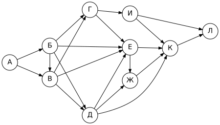
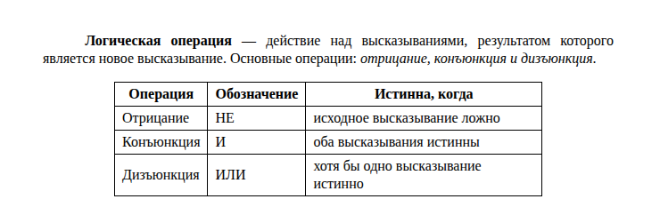
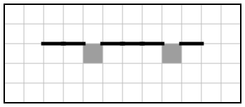

# Вариант 8

| Время | Заданий | Максимум |
|---|---|---|
| 2 ч 30 мин (150 минут) | 16 | 21 балл |

**Как выполнять.** Задания 1–10 решайте без компьютера и записывайте ответы на листок. Задания 11–16 выполняйте на компьютере. Ответы — в самом конце файла, под спойлером. Не подглядывайте до конца работы!

**Материалы:** каталог [`materials/archive`](../materials/archive) (задания 11, 12), файл [`materials/task14/variant-08.xlsx`](../materials/task14/variant-08.xlsx) (задание 14). Для задания 15 нужна среда КуМир, для 16 — Python.

Если времени мало (1 час), сделайте за одно занятие задания 1–12, а 13–16 — за следующее.

## Часть 1

### Задание 1

В кодировке UTF-32 каждый символ кодируется 32 битами. Дима написал текст (в нём нет лишних пробелов):

«Олень, барсук, гепард, носорог, бегемот, дикобраз, муравьед, аллигатор – дикие животные».

Ученик вычеркнул из списка название одного животного. Заодно он вычеркнул ставшие лишними запятую и пробел — два пробела не должны идти подряд.

При этом размер нового предложения в данной кодировке оказался на 44 байта меньше, чем размер исходного предложения. Напишите в ответе вычеркнутое название животного.

### Задание 2

Лена шифрует русские слова, записывая вместо каждой буквы её код:

| А | Д | К | Н | О | С |
|---|---|---|---|---|---|
| `01` | `100` | `101` | `10` | `111` | `000` |

Некоторые цепочки можно расшифровать не одним способом. Даны три кодовые цепочки:

- `10011110`
- `100111101`
- `10011100010101`

Найдите среди них ту, которая имеет только одну расшифровку, и запишите в ответе расшифрованное слово.

### Задание 3

Для какого из приведённых имён **истинно** высказывание:

**НЕ (Последняя буква гласная) И НЕ (Вторая буква гласная)**?

1) Юлия
2) Максим
3) Вера
4) Олег

В ответе запишите имя.

### Задание 4

Между населёнными пунктами A, B, C, D, E построены дороги, протяжённость которых (в километрах) приведена в таблице.

|   | A | B | C | D | E |
|---|---|---|---|---|---|
| **A** |  | 5 | 4 |  |  |
| **B** | 5 |  | 2 |  | 1 |
| **C** | 4 | 2 |  | 6 |  |
| **D** |  |  | 6 |  | 2 |
| **E** |  | 1 |  | 2 |  |

Определите длину кратчайшего пути между пунктами A и E. Передвигаться можно только по дорогам, протяжённость которых указана в таблице.

### Задание 5

У исполнителя Омега две команды, которым присвоены номера:

1. **прибавь 2**
2. **умножь на b**

(b — неизвестное натуральное число; b ≥ 2).

Выполняя первую из них, Омега увеличивает число на экране на 2, а выполняя вторую, умножает это число на b. Программа для исполнителя Омега — это последовательность номеров команд.

Известно, что программа **21122** переводит число 38 в число 2496. Определите значение b.

### Задание 6

Ниже приведена программа, записанная на языке Python.

```python
s = int(input())
t = int(input())
if s + t > 5:
    print("YES")
else:
    print("NO")
```

Было проведено 9 запусков программы, при которых в качестве значений переменных s и t вводились следующие пары чисел:

(7, 13), (-1, 9), (5, -5), (15, 12), (-4, 1), (7, -3), (13, 11), (3, 3), (9, 3).

Сколько было запусков, при которых программа напечатала «NO»?

### Задание 7

Доступ к файлу **song.mp3**, находящемуся на сервере **home.net**, осуществляется по протоколу **http**. Фрагменты адреса файла закодированы буквами от А до Ж. Запишите последовательность этих букв, кодирующую адрес указанного файла в сети Интернет.

А) `/`
Б) `home.`
В) `song.`
Г) `://`
Д) `net`
Е) `mp3`
Ж) `http`

### Задание 8

В языке запросов поискового сервера для обозначения логической операции «ИЛИ» используется символ «|», а для обозначения логической операции «И» — символ «&».

В таблице приведены запросы и количество найденных по ним страниц некоторого сегмента сети Интернет.

| Запрос | Найдено страниц (в тысячах) |
|---|---|
| Фрегат | 1400 |
| Фрегат \| Эсминец | 3340 |
| Эсминец | 2310 |

Какое количество страниц (в тысячах) будет найдено по запросу **Фрегат & Эсминец**?

Считается, что все запросы выполнялись практически одновременно, так что набор страниц, содержащих все искомые слова, не изменялся за время выполнения запросов.

### Задание 9

На рисунке — схема дорог, связывающих города А, Б, В, Г, Д, Е, Ж, И, К, Л. По каждой дороге можно двигаться только в одном направлении, указанном стрелкой.



Сколько существует различных путей из города А в город Л?

### Задание 10

Переведите число 190 из десятичной системы счисления в двоичную систему счисления. Сколько единиц содержит полученное число? В ответе укажите одно число.

## Часть 2

Задания этой части выполняются на компьютере.

### Задание 11

В одной из статей рассказывается о шахматном турнире. В решающей партии последнего тура проиграла шахматистка по фамилии Алексеева. Назовите фамилию победителя турнира.

Ищите в каталоге `materials/archive`.

### Задание 12

Сколько файлов с расширением **.txt** содержится в подкаталогах каталога **archive/2022**? В ответе укажите только число.

### Задание 13

Выберите **одно** из заданий: 13.1 или 13.2.

#### 13.1. Презентация «Кремль»

Используя информацию и иллюстративный материал о теме «**Кремль**», создайте презентацию из **трёх слайдов**.

В презентации должны использоваться простые шаблоны оформления: следует использовать единый стиль оформления всех слайдов, фон слайдов должен быть одинаковым (не белым).

1. **Первый слайд** — титульный слайд с названием презентации; в подзаголовке титульного слайда в качестве информации об авторе презентации указывается ваше имя (или идентификационный номер).
2. **Второй слайд** — основная информация в соответствии с заданием, размещённая по образцу (заголовок, три изображения, подписи к ним или текст).
3. **Третий слайд** — дополнительная информация по теме: заголовок, одно изображение и текст.

Размер шрифта: для названия презентации на титульном слайде — **40 пунктов**; для подзаголовка на титульном слайде и заголовков слайдов — **24 пункта**; для основного текста — **20 пунктов**.

Текст не должен перекрывать основные изображения или сливаться с фоном.

Информация для слайдов: Московский Кремль — крепость в центре Москвы, главный общественно-политический и историко-художественный комплекс города. Кремль окружён стенами с двадцатью башнями.

Изображения найдите самостоятельно (на экзамене их дают в каталоге задания). Сохраните презентацию в формате **.odp** (LibreOffice Impress) или **.pptx** (PowerPoint).

#### 13.2. Документ «Логические операции»

Создайте в текстовом редакторе документ и напишите в нём следующий текст, точно воспроизведя всё оформление текста, имеющееся в образце.

Данный текст должен быть набран шрифтом размером **12 пунктов** обычного начертания. Отступ первой строки первого абзаца основного текста — **1,25 см**. Расстояние между строками текста не менее одинарного, но не более полуторного междустрочного интервала.

Основной текст выровнен **по ширине**; в ключевых словах первого абзаца применено полужирное и курсивное начертание.

Таблица (4 строки, 3 столбца) выровнена **по центру**; ширина таблицы меньше ширины основного текста. Текст в первой строке таблицы — полужирный, выровнен по центру; в остальных ячейках — выравнивание по левому краю.

При этом допустимо, чтобы ширина вашего текста отличалась от ширины текста в примере, поскольку ширина текста зависит от размеров страницы и полей. В этом случае разбиение текста на строки должно соответствовать стандартной ширине абзаца.

**Образец:**



### Задание 14

Откройте файл [`variant-08.xlsx`](../materials/task14/variant-08.xlsx).

В электронную таблицу занесли данные о продажах канцтоваров в сети магазинов. В столбце A записано название магазина; в столбце B — товар; в столбце C — количество проданных единиц; в столбце D — цена одной единицы товара (руб.).

Всего в электронную таблицу были занесены данные по 530 продажам.

Первые строки таблицы:

|   | A | B | C | D |
|---|---|---|---|---|
| **1** | **магазин** | **товар** | **количество** | **цена, руб.** |
| **2** | Центральный | пенал | 7 | 350 |
| **3** | Лесной | карандаш | 30 | 15 |
| **4** | Центральный | дневник | 24 | 190 |
| **5** | Южный | карандаш | 6 | 15 |


Выполните задание:

1. Сколько всего единиц товара «**карандаш**» продано в магазине «**Заречный**»? Ответ на этот вопрос запишите в ячейку **H2** таблицы.
2. В столбце **E** для каждой записи вычислите стоимость покупки (количество × цена). Какова общая выручка магазина «**Заречный**»? Ответ на этот вопрос запишите в ячейку **H3** таблицы.
3. Постройте круговую диаграмму, отображающую соотношение числа записей о продажах в магазинах «Заречный», «Центральный» и «Северный». Левый верхний угол диаграммы разместите вблизи ячейки **G6**. В поле диаграммы должны присутствовать легенда и числовые значения данных, по которым построена диаграмма.

Полученную таблицу сохраните в формате `.ods`.

### Задание 15

Исполнитель Робот умеет перемещаться по лабиринту, начерченному на плоскости, разбитой на клетки. Система команд и проверок — [в теории](../theory/08-kumir.md).

На бесконечном поле имеется горизонтальная стена, в которой есть несколько проходов шириной в одну клетку. Длина стены, число и расположение проходов неизвестны. Известно, что никакие два прохода не расположены рядом и проходов нет у концов стены. Робот находится в клетке непосредственно под стеной у её левого конца.

Требуется закрасить все клетки, расположенные непосредственно **под проходами**.

При исполнении алгоритма Робот не должен разрушиться, выполнение алгоритма должно завершиться. Конечное расположение Робота может быть произвольным. Алгоритм должен решать задачу для любого допустимого расположения стен и любого расположения и размера проходов внутри стен.

| Пример поля | Нужно закрасить |
|---|---|
|  |  |

Алгоритм может быть выполнен в среде КуМир или записан в текстовом редакторе.

### Задание 16

Напишите программу, которая в последовательности натуральных чисел определяет, есть ли в ней число, кратное 13. Программа должна вывести «YES», если такое число есть, и «NO» в противном случае.

Программа получает на вход натуральные числа, количество введённых чисел неизвестно, последовательность чисел заканчивается числом 0 (0 — признак окончания ввода, не входит в последовательность). Количество чисел не превышает 1000. Введённые числа не превышают 30 000.

**Пример работы программы:**

| Входные данные | Выходные данные |
|---|---|
| 38<br>39<br>27<br>8<br>36<br>3<br>0 | YES |

---

## Ответы

<details><summary>Показать ответы и решения</summary>

**Задания 1–12** (по 1 баллу):

| № | Ответ |
|---|---|
| 1 | аллигатор |
| 2 | ДОН |
| 3 | Олег |
| 4 | 6 |
| 5 | 4 |
| 6 | 3 |
| 7 | ЖГБДАВЕ |
| 8 | 370 |
| 9 | 30 |
| 10 | 6 |
| 11 | Петухова |
| 12 | 4 |

**Задание 13** (2 балла): Проверка по чек-листам: [13.1](../tasks/13-presentation-text.md#чек-лист-самопроверки-131), [13.2](../tasks/13-presentation-text.md#чек-лист-самопроверки-132).

**Задание 14** (3 балла):

1. **93**
2. **506630**
3. **Заречный — 94; Центральный — 117; Северный — 95** (значения для диаграммы)

**Задание 15** (2 балла), один из возможных алгоритмов:

```
использовать Робот
алг
нач
  нц пока сверху стена
    нц пока сверху стена
      вправо
    кц
    вправо
    если сверху стена то
      влево
      закрасить
      вправо
    все
  кц
кон
```

**Задание 16** (2 балла), один из возможных вариантов программы:

```python
found = False
x = int(input())
while x != 0:
    if x % 13 == 0:
        found = True
    x = int(input())
if found:
    print("YES")
else:
    print("NO")
```

Тесты для проверки:

| № | Вход | Выход |
|---|---|---|
| 1 | 38<br>39<br>27<br>8<br>36<br>3<br>0 | YES |
| 2 | 25<br>28<br>15<br>24<br>31<br>55<br>0 | NO |
| 3 | 36<br>46<br>11<br>29<br>19<br>31<br>0 | NO |
| 4 | 44<br>56<br>32<br>18<br>8<br>38<br>2<br>0 | NO |

**Перевод в оценку:** 0–4 → «2», 5–10 → «3», 11–16 → «4», 17–21 → «5».

</details>


[← Все варианты](README.md) · [К оглавлению](../README.md)
