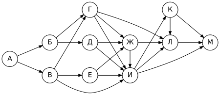
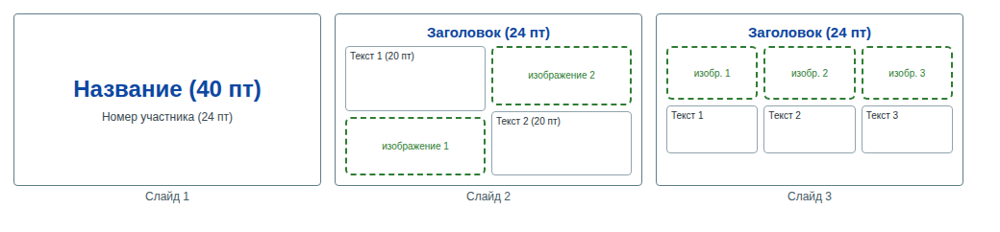
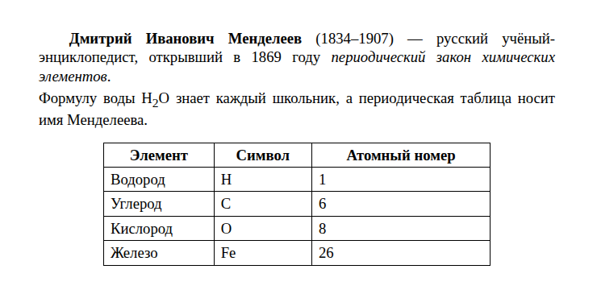
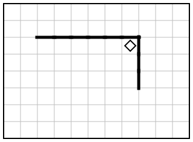
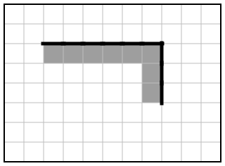

# Вариант 9

| Время | Заданий | Максимум |
|---|---|---|
| 2 ч 30 мин (150 минут) | 16 | 21 балл |

**Как выполнять.** Задания 1–10 решайте без компьютера и записывайте ответы на листок. Задания 11–16 выполняйте на компьютере. Ответы — в самом конце файла, под спойлером. Не подглядывайте до конца работы!

**Материалы:** каталог [`materials/archive`](../materials/archive) (задания 11, 12), файл [`materials/task14/variant-09.xlsx`](../materials/task14/variant-09.xlsx) (задание 14). Для задания 15 нужна среда КуМир, для 16 — Python.

Если времени мало (1 час), сделайте за одно занятие задания 1–12, а 13–16 — за следующее.

## Часть 1

### Задание 1

В кодировке Windows-1251 каждый символ кодируется 8 битами. Лена написала текст (в нём нет лишних пробелов):

«Арфа, орган, гитара, скрипка, барабан, саксофон, контрабас, виолончель – музыкальные инструменты».

Ученик вычеркнул из списка название одного инструмента. Заодно он вычеркнул ставшие лишними запятую и пробел — два пробела не должны идти подряд.

При этом размер нового предложения в данной кодировке оказался на 7 байт меньше, чем размер исходного предложения. Напишите в ответе вычеркнутое название инструмента.

### Задание 2

Мальчики играли в шпионов и закодировали сообщение придуманным шифром. В сообщении присутствуют только буквы из приведённого фрагмента кодовой таблицы:

| А | Б | В | Г | Д | Е | Ж | З |
|---|---|---|---|---|---|---|---|
| `•–` | `–•••` | `•––` | `––•` | `–••` | `•` | `•••–` | `––••` |

Определите, какое сообщение закодировано в строчке

`––••––••––•••–`

Известно, что буквы в сообщении не повторяются. В ответе запишите сообщение.

### Задание 3

Напишите наибольшее натуральное число X, для которого ложно высказывание:

**НЕ (X < 26) ИЛИ (X нечётное)**

### Задание 4

Между населёнными пунктами A, B, C, D, E построены дороги, протяжённость которых (в километрах) приведена в таблице.

|   | A | B | C | D | E |
|---|---|---|---|---|---|
| **A** |  |  |  | 8 | 2 |
| **B** |  |  |  |  | 8 |
| **C** |  |  |  | 7 | 6 |
| **D** | 8 |  | 7 |  | 7 |
| **E** | 2 | 8 | 6 | 7 |  |

Определите длину кратчайшего пути между пунктами A и E, проходящего через пункт C. Передвигаться можно только по дорогам, протяжённость которых указана в таблице.

### Задание 5

У исполнителя Удвоитель две команды:

1. **прибавь 5**
2. **умножь на 2**

Запишите порядок команд в программе, которая преобразует число 7 в число 101 и содержит не более пяти команд, указывая лишь номера команд.

### Задание 6

Ниже приведена программа, записанная на языке Python.

```python
s = int(input())
t = int(input())
if s + t > A:
    print("YES")
else:
    print("NO")
```

Было проведено 9 запусков программы, при которых в качестве значений переменных s и t вводились следующие пары чисел:

(-4, -2), (9, 11), (5, 7), (-3, -2), (1, -2), (12, -5), (15, 3), (-3, 10), (-4, 5).

Укажите наибольшее целое значение параметра A, при котором для указанных входных данных программа напечатает «YES» 2 раза.

### Задание 7

Доступ к файлу **www.htm**, находящемуся на сервере **edu.net**, осуществляется по протоколу **http**. Фрагменты адреса файла закодированы буквами от А до Ж. Запишите последовательность этих букв, кодирующую адрес указанного файла в сети Интернет.

А) `edu.`
Б) `http`
В) `/`
Г) `www.`
Д) `net`
Е) `://`
Ж) `htm`

### Задание 8

В языке запросов поискового сервера для обозначения логической операции «ИЛИ» используется символ «|», а для обозначения логической операции «И» — символ «&».

В таблице приведены запросы и количество найденных по ним страниц некоторого сегмента сети Интернет.

| Запрос | Найдено страниц (в тысячах) |
|---|---|
| Эсминец | 2290 |
| Фрегат \| Эсминец | 2590 |
| Фрегат & Эсминец | 230 |

Какое количество страниц (в тысячах) будет найдено по запросу **Фрегат**?

Считается, что все запросы выполнялись практически одновременно, так что набор страниц, содержащих все искомые слова, не изменялся за время выполнения запросов.

### Задание 9

На рисунке — схема дорог, связывающих города А, Б, В, Г, Д, Е, Ж, И, К, Л, М. По каждой дороге можно двигаться только в одном направлении, указанном стрелкой.



Сколько существует различных путей из города А в город М, проходящих через город В?

### Задание 10

Переведите число 1010000<sub>2</sub> в десятичную систему счисления. В ответе запишите полученное число.

## Часть 2

Задания этой части выполняются на компьютере.

### Задание 11

Ученики одного из классов ездили в город, поездка длилась 6 дней и её организовал Глеб Осипов. В какой город ездили ребята? Запишите название так, как оно указано в тексте.

Ищите в каталоге `materials/archive`.

### Задание 12

Сколько файлов с расширением **.txt** содержится в подкаталогах каталога **archive/2023**? В ответе укажите только число.

### Задание 13

Выберите **одно** из заданий: 13.1 или 13.2.

#### 13.1. Презентация «Космонавтика»

Используя информацию и иллюстративный материал о теме «**Космонавтика**», создайте презентацию из **трёх слайдов**. В презентации должны содержаться краткие иллюстрированные сведения по теме. Все слайды должны быть выполнены в едином стиле, каждый слайд должен быть озаглавлен.

**Требования к оформлению презентации**

1. Ровно три слайда **без анимации**. Параметры страницы (слайда): экран **16:9**, ориентация альбомная.
2. **Первый слайд** — титульный: название презентации; в подзаголовке — идентификационный номер участника экзамена (на тренировке — любой номер).
3. **Второй слайд** — основная информация, по макету: заголовок слайда, два блока текста, два изображения.
4. **Третий слайд** — дополнительная информация, по макету: заголовок слайда, три изображения, три блока текста.
5. В презентации используется **единый тип шрифта**. Размер шрифта: название на титульном слайде — **40 пт**; подзаголовок титульного слайда и заголовки слайдов — **24 пт**; основной текст — **20 пт**.
6. Текст не перекрывает изображения и не сливается с фоном; изображения не искажены (масштабируются пропорционально).

Информация для слайдов: 4 октября 1957 года в СССР был запущен первый искусственный спутник Земли. 12 апреля 1961 года Юрий Гагарин совершил первый полёт человека в космос на корабле «Восток».

Изображения подберите самостоятельно (на экзамене их дают в каталоге задания). Сохраните презентацию в формате **.odp** (LibreOffice Impress).

**Макет слайдов:**



#### 13.2. Документ «Д. И. Менделеев»

Создайте в текстовом редакторе документ и напишите в нём следующий текст, точно воспроизведя всё оформление текста, имеющееся в образце.

Данный текст должен быть набран шрифтом размером **14 пунктов** обычного начертания. Отступ первой строки первого абзаца основного текста — **1,0 см**. Расстояние между строками текста не менее одинарного, но не более полуторного междустрочного интервала.

Основной текст выровнен **по ширине**; в ключевых словах первого абзаца применено полужирное и курсивное начертание; есть нижний или верхний индекс.

Таблица (5 строк, 3 столбца) выровнена **по центру**; ширина таблицы меньше ширины основного текста. Текст в первой строке таблицы — полужирный, выровнен по центру; в остальных ячейках — выравнивание по левому краю.

Интервал между текстом и таблицей не менее 12 пунктов, но не более 24 пунктов.

При этом допустимо, чтобы ширина вашего текста отличалась от ширины текста в примере, поскольку ширина текста зависит от размеров страницы и полей. В этом случае разбиение текста на строки должно соответствовать стандартной ширине абзаца.

**Образец:**



### Задание 14

Откройте файл [`variant-09.xlsx`](../materials/task14/variant-09.xlsx).

В электронную таблицу занесли данные о тестировании учеников по выбранным ими предметам.

В столбце A записан код округа, в котором учится ученик; в столбце B — фамилия; в столбце C — выбранный учеником предмет; в столбце D — тестовый балл.

Всего в электронную таблицу были занесены данные по 696 ученикам.

Первые строки таблицы:

|   | A | B | C | D |
|---|---|---|---|---|
| **1** | **округ** | **фамилия** | **предмет** | **баллы** |
| **2** | С | Ученик 1 | химия | 616 |
| **3** | Ц | Ученик 2 | математика | 225 |
| **4** | С | Ученик 3 | литература | 944 |
| **5** | СЗ | Ученик 4 | химия | 704 |


Выполните задание:

1. Сколько учеников в Северо-Восточном округе (**СВ**) выбрали в качестве любимого предмета **физику**? Ответ на этот вопрос запишите в ячейку **H2** таблицы.
2. Каков средний тестовый балл у учеников Южного округа (**Ю**)? Ответ на этот вопрос запишите в ячейку **H3** таблицы с точностью не менее двух знаков после запятой.
3. Постройте круговую диаграмму, отображающую соотношение числа участников из округов с кодами «СЗ», «СВ» и «В». Левый верхний угол диаграммы разместите вблизи ячейки **G6**. В поле диаграммы должны присутствовать легенда (обозначение, какой сектор диаграммы соответствует каким данным) и числовые значения данных, по которым построена диаграмма.

Полученную таблицу сохраните в формате `.ods`.

### Задание 15

Исполнитель Робот умеет перемещаться по лабиринту, начерченному на плоскости, разбитой на клетки. Система команд и проверок — [в теории](../theory/08-kumir.md).

На бесконечном поле имеется горизонтальная стена. От правого конца стены вниз отходит вертикальная стена. Длины стен неизвестны. Робот находится в клетке, расположенной в углу: непосредственно под горизонтальной стеной и левее вертикальной.

Требуется закрасить все клетки, расположенные непосредственно ниже горизонтальной стены и левее вертикальной стены.

При исполнении алгоритма Робот не должен разрушиться, выполнение алгоритма должно завершиться. Конечное расположение Робота может быть произвольным. Алгоритм должен решать задачу для любого допустимого расположения стен и любого расположения и размера проходов внутри стен.

| Пример поля | Нужно закрасить |
|---|---|
|  |  |

Алгоритм может быть выполнен в среде КуМир или записан в текстовом редакторе.

### Задание 16

Напишите программу, которая в последовательности натуральных чисел определяет сумму чисел, оканчивающихся на 2 или на 5. Программа должна вывести одно число — сумму таких чисел.

Программа получает на вход количество чисел в последовательности, а затем сами числа. Количество чисел не превышает 1000. Введённые числа — натуральные, не превышают 30 000.

**Пример работы программы:**

| Входные данные | Выходные данные |
|---|---|
| 6<br>6<br>1<br>26<br>37<br>34<br>62 | 62 |

---

## Ответы

<details><summary>Показать ответы и решения</summary>

**Задания 1–12** (по 1 баллу):

| № | Ответ |
|---|---|
| 1 | орган |
| 2 | ЗГВЖ |
| 3 | 24 |
| 4 | 14 |
| 5 | 12221 |
| 6 | 17 |
| 7 | БЕАДВГЖ |
| 8 | 530 |
| 9 | 23 |
| 10 | 80 |
| 11 | Ярославль |
| 12 | 7 |

**Задание 13** (2 балла): Проверка по чек-листам: [13.1](../tasks/13-presentation-text.md#чек-лист-самопроверки-131), [13.2](../tasks/13-presentation-text.md#чек-лист-самопроверки-132).

**Задание 14** (3 балла):

1. **8**
2. **605,88**
3. **СЗ — 67; СВ — 79; В — 73** (значения для диаграммы)

**Задание 15** (2 балла), один из возможных алгоритмов:

```
использовать Робот
алг
нач
  нц пока сверху стена
    закрасить
    влево
  кц
  вправо
  нц пока справа свободно
    вправо
  кц
  нц пока справа стена
    закрасить
    вниз
  кц
кон
```

**Задание 16** (2 балла), один из возможных вариантов программы:

```python
n = int(input())
s = 0
for i in range(n):
    x = int(input())
    if x % 10 == 2 or x % 10 == 5:
        s += x
print(s)
```

Тесты для проверки:

| № | Вход | Выход |
|---|---|---|
| 1 | 6<br>6<br>1<br>26<br>37<br>34<br>62 | 62 |
| 2 | 6<br>88<br>65<br>14<br>84<br>89<br>77 | 65 |
| 3 | 6<br>99<br>67<br>27<br>77<br>33<br>89 | 0 |
| 4 | 8<br>73<br>89<br>41<br>75<br>24<br>65<br>83<br>16 | 140 |

**Перевод в оценку:** 0–4 → «2», 5–10 → «3», 11–16 → «4», 17–21 → «5».

</details>


[← Все варианты](README.md) · [К оглавлению](../README.md)
