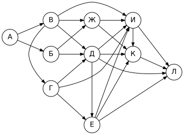
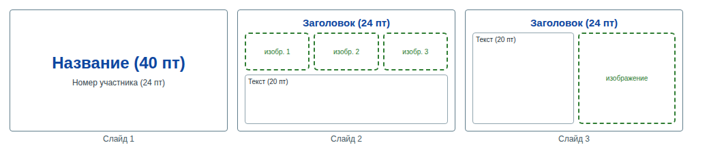
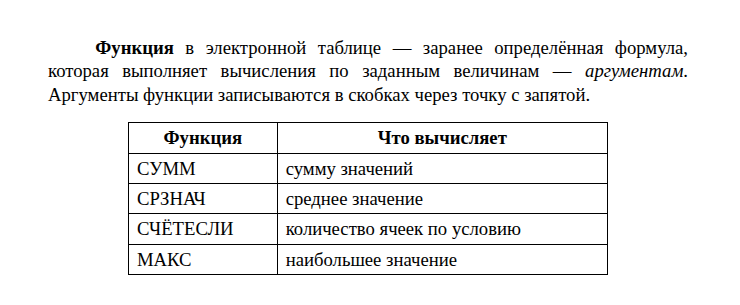
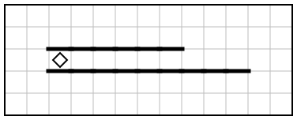
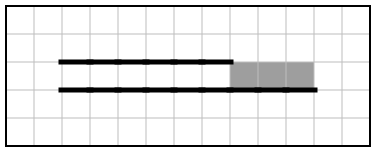

# Вариант 10

| Время | Заданий | Максимум |
|---|---|---|
| 2 ч 30 мин (150 минут) | 16 | 21 балл |

**Как выполнять.** Задания 1–10 решайте без компьютера и записывайте ответы на листок. Задания 11–16 выполняйте на компьютере. Ответы — в самом конце файла, под спойлером. Не подглядывайте до конца работы!

**Материалы:** каталог [`materials/archive`](../materials/archive) (задания 11, 12), файл [`materials/task14/variant-10.xlsx`](../materials/task14/variant-10.xlsx) (задание 14). Для задания 15 нужна среда КуМир, для 16 — Python.

Если времени мало (1 час), сделайте за одно занятие задания 1–12, а 13–16 — за следующее.

## Часть 1

### Задание 1

Рассказ, набранный на компьютере, содержит 64 страницы, на каждой странице 64 строки, в каждой строке 56 символов. Определите информационный объём текста в кодировке, в которой каждый символ кодируется 8 битами. Ответ дайте в килобайтах.

### Задание 2

Маша шифрует русские слова, записывая вместо каждой буквы её код:

| А | Д | К | Н | О | С |
|---|---|---|---|---|---|
| `01` | `100` | `101` | `10` | `111` | `000` |

Некоторые цепочки можно расшифровать не одним способом. Даны три кодовые цепочки:

- `0110111100`
- `10011100010101`
- `101011011110`

Найдите среди них ту, которая имеет только одну расшифровку, и запишите в ответе расшифрованное слово.

### Задание 3

Напишите наименьшее натуральное число X, для которого истинно высказывание:

**(X > 15) И (X < 31)**

### Задание 4

Между населёнными пунктами A, B, C, D, E построены дороги, протяжённость которых (в километрах) приведена в таблице.

|   | A | B | C | D | E |
|---|---|---|---|---|---|
| **A** |  | 1 |  | 1 |  |
| **B** | 1 |  |  | 7 | 2 |
| **C** |  |  |  | 4 | 5 |
| **D** | 1 | 7 | 4 |  |  |
| **E** |  | 2 | 5 |  |  |

Определите длину кратчайшего пути между пунктами A и E. Передвигаться можно только по дорогам, протяжённость которых указана в таблице.

### Задание 5

У исполнителя Альфа две команды, которым присвоены номера:

1. **вычти 3**
2. **умножь на b**

(b — неизвестное натуральное число; b ≥ 2).

Выполняя первую из них, Альфа уменьшает число на экране на 3, а выполняя вторую, умножает это число на b. Программа для исполнителя Альфа — это последовательность номеров команд.

Известно, что программа **21212** переводит число 5 в число 535. Определите значение b.

### Задание 6

Ниже приведена программа, записанная на языке Python.

```python
s = int(input())
t = int(input())
if s + t > 3:
    print("YES")
else:
    print("NO")
```

Было проведено 9 запусков программы, при которых в качестве значений переменных s и t вводились следующие пары чисел:

(4, 14), (7, 2), (-5, 5), (15, -4), (11, 6), (6, 7), (15, 7), (2, 0), (1, 8).

Сколько было запусков, при которых программа напечатала «YES»?

### Задание 7

Доступ к файлу **net.xls**, находящемуся на сервере **sch.info**, осуществляется по протоколу **http**. Фрагменты адреса файла закодированы буквами от А до Ж. Запишите последовательность этих букв, кодирующую адрес указанного файла в сети Интернет.

А) `net.`
Б) `xls`
В) `/`
Г) `http`
Д) `info`
Е) `://`
Ж) `sch.`

### Задание 8

В языке запросов поискового сервера для обозначения логической операции «ИЛИ» используется символ «|», а для обозначения логической операции «И» — символ «&».

В таблице приведены запросы и количество найденных по ним страниц некоторого сегмента сети Интернет.

| Запрос | Найдено страниц (в тысячах) |
|---|---|
| Линкор | 1040 |
| Крейсер | 710 |
| Крейсер & Линкор | 170 |

Какое количество страниц (в тысячах) будет найдено по запросу **Крейсер | Линкор**?

Считается, что все запросы выполнялись практически одновременно, так что набор страниц, содержащих все искомые слова, не изменялся за время выполнения запросов.

### Задание 9

На рисунке — схема дорог, связывающих города А, Б, В, Г, Д, Е, Ж, И, К, Л. По каждой дороге можно двигаться только в одном направлении, указанном стрелкой.



Сколько существует различных путей из города А в город Л?

### Задание 10

Среди приведённых ниже трёх чисел, записанных в различных системах счисления, найдите максимальное и запишите его в ответе в десятичной системе счисления. В ответе запишите только число, основание системы счисления указывать не нужно.

216<sub>8</sub>, 50<sub>16</sub>, 10010100<sub>2</sub>

## Часть 2

Задания этой части выполняются на компьютере.

### Задание 11

В рубрике «Книжная полка» ученица 7 «В» класса по имени Полина рассказывает о любимой книге. Назовите её фамилию.

Ищите в каталоге `materials/archive`.

### Задание 12

Сколько файлов с расширением **.txt** содержится в подкаталогах каталога **archive/2018**? В ответе укажите только число.

### Задание 13

Выберите **одно** из заданий: 13.1 или 13.2.

#### 13.1. Презентация «Совы России»

Используя информацию и иллюстративный материал о теме «**Совы России**», создайте презентацию из **трёх слайдов**. В презентации должны содержаться краткие иллюстрированные сведения по теме. Все слайды должны быть выполнены в едином стиле, каждый слайд должен быть озаглавлен.

**Требования к оформлению презентации**

1. Ровно три слайда **без анимации**. Параметры страницы (слайда): экран **16:9**, ориентация альбомная.
2. **Первый слайд** — титульный: название презентации; в подзаголовке — идентификационный номер участника экзамена (на тренировке — любой номер).
3. **Второй слайд** — основная информация, по макету: заголовок слайда, три изображения, один блок текста.
4. **Третий слайд** — дополнительная информация, по макету: заголовок слайда, одно изображение, один блок текста.
5. В презентации используется **единый тип шрифта**. Размер шрифта: название на титульном слайде — **40 пт**; подзаголовок титульного слайда и заголовки слайдов — **24 пт**; основной текст — **20 пт**.
6. Текст не перекрывает изображения и не сливается с фоном; изображения не искажены (масштабируются пропорционально).

Информация для слайдов: Совы — отряд хищных птиц. Они охотятся в основном ночью на мелких грызунов. В России обитает около двух десятков видов сов, самая крупная из них — филин.

Изображения подберите самостоятельно (на экзамене их дают в каталоге задания). Сохраните презентацию в формате **.odp** (LibreOffice Impress).

**Макет слайдов:**



#### 13.2. Документ «Функции электронных таблиц»

Создайте в текстовом редакторе документ и напишите в нём следующий текст, точно воспроизведя всё оформление текста, имеющееся в образце.

Данный текст должен быть набран шрифтом размером **14 пунктов** обычного начертания. Отступ первой строки первого абзаца основного текста — **1,25 см**. Расстояние между строками текста не менее одинарного, но не более полуторного междустрочного интервала.

Основной текст выровнен **по ширине**; в ключевых словах первого абзаца применено полужирное и курсивное начертание.

Таблица (5 строк, 2 столбца) выровнена **по центру**; ширина таблицы меньше ширины основного текста. Текст в первой строке таблицы — полужирный, выровнен по центру; в остальных ячейках — выравнивание по левому краю.

Интервал между текстом и таблицей не менее 12 пунктов, но не более 24 пунктов.

При этом допустимо, чтобы ширина вашего текста отличалась от ширины текста в примере, поскольку ширина текста зависит от размеров страницы и полей. В этом случае разбиение текста на строки должно соответствовать стандартной ширине абзаца.

**Образец:**



### Задание 14

Откройте файл [`variant-10.xlsx`](../materials/task14/variant-10.xlsx).

В электронную таблицу занесли данные наблюдения за погодой в течение 2024 года. В столбце A записана дата наблюдения, в столбце B — среднесуточная температура воздуха (°C), в столбце C — количество осадков (мм), в столбце D — атмосферное давление (мм рт. ст.), в столбце E — направление ветра, в столбце F — средняя скорость ветра (м/с).

Всего в таблицу были занесены данные по 366 дням.

Первые строки таблицы:

|   | A | B | C | D | E | F |
|---|---|---|---|---|---|---|
| **1** | **дата** | **температура** | **осадки** | **давление** | **ветер** | **скорость ветра** |
| **2** | 01.01.2024 | -17,2 | 0,0 | 752 | СВ | 8,3 |
| **3** | 02.01.2024 | -15,9 | 3,4 | 758 | СЗ | 2,5 |
| **4** | 03.01.2024 | -12,1 | 0,0 | 771 | СВ | 6,5 |
| **5** | 04.01.2024 | -16,1 | 5,7 | 763 | ЮЗ | 9,5 |


Выполните задание:

1. Какова средняя температура воздуха в **октябре** 2024 года? Ответ на этот вопрос запишите в ячейку **H2** таблицы с точностью не менее двух знаков после запятой.
2. Сколько дней дул **северо-западный** ветер (**СЗ**) со скоростью **более 6 м/с**? Ответ на этот вопрос запишите в ячейку **H3** таблицы.
3. Постройте круговую диаграмму, отображающую соотношение количества дней, когда дул ветер направлений «Ю», «С» и «ЮВ». Левый верхний угол диаграммы разместите вблизи ячейки **G6**. В поле диаграммы должны присутствовать легенда и числовые значения данных, по которым построена диаграмма.

Полученную таблицу сохраните в формате `.ods`.

### Задание 15

Исполнитель Робот умеет перемещаться по лабиринту, начерченному на плоскости, разбитой на клетки. Система команд и проверок — [в теории](../theory/08-kumir.md).

На бесконечном поле имеются две горизонтальные стены, расположенные одна над другой на расстоянии одной клетки. Левые концы стен находятся в одном столбце. Нижняя стена **длиннее** верхней. Длины стен неизвестны. Робот находится в клетке между стенами у их левого конца.

Требуется закрасить все клетки, расположенные непосредственно над нижней стеной, у которых **нет** стены сверху.

При исполнении алгоритма Робот не должен разрушиться, выполнение алгоритма должно завершиться. Конечное расположение Робота может быть произвольным. Алгоритм должен решать задачу для любого допустимого расположения стен и любого расположения и размера проходов внутри стен.

| Пример поля | Нужно закрасить |
|---|---|
|  |  |

Алгоритм может быть выполнен в среде КуМир или записан в текстовом редакторе.

### Задание 16

Напишите программу, которая в последовательности натуральных чисел определяет минимальное число, кратное 4, и количество чисел, кратных 4. Программа должна вывести два числа: сначала минимальное число, кратное 4, затем количество таких чисел (каждое — в отдельной строке).

Программа получает на вход натуральные числа, количество введённых чисел неизвестно, последовательность чисел заканчивается числом 0 (0 — признак окончания ввода, не входит в последовательность). Количество чисел не превышает 1000. Введённые числа не превышают 30 000. В последовательности всегда имеется хотя бы одно число, кратное 4.

**Пример работы программы:**

| Входные данные | Выходные данные |
|---|---|
| 18424<br>14889<br>16102<br>0 | 18424<br>1 |

---

## Ответы

<details><summary>Показать ответы и решения</summary>

**Задания 1–12** (по 1 баллу):

| № | Ответ |
|---|---|
| 1 | 224 |
| 2 | АНОД |
| 3 | 16 |
| 4 | 3 |
| 5 | 5 |
| 6 | 7 |
| 7 | ГЕЖДВАБ |
| 8 | 1580 |
| 9 | 38 |
| 10 | 148 |
| 11 | Коновалова |
| 12 | 1 |

**Задание 13** (2 балла): Проверка по чек-листам: [13.1](../tasks/13-presentation-text.md#чек-лист-самопроверки-131), [13.2](../tasks/13-presentation-text.md#чек-лист-самопроверки-132).

**Задание 14** (3 балла):

1. **2,80**
2. **23**
3. **Ю — 44; С — 39; ЮВ — 60** (значения для диаграммы)

**Задание 15** (2 балла), один из возможных алгоритмов:

```
использовать Робот
алг
нач
  нц пока снизу стена
    если сверху свободно то
      закрасить
    все
    вправо
  кц
кон
```

**Задание 16** (2 балла), один из возможных вариантов программы:

```python
mn = 30001
count = 0
x = int(input())
while x != 0:
    if x % 4 == 0:
        count += 1
        if x < mn:
            mn = x
    x = int(input())
print(mn)
print(count)
```

Тесты для проверки:

| № | Вход | Выход |
|---|---|---|
| 1 | 18424<br>14889<br>16102<br>0 | 18424<br>1 |
| 2 | 12056<br>14194<br>22996<br>16461<br>17331<br>12101<br>0 | 12056<br>2 |
| 3 | 14901<br>29457<br>24749<br>11248<br>26242<br>23076<br>0 | 11248<br>2 |
| 4 | 24005<br>24981<br>5942<br>6858<br>20400<br>9589<br>13338<br>20501<br>27813<br>15887<br>25986<br>3333<br>0 | 20400<br>1 |

**Перевод в оценку:** 0–4 → «2», 5–10 → «3», 11–16 → «4», 17–21 → «5».

</details>


[← Все варианты](README.md) · [К оглавлению](../README.md)
